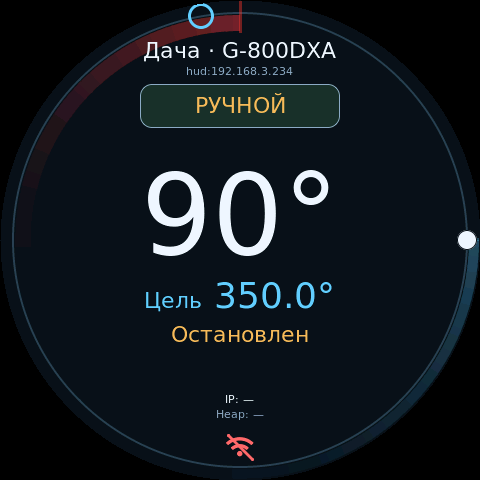

# G5500 Controller

Прошивка контроллера антенных поворотных устройств Yaesu G-5500, G-800DXA и независимых DC-приводов. Поддерживает ESP32 WROOM/WROVER, ESP32-S3, ESP32-S2, WT32-ETH01 с Ethernet, [Waveshare ESP32-S3-ETH с камерой](docs/boards/waveshare-esp32-s3-eth.md) и CrowPanel 2.1.

## Возможности

- AZ и EL с независимой калибровкой, стандартными или произвольными диапазонами, возможностью смещения нулевой точки.
- Штатные блоки Yaesu, отдельные PWM-приводы и BTS7960.
- GS-232, rotctld, N1MM и PstRotator UDP(в том числе UR5EQF, 5MContest, SkyRoof, TR4W, DXLog.net, Log4OM 2 и Gpredict.); HTTP, WebSocket и командный API.
- Веб-управление, предустановки, кнопки направлений и аналоговый джойстик.
- Дисплеи ILI9341/XPT2046, LCD1602 и CrowPanel 2.1.
- Возможность подключения удаленного (HUD) пульта по сети или UART для контроля удаленного поворотного устройства.
- Практически полное переконфигурирование подключенного оборудовния без перепрошивки(тип поворотки, GPIO, дисплей, BLuetooth).
- OTA обновление по Wi-Fi.
- Режим имитации движения для отладки
- Простой регулятор или каскадный ПИД, автотюн регуляторов движения, режим активного удержания позиции.
- Ручной и Авторежим. В ручном режиме команда из внешней программы по умолчанию ждёт подтверждения пользователя; возможно включить автоследование отдельно для каждого протокола.

## Интерфейс


| CrowPanel: AZ / EL | HUD: выбранная поворотка |
|---|---|
|  |  |

## Начало работы

Начните с [первого запуска](docs/quickstart.md): выбор платы и подключения → сборка и USB-прошивка → настройка оборудования → калибровка → управление.

Arduino IDE: откройте `G5500_Fork/G5500_Fork.ino` вместе с его папкой. Плату и Partition Scheme выбирайте по [инструкции для Arduino IDE 2.x](docs/build.md#arduino-ide-2x).

Для ESP32-S3 DevKitC-1 N16R8 без дисплея:

```sh
pio run -e esp32s3_n16r8
```

Это только сборка. [Запись через USB](docs/build.md#первая-прошивка-через-usb), [выбор других плат](docs/setup/configuration.md#выбор-конфигурации), [вся документация](docs/index.md).

## Лицензия

[GNU GPL v3](LICENSE). Автор [исходного проекта](https://github.com/ua1cfm/G5500-ESP32S3-Controller) — UA1CFM; автор изменений форка — RA3VLD. [Лицензии сторонних компонентов](docs/index.md#лицензии-и-авторство).

## Документация

- [Первый запуск](docs/quickstart.md), [сборка и USB-прошивка](docs/build.md).
- [Выбор платы и настройка оборудования](docs/setup/configuration.md), [схемы подключения](docs/hardware/index.md).
- [Диапазоны и калибровка](docs/setup/az-range.md), [регуляторы движения и автотюн](docs/setup/regulator-tuning.md).
- [Веб-управление](docs/control/index.md), [кнопки и джойстик](docs/control/local-controls.md).
- [CrowPanel 2.1](docs/boards/crowpanel-21.md), [удалённый пульт HUD](docs/control/hud.md).
- [Внешние программы](docs/integrations/index.md), [Wi-Fi и сетевые порты](docs/setup/network.md).
- [Обновление прошивки](docs/maintenance/ota.md), [диагностика и восстановление](docs/maintenance/diagnostics.md).
- [HTTP API](docs/api/index.md), [WebSocket](docs/api/live.md), [командный API](docs/api/command-api.md).
- [Полное оглавление документации](docs/index.md).
