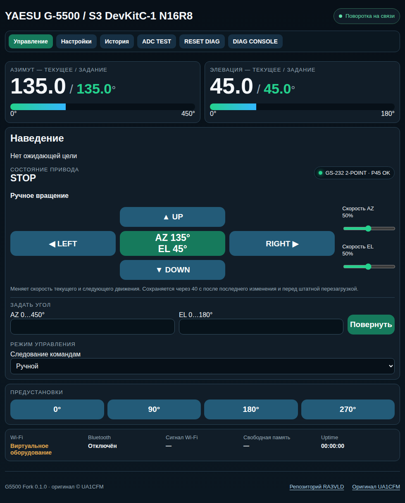
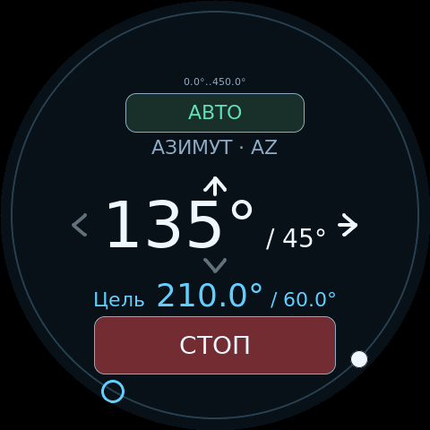
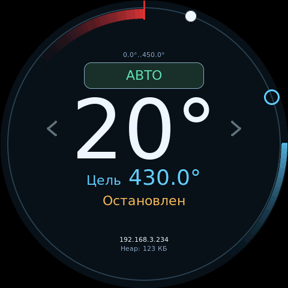
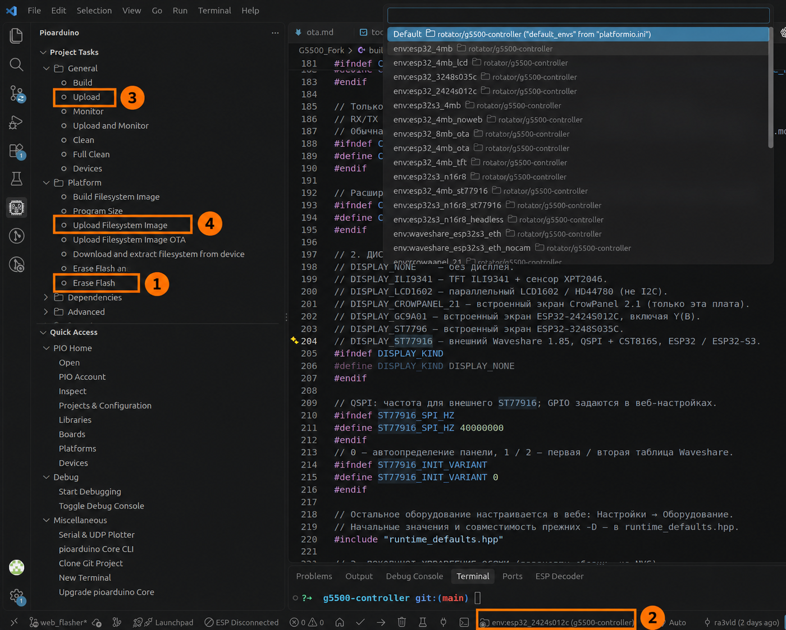

# G5500 Controller

Модульная прошивка для управления антенными поворотными устройствами Yaesu G-5500, G-800DXA, G-800SA и независимыми DC-приводами. Работает на ESP32, ESP32-S2, ESP32-S3 и ESP32-C3. Для полного набора функций рекомендуется **ESP32-S3 с PSRAM**; [платы и конфигурации](docs/setup/configuration.md#выбор-конфигурации).

Для простой установки достаточно одной платы возле блока поворотки и браузера на компьютере или телефоне. При необходимости можно добавить дисплей, кнопки, джойстик или энкодер либо вынести органы управления на отдельный пульт **HUD**. Один HUD переключается между несколькими контроллерами; к одному контроллеру могут подключаться несколько пультов. Программы на компьютере подключаются к контроллеру или к HUD, который передаёт команды выбранной поворотке.

[Открыть веб-конфигуратор и прошивальщик](https://ra3vld.github.io/G5500-ESP32S3-Controller/) — выберите плату и готовую конфигурацию, затем установите прошивку через USB из браузера. [Инструкция](docs/web-flasher.md).

## Возможности

Доступность функций зависит от [выбранной сборки](docs/setup/configuration.md#выбор-конфигурации), подключённого оборудования и свободных GPIO.

### Поворотки и наведение

- Штатные блоки **Yaesu G-5500** с AZ/EL, **G-800DXA** и **G-800SA** с AZ; [подключение и схемы](docs/hardware/index.md).
- Независимые приводы с интерфейсами **DIR + PWM**, **LEFT / RIGHT + PWM**, **RPWM + LPWM** (например, BTS7960 / IBT-2). Для каждой оси можно назначить необязательный ENABLE.
- Для регулируемых приводов — плавный разгон и торможение, простой регулятор или каскадный ПИД; для нерегулируемых — учёт выбега при остановке.
- Активное удержание заданного угла в серворежиме каскадного ПИД.
- [Автотюн](docs/setup/regulator-tuning.md#6-автотюн) для измерения характеристик и подбора регулятора, в том числе выбега релейного привода. Подбор экспериментальный: результат нужно проверить на своей механике, при необходимости параметры настраиваются вручную.
- Ограничения хода, контроль обратной связи, защита от отсутствия движения и пауза перед реверсом.

### Управление и программы

- [Прямое подключение N1MM+, UR5EQF, 5MContest, DXLog, Gpredict, SkyRoof](docs/integrations/index.md) и других совместимых программ. Поддерживаются **N1MM UDP, PstRotator UDP, GS-232 и rotctld / Hamlib**; отдельная программа PstRotator или процесс rotctld для этих подключений не нужны.
- [Look4Sat по Bluetooth](docs/boards/classic-esp32.md#bluetooth-и-usb) через встроенный SPP или внешний HC-05.
- [Веб-интерфейс](docs/control/index.md) для компьютера и телефона: положение и цели AZ/EL, ручное движение, скорость, режимы, настройки и диагностика. На компьютере можно управлять стрелками клавиатуры.
- **Ручной**, **Авто** и **Авто 1 ч**. В ручном режиме внешние числовые цели по умолчанию ждут подтверждения; автоследование включается отдельно для каждого протокола. В автоматическом режиме цели выполняются сразу, а «Авто 1 ч» через час возвращает ручной режим.
- Четыре редактируемые предустановки положений; [физические кнопки и аналоговый джойстик](docs/control/local-controls.md), сенсорный экран и энкодер задания угла с настраиваемым шагом.
- [HTTP API](docs/api/index.md), [WebSocket](docs/api/live.md) и [командный API по UART/USB, UDP и TCP](docs/api/command-api.md) для собственных программ и настройки без браузера.

### Датчики положения и калибровка

- [Произвольные диапазоны AZ и EL](docs/setup/az-range.md), включая ненулевое начало, отрицательные углы и перекрытие оборота; выбор кратчайшего пути или точного механического угла для команд программ.
- Независимая двухточечная или многоточечная калибровка каждой оси.
- Потенциометр через ADC либо [магнитные энкодеры MT6701 и AS5600](docs/setup/position-sensors.md) по I²C; датчики можно сочетать независимо по осям. Для магнитного датчика рабочий ход должен укладываться в непрерывный участок одного оборота, при необходимости через редуктор.

### Выносной пульт и связь

- [Роль HUD](docs/control/hud.md): силовой контроллер возле двигателя, пульт с дисплеем и органами управления — у оператора. Каталог нескольких повороток, переключение выбранной без перенастройки логгера и работа нескольких HUD с одним контроллером.
- Связь HUD с контроллером по **Wi-Fi / Ethernet (UDP)**, **UART**, **RS-485** или **MQTT**. Для локальной сети рекомендуется UDP; MQTT подходит, когда прямое UDP-соединение недоступно.
- Прозрачный UART-радиомост, например **LoRa Ebyte E220**, с настройкой скорости, частоты опроса и входа AUX / BUSY.
- [RS-485](docs/integrations/rs485.md) с последовательным обменом и [Modbus RTU с маркером](docs/integrations/modbus-rtu.md): несколько контроллеров, HUD и компьютер на общей линии. Компьютер подключается через программный шлюз или отдельный порт HUD.
- Ethernet через **LAN8720** на WT32-ETH01 и **W5500** на Waveshare ESP32-S3-ETH; Wi-Fi и резервная точка доступа сохраняются.
- Встроенный **Bluetooth Classic SPP** на классическом ESP32; на других чипах — внешний **HC-05**. Для совместной работы Wi-Fi, веба и SPP предусмотрены [компактные профили](docs/boards/esp32-spp.md) без PID, автотюна, MQTT и OTA.
- [MQTT с необязательным TLS и Home Assistant MQTT Discovery](docs/integrations/mqtt.md): положение, цели, режимы, скорость, STOP, предустановки и диагностика. HUD публикует сохранённые поворотки и отдельное устройство для текущего выбора.

### Платы, дисплеи и камера

- Платы на **ESP32, ESP32-S2, ESP32-S3 и ESP32-C3**, включая CrowPanel 2.1, ESP32-2424S012C, ESP32-3248S035C, WT32-ETH01 и Waveshare ESP32-S3-ETH.
- Графические дисплеи **ST7701, ST7796, ST77916, GC9A01, ILI9341**, тач-контроллеры **CST816, GT911, XPT2046** и символьный **LCD1602**. [Графический интерфейс](docs/control/display.md) на LVGL адаптируется к поддерживаемым размерам экранов; тип дисплея выбирается при сборке.
- На экране доступны управление, скорость, выбор поворотки, состояние связи, яркость и часть настроек; [меню дисплея](docs/control/display.md#меню-на-дисплее).
- На [Waveshare ESP32-S3-ETH с камерой](docs/boards/waveshare-esp32-s3-eth.md) — изображение в веб-интерфейсе через Ethernet или Wi-Fi для наблюдения за антенной.

### Настройка и обслуживание

- [Настройка без перепрошивки](docs/setup/configuration.md#оборудование-в-веб-интерфейсе): модель и интерфейс привода, датчики положения, местные органы управления, Bluetooth и доступные GPIO. Проверяются возможности выводов и конфликты назначений. Плата, дисплей, встроенные Ethernet/камера, память и разделы выбираются при сборке.
- [Пошаговый мастер первого запуска](docs/setup/first-start.md) для контроллера и HUD; пробное применение оборудования и сетевых адресов с подтверждением и возвратом прежних настроек.
- [Обновление через браузер и ArduinoOTA](docs/maintenance/ota.md) по Wi-Fi или Ethernet при наличии поддержки в сборке и подходящих разделов Flash. Для ряда плат с 4 МиБ доступны компактные OTA-сборки; остальные обновляются через USB.
- Имитация движения без реальной поворотки для проверки интерфейса и взаимодействия с программами; на HUD — отдельная виртуальная поворотка.
- [Восстановление](docs/maintenance/diagnostics.md#вход-в-восстановление-кнопкой-reset) при неудачном запуске оборудования или по трём нажатиям Reset: исправление сети и оборудования, возврат подтверждённой конфигурации. Вход в восстановление не стирает настройки и калибровки.

У ESP32, ESP32-C3 и ESP32-S2 есть [ограничения памяти и производительности](docs/setup/configuration.md#ограничения-esp32-c3-и-esp32-s2). Для дисплея и нескольких сетевых сервисов предпочтительна ESP32-S3 с PSRAM. На классическом ESP32 особенно требователен встроенный SPP; выбирайте подходящую сборку или внешний HC-05.

## Интерфейс



| CrowPanel: AZ / EL | HUD: выбранная поворотка |
|---|---|
|  |  |

## Начало работы

Начните с [первого запуска](docs/quickstart.md): выбор платы и подключения → сборка и USB-прошивка → настройка оборудования → калибровка → управление.

Рекомендуемый способ сборки — **pioarduino / PlatformIO**: он использует закреплённые в проекте версии платформы и библиотек. Совместимость с Arduino IDE сохраняется: откройте `G5500_Fork/G5500_Fork.ino` вместе с его папкой, выберите плату и Partition Scheme по [инструкции для Arduino IDE 2.x](docs/build.md#arduino-ide-2x).

Для ESP32-S3 DevKitC-1 N16R8 без дисплея:

```sh
pio run -e esp32s3_n16r8
```

Это только сборка. [Запись через USB](docs/build.md#первая-прошивка-через-usb), [выбор других плат](docs/setup/configuration.md#выбор-конфигурации), [вся документация](docs/index.md).

### Прошивка через GUI pioarduino

Установите [pioarduino IDE в VS Code](docs/quickstart.md#установка-pioarduino--platformio), откройте корень проекта с `platformio.ini` и панель **Pioarduino → Project Tasks**. Отключите силовое питание привода, подключите плату USB-кабелем с передачей данных, выберите её последовательный порт в нижней панели и закройте Serial Monitor.

Цифры на скриншоте соответствуют шагам ниже. Если текущий профиль рассчитан на другой чип, выберите профиль своей платы по шагу 2 ещё до очистки Flash.

1. **Очистить Flash:** откройте **Platform → Erase Flash** и дождитесь `SUCCESS` в терминале. Очистка удаляет прошивку, настройки и калибровки; выполняйте её для установки с полным сбросом. При обычном обновлении этот шаг можно пропустить.
2. **Выбрать профиль платы:** нажмите **env:…** в нижней строке VS Code и выберите [окружение своей платы](docs/setup/configuration.md#выбор-конфигурации). На скриншоте показан `env:esp32_2424s012c` для ESP32-2424S012C-Y(B). **Default** использует `default_envs` из `platformio.ini` и может не соответствовать подключённой плате.
3. **Залить прошивку:** в задачах выбранного профиля нажмите **General → Upload**. Дождитесь окончания сборки и записи с результатом `SUCCESS`.
4. **Залить файловую систему, если она используется:** для того же профиля выберите **Platform → Upload Filesystem Image** и дождитесь `SUCCESS`. **В текущем проекте этот шаг пропустите:** отдельной папки `data/` нет, веб-интерфейс уже входит в прошивку. Этот пункт GUI нужен для сборок с отдельными файлами в `data/`; порядок их загрузки описан в [справке PlatformIO](https://docs.platformio.org/en/latest/platforms/espressif32.html#uploading-files-to-file-system).



После записи при необходимости нажмите **RESET/EN** и выполните [первое подключение и настройку](docs/quickstart.md#первое-подключение). Если загрузчик не отвечает, используйте [порядок входа в BOOT и выбора USB-порта](docs/build.md#первая-прошивка-через-usb).

## Лицензия

[GNU GPL v3](LICENSE). Автор [исходного проекта](https://github.com/ua1cfm/G5500-ESP32S3-Controller) — UA1CFM; автор изменений форка — RA3VLD. [Лицензии сторонних компонентов](docs/index.md#лицензии-и-авторство).

## Документация

- [Выбор готовой прошивки и установка из браузера](docs/web-flasher.md).
- [Первый запуск](docs/quickstart.md), [сборка и USB-прошивка](docs/build.md).
- [Выбор платы и настройка оборудования](docs/setup/configuration.md), [схемы подключения](docs/hardware/index.md).
- [Диапазоны и калибровка](docs/setup/az-range.md), [регуляторы движения и автотюн](docs/setup/regulator-tuning.md).
- [Веб-управление](docs/control/index.md), [кнопки и джойстик](docs/control/local-controls.md).
- [CrowPanel 2.1](docs/boards/crowpanel-21.md), [удалённый пульт HUD](docs/control/hud.md).
- [Внешние программы](docs/integrations/index.md), [Wi-Fi и сетевые порты](docs/setup/network.md).
- [Обновление прошивки](docs/maintenance/ota.md), [диагностика и восстановление](docs/maintenance/diagnostics.md).
- [HTTP API](docs/api/index.md), [WebSocket](docs/api/live.md), [командный API](docs/api/command-api.md).
- [Полное оглавление документации](docs/index.md).
