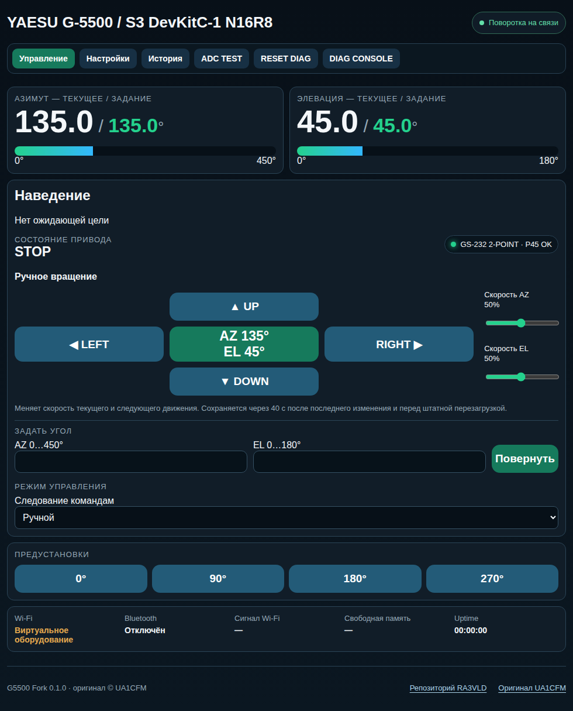
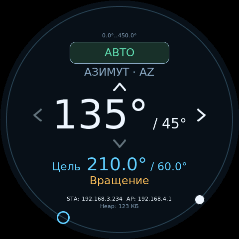

# G5500 Controller

Прошивка контроллера антенных поворотных устройств Yaesu G-5500, G-800DXA и независимых DC-приводов. Поддерживает ESP32 WROOM/WROVER, ESP32-S3, ESP32-S2 и CrowPanel 2.1.

## Возможности

- Азимут P36/P45 или [произвольный диапазон](docs/az-range.md) с ходом -3600…3600° и смещением начала в обе стороны; элевация 0…180° или собственный произвольный диапазон.
- Управление штатным блоком Yaesu либо независимыми двигателями через PWM.
- Простой регулятор с S-рампой и пусковым импульсом либо каскадный ПИД положения и скорости с активным удержанием. [Автотюн](docs/usage.md#автотюн-простого-режима-и-каскада) подбирает параметры выбранного регулятора по пробным движениям и проверочному наведению; результат применяется вручную. Настройки AZ/EL независимы; для G-800DXA нужно согласоваие в 0–5 В.
- Ручной режим с подтверждением внешних целей (с независимой настройкой подтверждения каждого протокола), автоматический режим и «Авто 1 ч».
- Четыре редактируемые предустановки для каждого профиля поворотки.
- [OTA из браузера и Arduino IDE](docs/ota.md) с автоматической проверкой flash и разделов.
- Веб-интерфейс, калибровка, диагностика и экран: ILI9341/XPT2046, параллельный LCD1602 или круглый сенсорный дисплей [CrowPanel 2.1](docs/crowpanel-21.md).
- [Командный API UART/USB, UDP и TCP](docs/command-api.md): управление и настройка с компьютера во всех сборках, включая вариант ESP32 без веба и PSRAM.
- GS-232 через UART0 и Bluetooth; rotctld и GS-232 через TCP 4533, в том числе для [SkyRoof и Gpredict](docs/usage.md#skyroof-и-gpredict).
- Прямой UDP для N1MM Logger+, UR5EQF и 5MContest; PstRotator UDP с передачей числового азимута для TR4W, DXLog.net и Log4OM 2 — [настройка и ограничения](docs/usage.md#pstrotator-udp--ur5eqf-и-5mcontest).
- [HUD](docs/hud.md): удалённые пульты и несколько повороток по Wi-Fi или UART.
- Режим имитации движения для проверки интерфейса и протоколов без подключения двигателей.

В ручном режиме числовая цель от логгера по умолчанию ожидает подтверждения. В настройках можно независимо включить автоследование для N1MM UDP, PstRotator UDP, GS-232 и rotctld. Команды направления и STOP выполняются сразу, кроме ограничений активной предустановки, описанных в [инструкции управления](docs/usage.md#предустановки-и-профили). Для наведения реальной поворотки нужна калибровка соответствующей оси.

## Интерфейс

Веб-интерфейс: положение AZ/EL, наведение, ручное вращение и предустановки.



CrowPanel 2.1: двухосевая поворотка и удалённый пульт HUD.

| AZ / EL в режиме имитации | HUD с выбранной повороткой |
|---|---|
|  |  |

## Начало работы

1. Выберите плату и схему подключения в [аппаратной инструкции](docs/hardware.md).
2. Настройте [build_config.hpp](G5500_Fork/build_config.hpp) по [таблице параметров](docs/configuration.md). По умолчанию дисплей и Bluetooth выключены, интерфейс привода — YAESU. Для CrowPanel окружение сборки выбирает встроенный экран; `crowpanel_21` задаёт имитацию, `crowpanel_21_az` — физический привод переделанной платы. Сохранённые настройки оборудования имеют приоритет над начальными значениями. Распиновка внешних сигналов меняется через [веб-интерфейс или API](docs/configuration.md#распиновка-gpio) без пересборки; имитация доступна на всех платах.
3. Соберите прошивку для своей платы по [инструкции сборки](docs/build.md). При первой загрузке выполните [настройку оборудования и подтверждение доступа](docs/configuration.md#применение-и-восстановление-доступа).
4. После первого запуска подключитесь к сети `G5500-Rotator-XXXXXX` и откройте `http://192.168.4.1`. В настройках задайте Wi-Fi, пароль точки доступа и модель поворотки. Для удалённого пульта выберите роль HUD.
5. Для реального привода проверьте подключение и направления, выполните калибровку, затем настройте логгер. Для HUD калибруется основной контроллер подключенный к двигателю.

Arduino IDE: откройте **[G5500_Fork/G5500_Fork.ino](G5500_Fork/G5500_Fork.ino)** вместе с его папкой. Плату и Partition Scheme выбирайте по [инструкции](docs/build.md#arduino-ide-2x).

PlatformIO, примеры сборки без дисплея:

```sh
pio run -e esp32s3_n16r8
pio run -e esp32_4mb
pio run -e esp32s2_mini
```

Для выбора дисплея, Bluetooth и силового интерфейса используйте общий скрипт:

```sh
python3 tools/build_platformio.py --env esp32s2_mini --display lcd --bluetooth 0 --drive bts7960
```

## Документация

- [Сборка Arduino IDE/CLI и PlatformIO](docs/build.md)
- [Обновление прошивки по Wi-Fi (OTA)](docs/ota.md)
- [Конфигурация, профили плат и распиновки](docs/configuration.md)
- [Классический ESP32: подключение, Bluetooth и диагностика](docs/classic-esp32.md)
- [Режимы, логгеры, протоколы и API](docs/usage.md)
- [Силовые интерфейсы и схемы](docs/hardware.md)
- [Yaesu G-800DXA: общая земля, ADuM1201 и оптоканал с изолированным питанием](docs/hardware/g800dxa-guide.md)
- [Два BTS7960 / IBT-2: прямое подключение, 74HCT245 и оптопары PC817C](docs/hardware/independent-pwm-bts7960.md)
- [Удалённый пульт HUD](docs/hud.md)
- [CrowPanel 2.1: экран и управление](docs/crowpanel-21.md)
- [CrowPanel 2.1: локальный AZ, Yaesu и BTS7960](docs/crowpanel-az.md)
- [Обновление веб-интерфейса и WebSocket API](docs/live.md)
- [Совместимость и особенности управления](docs/upstream.md)

## Лицензия

[GNU GPL v3](LICENSE). Автор [исходного проекта](https://github.com/ua1cfm/G5500-ESP32S3-Controller) — UA1CFM; автор изменений форка — RA3VLD. Использованные драйвер CrowPanel и шрифты имеют отдельные [лицензионные сведения](docs/licenses/crowpanel-rgb-driver.md).
