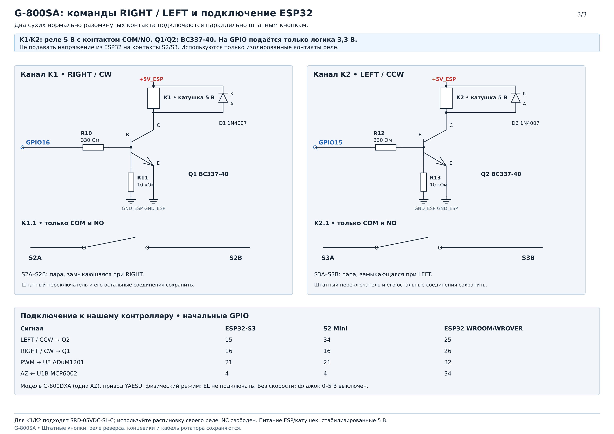

# Классический ESP32 WROOM/WROVER

[Документация](../index.md)

Профиль `BOARD_ESP32` рассчитан на обычные ESP32 DevKit, DevKitC и NodeMCU с Flash от 4 MB(но лучше 8 и больше) и доступными GPIO из таблицы. Общая распиновка подходит модулям WROOM и WROVER: GPIO6…11 и GPIO16/17 не используются, PSRAM не требуется(но крайне рекомендуется). Платы со встроенными экранами, SD-картой или другой периферией нужно сверять отдельно. [Ограничения DevKitC и WROVER у Espressif](https://docs.espressif.com/projects/esp-dev-kits/en/latest/esp32/esp32-devkitc/user_guide.html).

## Подключение

Схемы подключения повороток: [G-5500](../hardware/g5500/g5500-esp32s3-tft-schematic.png), [G-800DXA](../hardware/g800dxa/g800dxa-connection.png), [датчик G-800SA](../hardware/g800sa/g800sa-tap-points-wiring.png), [BTS7960 / IBT-2](../hardware/bts7960/independent-pwm-bts7960.png). [Все схемы](../hardware/schematics.md).

Номера GPIO на схемах ESP32-S3 переносите по назначению сигналов, используя распиновку своей платы и раздел **Оборудование**.

Пример релейного управления G-800SA. Для этой платы используйте столбец **ESP32 WROOM/WROVER** в таблице на рисунке; GPIO34 — вход положения, GPIO25/26 — направления.

[](../hardware/g800sa/g800sa-directions.png)

Таблица показывает начальную распиновку. Изменить её можно в любой момент без перепрошивки через [веб-интерфейс или API](../setup/configuration.md#распиновка-gpio). После переноса UART0 используйте новые GPIO для рабочих команд; встроенный USB–UART-мост остаётся соединён с GPIO3/1.

| Назначение | GPIO |
|---|---|
| ADC обратной связи AZ / EL | 34 / 35 |
| AZ отрицательное / положительное, LEFT / RIGHT | 25 / 26 |
| EL отрицательное / положительное, DOWN / UP | 14 / 27 |
| AZ / EL скорость либо ENABLE | 32 / 33 |
| USB-UART0 RX / TX | 3 / 1 |
| Внешний HC-05: RX ESP32 / TX ESP32 / STATE | 39 / 5 / 15 |
| Подтверждение ожидающей цели | 0, кнопка BOOT |
| TFT MOSI / SCK / MISO | 23 / 18 / 19 |
| TFT CS / DC / RST | 21 / 22 / 4 |
| XPT2046 CS / IRQ | 13 / 36 |
| LCD1602 RS / E | 21 / 22 |
| LCD1602 D4 / D5 / D6 / D7 | 23 / 18 / 19 / 4 |

TFT и параллельный LCD1602 — альтернативные сборки; LCD RW соединяется с GND. Для LCD с логикой 5 В сохраняется требование согласования уровней. Светодиодная индикация по умолчанию отключена, поскольку её GPIO различаются между платами. GPIO34…39 — только входы, без внутренних подтяжек. Обратная связь использует ADC1 и работает одновременно с Wi-Fi; на входы нужны делитель и защита согласно [аппаратной документации](../hardware/index.md).

YAESU, SEPARATE_PWM и BTS7960 сохраняют свои назначения сигналов и правила подключения. Схемы S3 показывают другую нумерацию GPIO: переносите соединения по названиям сигналов, используя эту таблицу. В YAESU GPIO33 не используется; в G-800DXA выходы EL остаются выключенными.

## Bluetooth и USB

Встроенный SPP требует значительного объёма внутренней RAM. На ESP32 без PSRAM совместный запуск SPP, Wi-Fi, веба и MQTT может превысить доступную память. Если новая конфигурация не запускается, прошивка автоматически возвращает подтверждённые настройки; причина последнего сбоя показана в разделе «Оборудование». В таком случае используйте внешний HC-05 или уменьшите набор сервисов в выбранной конфигурации.

Обычная сборка исключает встроенный SPP; доступен внешний HC-05. Для встроенного SPP выберите отдельный [SPP-профиль](esp32-spp.md) либо включите `BLUETOOTH_SPP_SUPPORT=1` при сборке. В сборке с поддержкой SPP при включённом Bluetooth и транспорте «Автоматически» или «Встроенный SPP» ESP32 запускает Bluetooth Classic SPP с именем **G5500-Rotator**. Поддерживается один подключённый SPP-клиент. BLE в прошивке не используется. На ПК или Android выполните обычное сопряжение; ввод PIN или подтверждение на контроллере не нужны. Скорость виртуального COM-порта не задаёт скорость радиолинка. Встроенный Classic SPP доступен только на классическом ESP32; для S2/S3 необходим внешний HC-05.

Для внешнего модуля включите Bluetooth и выберите «Внешний HC-05» в веб-настройках оборудования. В этом режиме встроенный SPP не запускается. HC-05 использует отдельный UART1, 9600 бод, 8N1: **TXD модуля → GPIO39**, **RXD модуля ← GPIO5**, **STATE → GPIO15**, общий GND. Логические сигналы должны иметь уровень 3,3 В; питание VCC выбирайте по конкретной плате модуля. GPIO не пересекаются с приводом, UART0, TFT/touch или LCD1602 и не занимают GPIO16/17 WROVER.

GPIO5 и GPIO15 — strapping-выводы. LOW на STATE/GPIO15 при сбросе подавляет ROM-загрузочный текст UART0; GPIO5/15 также задают тайминги неиспользуемого SDIO slave. Назначения приведены в [даташите Espressif, Boot Configurations](https://documentation.espressif.com/esp32_datasheet_en.html). Состояние соединения HC-05 читается с STATE; MAC модуля через обычный UART неизвестен и в вебе не показывается.

```sh
python3 tools/build_platformio.py --env esp32_4mb --bluetooth 1 --bluetooth-mode hc05
```

USB-UART0 и Bluetooth принимают GS-232: положение, STOP, направления, цели и калибровку. Числовые внешние цели в ручном режиме по умолчанию ожидают подтверждения; настройка автоследования GS-232 позволяет выполнять их сразу по USB-UART0 и Bluetooth. Завершайте команды CR, LF или CRLF; длина строки — до 512 байт. При разрыве SPP незавершённый ввод и ожидающие отправки ответы отменяются. Порядок работы описан в [инструкции управления](../control/index.md).

USB-мост платы использует GPIO3/1: GS-232 на 9600 бод и загрузка прошивки. ROM при сбросе может выдавать загрузочный текст на 115200 бод. Журнал приложения доступен через веб по `/diaglog` при сборке с `LOG_HISTORY_SUPPORT=1`; стандартный ESP32 его не хранит.

Для встроенного SPP веб показывает **Bluetooth MAC** — его можно скопировать в настройки Look4Sat. «Bluetooth-соединение» означает активную связь с телефоном, «Канал SPP» — открытый последовательный канал приложения. Сохранённое сопряжение Android само по себе не означает активного соединения. Для HC-05 состояние берётся с STATE; MAC внешнего модуля через этот UART недоступен.

## Wi-Fi

Стандартный профиль Wi-Fi — `compact` (`WIFI_COMPACT_BUFFERS=1`). При явном `WIFI_COMPACT_BUFFERS=0` без встроенного SPP используется `controller`; со встроенным SPP и в восстановлении используется `compact`. Активный профиль виден в диагностике `H4`.

При выборе резервной точки доступа контроллер подключается к роутеру. Если настройки отсутствуют или связь потеряна, запускается резервная сеть `G5500-Rotator-XXXXXX`; в роли HUD — `G5500-HUD-XXXXXX`. После восстановления связи с роутером резервная AP отключается. При сохранении Wi-Fi через веб она остаётся доступной до следующей перезагрузки, чтобы можно было увидеть полученный IP клиента. Для постоянной AP вместе с STA выберите соответствующий режим в настройках оборудования. Этот режим расходует больше внутренней памяти, особенно при встроенном SPP.

В режиме общей точки доступа для HUD устройство сохраняет AP независимо от этого флага. Настройка сети и интервалы повторного подключения описаны в [разделе Wi-Fi](../setup/network.md#подключение-wi-fi).

## Диагностика

Если веб недоступен, откройте монитор USB-UART на **9600 бод** и отправьте `H4` с окончанием CR или LF. Ответ передаётся построчно; дождитесь завершения перед следующей командой. Журнал последних сообщений доступен по `/diaglog` при включённом `LOG_HISTORY_SUPPORT`; в стандартной сборке используйте текущую диагностику USB.

| Поле H4 | Как использовать |
|---|---|
| `elf` | Идентификатор загруженной сборки; приложите его к сообщению о неисправности |
| `HEAP free/min/max` | Свободная внутренняя память, минимум с момента запуска и наибольший свободный блок |
| `PSRAM available/total/free/min/max` | Доступность и объём внешней памяти; `available=no` также возможно при отключённой PSRAM или ошибке её запуска |
| `WIFI status=3`, `savedSSID=yes` | Подключение к роутеру и наличие сохранённых настроек сети соответственно |
| `runtimeMode`, `apPolicy` | Фактический режим Wi-Fi и политика точки доступа |
| `HTTP txFailures`, `cause/errno/bytes` | Ошибки передачи веб-ответов; поля причины могут хранить предыдущую ошибку, поэтому смотрите изменение счётчика |
| `TCP timewait` | Закрытые TCP-соединения, временно сохраняемые сетевым стеком |
| `RUNTIME allocFailures`, `OOM` | Отказы выделения памяти; сохраните полный ответ при обращении за помощью |
| `loopMaxUs`, `loopsOver20ms` | Максимальная длительность рабочего цикла и число циклов дольше 20 мс |

Размеры памяти указаны в байтах. PSRAM учитывается отдельно от внутренней памяти. При проблемах с вебом или Bluetooth сравните показатели после запуска и после появления неисправности; единичный минимум памяти не показывает, продолжает ли её расход расти.

## Сборка

Выбор окружения, параметры IDE и запись через USB — в [инструкции сборки](../build.md). Для обычного образа с физическими 4 МиБ Flash используйте `esp32_4mb` без OTA; при 8 МиБ — `esp32_8mb_ota`. Стандартная сборка для WROOM/WROVER исключает встроенный SPP, WebSocket, историю логов/RSSI и OTA, использует HTTP-опрос и компактные Wi-Fi-буферы. Профили OTA явно включают обновление. Остальные функции можно включить соответствующими флагами `-D` при сборке. Для 4 МиБ с OTA и вебом используйте `esp32_4mb_ota_compact`: управление через HTTP, браузерное обновление, MQTT/Home Assistant и HC-05; встроенный SPP и ArduinoOTA исключены. Для варианта без веба предусмотрен профиль ниже.

## Работа без веб-интерфейса

Для ESP32 с flash 4 МБ без PSRAM выберите `esp32_4mb_noweb`. Профиль исключает HTTP/WebSocket, дисплей и Bluetooth; настройка оборудования, сети, калибровки, движения и роли HUD выполняется через [командный API](../api/command-api.md). API UART/USB доступен и в обычных сборках с вебом.

```sh
pio run -e esp32_4mb_noweb
python3 tools/controller_api.py --serial /dev/ttyUSB0 GET /api/status
```

Перед подключением привода настройте оборудование, проверьте входные напряжения и откалибруйте оси по [инструкции подключения](../hardware/index.md). Для первичной записи профиля и OTA-разметки используйте USB.
