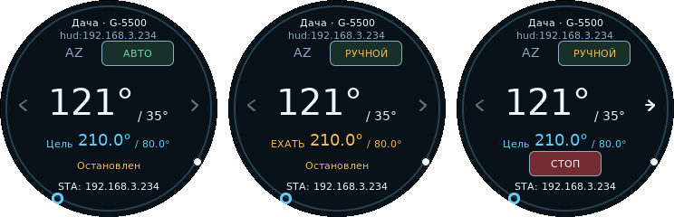

# ESP32-2424S012C-Y(B): круглый сенсорный пульт

[Документация](../index.md)

Профиль `esp32_2424s012c` предназначен для Guition / Sunton ESP32-2424S012C на **ESP32-C3**: Flash 4 МиБ, круглый экран **GC9A01 240×240**, ёмкостный сенсор **CST816**. Вариант **Y(B)** поставляется в чёрном корпусе и использует тот же профиль. PSRAM и механического энкодера нет.

## Сборка и подключение

```sh
pio run -e esp32_2424s012c
```

Для Arduino CLI установите LVGL 9.6.0, Adafruit GC9A01A 1.1.0, Adafruit GFX 1.12.1 и Adafruit BusIO 1.17.2, затем выполните:

```sh
./tools/build_arduino.sh esp32-2424s012c
```

Подключите USB-C к компьютеру кабелем с линиями данных. Для загрузки выберите порт ESP32-C3 USB Serial/JTAG. Если порт не появился, удерживайте BOOT, нажмите RESET и отпустите BOOT. Для записи через PlatformIO:

```sh
pio run -e esp32_2424s012c -t upload --upload-port /dev/ttyACM0
```

Замените порт на фактический. Профиль использует один раздел приложения 3 МиБ: обновление выполняется через USB, **OTA недоступно**.

## Первый запуск

1. Подключитесь к точке доступа `G5500-Rotator-XXXXXX` и откройте `http://192.168.4.1/`.
2. Пройдите [первую настройку](../setup/first-start.md), оставив роль **HUD — удалённый пульт**.
3. Подключите пульт к сети контроллера поворотки и добавьте контроллер в [список HUD](../control/hud.md).
4. Выберите сохранённый контроллер. На экране появятся его текущие углы, цель и состояние.

Роль HUD выбрана по умолчанию, имитация выключена. Можно выбрать роль **Контроллер** и назначить свободные GPIO местному приводу, кнопкам или внешнему HC-05. Встроенного Bluetooth SPP у ESP32-C3 нет. Для демонстрации можно отдельно включить виртуальную поворотку в настройках HUD либо имитацию в роли контроллера.

## Местный релейный привод

Для ручного управления одной осью двумя релейными входами:

1. В мастере выберите роль **Контроллер**, физический привод и интерфейс **Штатный блок Yaesu**. Этот интерфейс выдаёт два дискретных направления.
2. В оборудовании освободите UART: установите **UART0 · RX = −1** и **UART0 · TX = −1**. Отключите связь HUD по UART и Modbus, если они использовали эти линии. USB остаётся отдельным интерфейсом.
3. Назначьте **AZ · отрицательное направление = GPIO20**, **AZ · положительное направление = GPIO21**. Обратную связь AZ, скорость AZ и все четыре сигнала EL оставьте **−1**. Датчик AZ оставьте «Потенциометр · ADC»: при ADC −1 он не подключён.
4. Сохраните и подтвердите оборудование, затем завершите мастер. Для такого подключения калибровка угла и настройка регулятора пропускаются.
5. Управляйте удержанием стрелок на экране или в вебе. Отпускание и STOP отключают направления; при смене направления соблюдается пауза реверса.

Без датчика текущий угол показан прочерками, команды движения к заданному углу недоступны. Выходы направлений активны HIGH, в покое LOW. Подключайте GPIO к совместимым входам драйвера реле на 3,3 В; катушки реле непосредственно к GPIO не подключайте.

Другую распиновку и интерфейс привода можно выбрать в оборудовании. Проверяются занятые линии, возможности GPIO, полнота сигналов выбранного интерфейса и конфликты назначений. При назначении GPIO8 или GPIO9 учитывайте их влияние на загрузку; если используете GPIO9 для оборудования, отключите на нём кнопку подтверждения и не нажимайте BOOT при включённом силовом питании.

Для позиционирования можно подключить MT6701 или AS5600 к общей шине сенсора экрана: **SDA GPIO4, SCL GPIO5**, питание и подтяжки 3,3 В. Выберите этот датчик для AZ, назначьте ту же пару SDA/SCL и откалибруйте ось. Адрес 0x15 занят сенсором экрана. Линии 4/5 разрешены для общей I²C-шины; назначение их релейным выходам остаётся заблокировано.

## Управление с экрана



Экран использует общий [сенсорный интерфейс](../control/display.md) на LVGL с CrowPanel и ILI9341. Шрифт DejaVu Sans рисуется в разрешении 240×240. У G-5500 крупно показан угол выбранной оси, рядом меньшим шрифтом — угол второй; AZ всегда слева, EL справа.

| Касание | Действие |
|---|---|
| Имя сверху | При двух сохранённых поворотках переключить на другую; при большем количестве открыть список |
| Верхняя / нижняя строка списка | Предыдущая / следующая поворотка |
| Средняя строка списка | Подключиться к выделенной поворотке и сохранить выбор |
| AZ / EL | Переключить выбранную ось; EL доступна у G-5500 |
| «РУЧНОЙ» / «АВТО» | Переключить режим выбранной поворотки |
| Окружность | Сразу задать угол выбранной оси; при движении пальца цель обновляется |
| Удержание стрелки | Двигать выбранную ось; отпускание останавливает её |
| Строка «Цель» / «ЕХАТЬ» в покое | При отпускании подтвердить показанные цели |
| «СТОП» во время движения | Немедленно остановить обе оси |
| Двойной тап по текущим углам | Открыть регулировку рабочих скоростей |
| Свайп от текущих углов или строки цели | Управлять скоростью: горизонталь — AZ, вертикаль — EL |

На небольшом экране видны две стрелки выбранной оси. Для свайпа мёртвая зона составляет 6 px, полная скорость достигается при смещении на 50 px; отпускание прекращает движение захваченных жестом осей. Кнопка «СТОП» остаётся доступной во время движения на экране скорости и в списке повороток.

Белая точка на окружности показывает текущее положение, голубое кольцо — цель. При приближении к механическому пределу на внутренней стороне ободка появляется красная полоса, на внешней — голубая для цели. Числа сохраняют полный механический угол, включая отрицательные значения и значения больше 360°. Снизу отображаются сетевые адреса пульта.

При потере связи углы заменяются прочерками, движение и подтверждение недоступны; выбор другого контроллера остаётся доступен. Ошибка чтения сенсора прерывает ручной жест; для нового движения отпустите палец. Смена поворотки, оси или цели отменяет начатое подтверждение: дождитесь обновления экрана и коснитесь цели заново.

## Встроенные соединения

| Узел | GPIO |
|---|---|
| GC9A01 SCK / MOSI / CS / DC | 6 / 7 / 10 / 2 |
| Подсветка, активный HIGH | 3 |
| CST816 SDA / SCL / RESET / INT | 4 / 5 / 1 / 0 |
| BOOT, подтверждение цели | 9 |
| USB D− / D+ | 18 / 19 |
| UART RX / TX, разъём SH1.0 | 20 / 21 |

Уровни UART — **3,3 В**; это не RS-232. Его можно использовать для [проводного HUD](../control/hud.md). Встроенные линии экрана и сенсора, Flash и USB защищены от посторонних назначений. UART20/21 можно переназначить после отключения UART; шина I²C 4/5 допускает совместное подключение датчиков с другими адресами.

Аппаратные параметры: [конфигурация производителя Guition](https://github.com/Guition-JC/Guition/tree/3dd044478e934a574df4e44d9cf5fde19171d0f8/components/board/guition_boards/esp32_2424s012).
