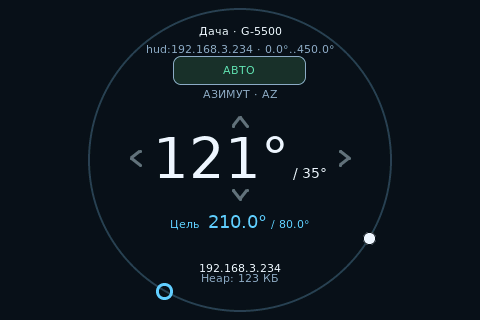

# ESP32-3248S035C

[Документация](../index.md) · [Сборка](../build.md) · [Сенсорное управление](../control/display.md)

Плата Sunton ESP32-3248S035C использует ESP32, SPI-дисплей ST7796 3,5″ и ёмкостный тач GT911. Профиль выводит общий интерфейс LVGL в альбомной ориентации **480×320**. Калибровка резистивного тача не требуется.



## Сборка и установка

```sh
pio run -e esp32_3248s035c -j4
```

Через вспомогательные скрипты:

```sh
python3 tools/build_platformio.py --env esp32_3248s035c --display st7796
./tools/build_arduino.sh esp32-3248s035c
```

Для Arduino IDE подготовьте копию `python3 tools/prepare_sketch.py --target esp32-3248s035c`. Выберите **ESP32 Dev Module**, Flash **4 MB**, Flash Mode **DIO**, Flash Frequency **40 MHz**, PSRAM **Disabled**. Задайте `BOARD_PROFILE=BOARD_ESP32_3248S035C` и `DISPLAY_KIND=DISPLAY_ST7796` в `build_config.hpp`. Для графического интерфейса используйте [команды Arduino CLI с настройками LVGL и LTO](../build.md#arduino-cli).

Приложение занимает один раздел **3 МиБ**; обновление выполняется через USB–UART CH340. NVS находится на `0x9000`. Для первой установки или перехода с другой разметки запишите полный комплект сборки с таблицей разделов:

```sh
pio run -e esp32_3248s035c -t upload --upload-port /dev/ttyUSB0
```

Замените порт своим. [Поиск порта и режим BOOT](../build.md#первая-прошивка-через-usb).

## Настройка и управление

По умолчанию плата работает как **HUD**. Подключите её к сети контроллера и выберите поворотку в [настройках HUD](../control/hud.md). Кольцо задаёт цель, касание цели подтверждает движение, стрелки и свайпы обеспечивают ручное управление до отпускания. Для остановки движения к цели используйте веб-интерфейс; двойной тап по углам открывает настройку скоростей.

Местные выходы привода и датчики по умолчанию не назначены. Назначение доступных выводов выполняется в настройках оборудования. Встроенный Bluetooth SPP доступен и по умолчанию выключен.

## Выводы платы

| Устройство | GPIO |
|---|---|
| ST7796: SCK / MOSI / MISO | 14 / 13 / 12 |
| ST7796: CS / DC / подсветка | 15 / 2 / 27 |
| GT911: SDA / SCL / RESET | 33 / 32 / 25 |
| GT911: INT | 21; используется опрос по I²C |
| USB–UART CH340: TX / RX ESP32 | 1 / 3 |
| RGB-светодиод | 4 / 16 / 17 |
| Аудиовыход / датчик освещённости | 26 / 34 |
| microSD: CS / CLK / MISO / MOSI | 5 / 18 / 19 / 23 |
| Выведенные пользовательские сигналы P3 | 22; 35 — только вход, без внутренней подтяжки |
| Кнопка BOOT | 0 |

Встроенные устройства и USB-диагностика резервируют свои выводы. GPIO0 участвует в выборе режима загрузки; удержание BOOT при сбросе переводит плату в загрузчик.

GT911 опрашивается без управления INT: на части плат эта линия соединена с землёй. Поддерживаются адреса `0x5D` и `0x14`. Второй контроллер I²C занят тачем; двум внешним датчикам положения нужна общая отдельная шина с разными адресами.

Распиновка и особенности платы: [исходный BSP ESP32-3248S035](https://github.com/ardnew/ESP32-3248S035), [описание ESP3D](https://esp3d.io/esp3d-tft/version_1x/hardware/esp32/sunton-35-3248/).
