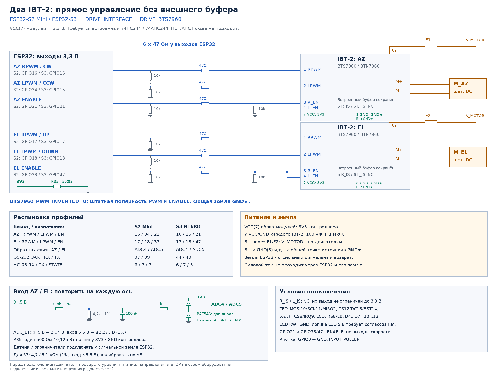

# Внешние дисплеи для generic-плат

В веб-прошивальщике внешние generic-дисплеи доступны для ESP32-S3 N16R8. Выберите эту плату и конфигурацию дисплея. Для других процессоров доступны основные готовые прошивки; внешний дисплей можно выбрать при самостоятельной сборке по таблице ниже. Прошивка должна соответствовать контроллеру экрана **и** контроллеру сенсора. Для плат Guition, Sunton и CrowPanel со встроенным экраном выбирайте отдельный профиль самой платы.

| Процессор / модуль | LCD1602 | ILI9341 + XPT2046 | GC9A01 + CST816 | ST7796 + GT911 | ST77916 + CST816S |
|---|---|---|---|---|---|
| ESP32, Flash 4 МБ | `esp32_4mb_lcd` | `esp32_4mb_tft` | `esp32_4mb_gc9a01` | `esp32_4mb_st7796` | `esp32_4mb_st77916` |
| ESP32-S3 N16R8 | `esp32s3_n16r8_lcd` | `esp32s3_n16r8_tft` | `esp32s3_n16r8_gc9a01` | `esp32s3_n16r8_st7796` | `esp32s3_n16r8_st77916` |
| ESP32-C3, Flash 4 МБ | `esp32c3_4mb_lcd` | `esp32c3_4mb_tft` | `esp32c3_4mb_gc9a01` | `esp32c3_4mb_st7796` | — |
| ESP32-S2 Mini, PSRAM 2 МБ | `esp32s2_mini_lcd` | `esp32s2_mini_tft` | `esp32s2_mini_gc9a01` | `esp32s2_mini_st7796` | — |
| ESP32-S2 без PSRAM | `esp32s2_4mb_lcd` | `esp32s2_4mb_tft` | `esp32s2_4mb_gc9a01` | `esp32s2_4mb_st7796` | — |

Для самостоятельной сборки используйте `pio run -e <имя_профиля>`. В веб-прошивальщике для ESP32-S3 доступны готовые варианты с MQTT + RS-485 либо без обоих сервисов. Ethernet на generic-платах отсутствует.

## Подключение и первая настройка

Схемы подключения повороток: [G-5500](../hardware/g5500/g5500-esp32s3-tft-schematic.png), [G-800DXA](../hardware/g800dxa/g800dxa-connection.png), [датчик G-800SA](../hardware/g800sa/g800sa-tap-points-wiring.png), [BTS7960 / IBT-2](../hardware/bts7960/independent-pwm-bts7960.png). [Все схемы](../hardware/schematics.md).

Номера GPIO на схемах ESP32-S3 переносите по назначению сигналов, используя распиновку своей платы и раздел **Оборудование**.

Пример подключения двух приводов через BTS7960. Сначала назначьте GPIO выбранного экрана по инструкции ниже, затем перенесите сигналы привода на оставшиеся свободные выводы.

1. Проверьте питание модуля по его документации. Логические сигналы ESP работают с уровнем 3,3 В; объедините GND платы и дисплея. Подсветку, которой требуется большой ток, подключайте через подходящий драйвер.
2. Прошейте выбранную конфигурацию через USB. Подключитесь к Wi-Fi `G5500-Rotator`, откройте `http://192.168.4.1/` и раздел **Оборудование**. При неназначенных GPIO экрана устройство открывает настройку в режиме восстановления. Нажмите **Открыть ручную настройку**.
3. Назначьте GPIO экрана и сенсора. Уберите неиспользуемые назначения, которые пересекаются с проводами дисплея: привод, HC-05, UART, кнопка и индикаторы. Не используйте выводы Flash, PSRAM и native USB. Учитывайте загрузочные уровни strapping GPIO выбранного модуля.
4. Сохраните настройки, перезапустите устройство и подтвердите запуск конфигурации. Калибровку привода выполняйте после настройки оборудования.

| Экран | Обязательные сигналы | Дополнительные сигналы |
|---|---|---|
| LCD1602, параллельный 4-битный | RS, E, D4–D7 | RW соедините с GND; контраст задаётся аппаратно. I²C-переходник PCF8574 не поддерживается. |
| ILI9341 + XPT2046 | SPI MOSI, MISO, SCK; TFT CS, DC; сенсор CS | TFT RESET, сенсор IRQ. Экран и XPT2046 используют общую SPI-шину. |
| GC9A01 + CST816 | SPI MOSI, SCK; TFT CS, DC; сенсор SDA, SCL | TFT RESET, подсветка BL, сенсор RESET и IRQ. MISO не используется. |
| ST7796 + GT911 | SPI MOSI, SCK; TFT CS, DC; сенсор SDA, SCL | TFT RESET, подсветка BL, сенсор RESET и IRQ. MISO не используется. |

`−1` означает отсутствие необязательного подключения. При BL = `−1` обеспечьте постоянное включение подсветки аппаратно. При RESET = `−1` обеспечьте аппаратный сброс и штатные уровни на модуле. Для GT911 оставьте INT в предусмотренном модулем состоянии при запуске: драйвер опрашивает адреса `0x5D` и `0x14` и не управляет линией INT. Раскладка ST7796 рассчитана на 480 × 320, GT911 — на исходные координаты 320 × 480. Поворот и отражение задаются в настройках экрана.

CST816 использует I²C-адрес `0x15`. Датчики угла с GC9A01 подключайте к той же I²C-шине, с другими адресами. На ESP32-C3 также нужно разделять шину GT911 и датчиков угла: доступен один контроллер I²C. Не назначайте датчикам адреса сенсора.

Подключение QSPI ST77916 описано в [инструкции внешнего Waveshare 1.85″](waveshare-1.85-qspi.md).

## Память и нагрузка

Графические сборки для плат с Flash 4 МБ используют один раздел приложения 3 МиБ и обновляются через USB. LCD1602 для ESP32-S2 без PSRAM сохраняет два OTA-раздела и исключает MQTT; графические варианты S2 используют раздел 3 МиБ. S3 N16R8 сохраняет свой профиль Flash/PSRAM.

Показатели Flash и статической RAM в прошивальщике берутся из выбранного бинарника. Они не определяют свободную память и задержки во время работы. На одноядерных ESP32-C3 и ESP32-S2 экран и сеть делят время процессора; уменьшайте число клиентов и отключайте ненужные сервисы. На ESP32 без PSRAM также учитывайте расход памяти встроенного SPP. Следите за свободной внутренней RAM, крупнейшим блоком и задержками цикла в диагностике контроллера.

Если после смены прошивки возникают проблемы запуска или настроек, выполните прошивку с полным стиранием и настройте устройство заново.
