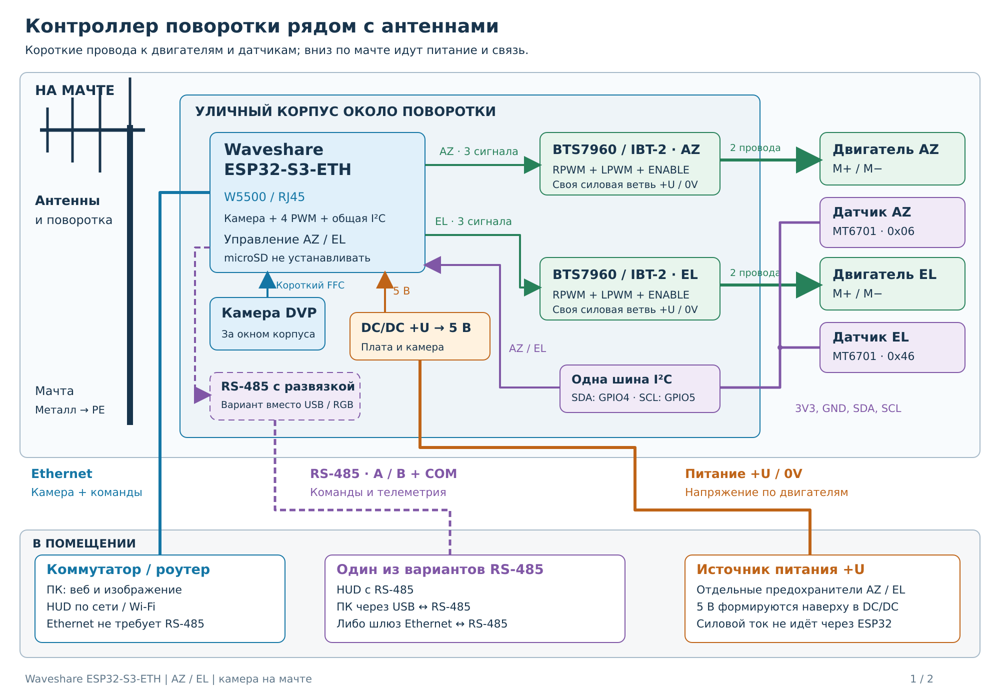
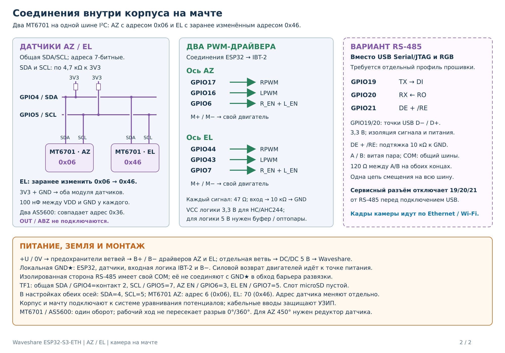

# Waveshare с камерой на мачте

[Профиль платы и распиновка](waveshare-esp32-s3-eth.md) · [Документация](../index.md)

Контроллер устанавливается около поворотки в уличном корпусе вместе с двумя BTS7960 и преобразователем питания. Камера находится за оптическим окном; её DVP-шлейф остаётся коротким внутри корпуса. Двигатели подключаются местными кабелями, два датчика положения используют одну общую шину I²C. В помещение идут питание и выбранная линия связи.

[PDF, два листа](waveshare-esp32-s3-eth-mast.pdf) · [SVG размещения](waveshare-esp32-s3-eth-mast.svg) · [SVG соединений](waveshare-esp32-s3-eth-mast-connections.svg).

Редактируемая монтажная схема с проводными соединениями на одном листе A2 — [проект KiCad](../../hardware/ESP32-S3-ETH-CAM-MAST/README.md).

## Питание и монтаж

1. Установите корпус около поворотки, предусмотрите окно камеры, гермовводы, отвод конденсата и охлаждение драйверов. Оставьте запас кабеля для полного рабочего хода AZ и EL.
2. Подайте низкое напряжение `+U / 0V`, соответствующее двигателям. Выберите источник, кабель и разъёмы по пусковому току двух двигателей и падению напряжения на длине линии. Сеть 230 В остаётся в помещении.
3. В корпусе разделите питание на защищённые предохранителями ветви AZ, EL и DC/DC. Преобразователь выдаёт стабилизированные 5 В для Waveshare с камерой и Ethernet; подключайте их к входу 5 В платы, не к 3V3. Не подавайте одновременно два независимых источника 5 В на USB и вход платы.
4. Сведите силовые возвраты B− к точке распределения питания. Отдельными проводами подключите к ней GND контроллера, входной логики и датчиков. Ток двигателей не должен проходить по земле сигнального кабеля или платы ESP32.
5. Разведите сигнальные и силовые провода, удалите их от RF-кабелей и излучающих частей антенны. Соедините мачту и металлический корпус с системой уравнивания потенциалов; предусмотрите подходящие УЗИП на внешних линиях и вводе в помещение.

Номера GPIO и контактов TF1 для двух BTS7960 приведены в [руководстве платы](waveshare-esp32-s3-eth.md#подключение-привода). Слот microSD должен оставаться пустым. Уровень логики модулей, буферы и оптроны выбираются по [руководству BTS7960](../hardware/bts7960/index.md#выбор-подключения).

## Два датчика положения

На рисунке показаны **два MT6701 с разными адресами на одной шине I²C**: AZ — `0x06`, EL — `0x46`. Внешние АЦП, делители напряжения и мультиплексор не нужны. Камера, W5500, четыре PWM и независимые ENABLE сохраняются. GPIO0 не используется датчиками; GPIO21 можно оставить RGB либо отдать направлению RS-485 в отдельном варианте.

| Подключение | Оба MT6701 |
|---|---|
| SDA | GPIO4, TF1 CD/D3, контакт 2 |
| SCL | GPIO5, TF1 D0, контакт 7 |
| Питание | 3V3 и общий GND; модуль должен поддерживать питание 3,3 В |
| Развязка питания | 100 нФ между VDD и GND около каждого датчика |
| Подтяжки | SDA и SCL через отдельные резисторы около 4,7 кОм к 3V3 |

Учитывайте уже установленные на модулях подтяжки: дополнительные резисторы включаются параллельно. Подтяжек к 5 В быть не должно. Провода SDA/SCL остаются короткими около поворотки, отдельно от силовых и RF-кабелей; длинная линия вниз по мачте — Ethernet или RS-485. Шина датчиков работает на 400 кГц. OUT, PWM и выходы ABZ в этой схеме не подключаются; на модуле MT6701 должен быть выбран режим I²C.

### Адрес второго датчика

MT6701 по умолчанию отвечает на 7-битный адрес `0x06`; производитель допускает его программирование в `0x46`, см. [раздел 7.7.2 datasheet MagnTek](https://www.magntek.com.cn/upload/pdf/202407/MT6701_Rev.1.8.pdf).

1. До объединения датчиков подключите только будущий датчик EL к программатору, совместимому с MT6701. Измените его адрес с `0x06` на `0x46` по процедуре производителя для конкретного исполнения датчика.
2. Полностью отключите и снова подайте питание на этот датчик. Проверьте, что он отвечает по `0x46`; затем присоедините AZ с исходным адресом `0x06` к общей SDA/SCL. Два датчика с одинаковым адресом одновременно к общей шине не подключаются.
3. В **Настройки → Оборудование → Настроить оборудование** выберите MT6701 на обеих осях. Для AZ задайте адрес **6** (`0x06`), для EL — **70** (`0x46`). На обеих осях назначьте SDA=4 и SCL=5; прежние ADC можно поставить в «Не подключён».
4. Сохраните конфигурацию, подтвердите пробный запуск и выполните калибровку обеих осей по [инструкции датчиков положения](../setup/position-sensors.md).

Поле адреса в контроллере выбирает, откуда читать угол, и **не меняет адрес внутри энкодера**. Программирование самого MT6701 выполняется отдельно; произвольный адрес вместо предусмотренных `0x06` / `0x46` ему не назначается.

### Варианты замены AS5600

| Датчики на общей шине | Адреса | Условия |
|---|---|---|
| Два MT6701 | `0x06` и `0x46` | Адрес второго изменён заранее; основной вариант рисунка |
| AS5600 + MT6701 | `0x36` и `0x06` | Разные заводские адреса, перепрограммирование не нужно |
| Два обычных AS5600 | Оба `0x36` | Напрямую на одной общей шине не используются |
| Два AS5600L | По умолчанию оба `0x40`, адрес программируется | Нужны настройка разных адресов и отдельная поддержка AS5600L в прошивке |

У AS5600 адрес фиксирован, см. [руководство производителя](https://look.ams-osram.com/m/4f8342513a447495/original/AS5600_UG000254_2-00.pdf). **AS5600L с буквой L** имеет программируемый адрес и рассчитан на работу нескольких датчиков на общей шине; это отдельная модель, см. [Infineon AS5600L](https://www.infineon.com/part/AS5600L). Не выбирайте AS5600L как обычный AS5600: в штатном типе AS5600 адрес ограничен `0x36`.

Магнитный датчик измеряет один оборот. Расположите магнит соосно датчику и выберите передаточное отношение так, чтобы весь рабочий ход оставался на непрерывном участке шкалы. Для AZ с ходом 450° нужен механический редуктор датчика, например 2:1: 450° поворотки дают 225° датчика. Программный ноль сдвигает разрыв отсчётов за рабочий участок, но не создаёт многооборотное измерение. После установки проверьте оба края и откалибруйте положение.

## Ethernet и HUD

Ethernet — базовый вариант для окружения `waveshare_esp32s3_eth`. Подключите RJ45 к коммутатору или роутеру. Веб-управление, команды, телеметрия и камера идут по одной сети; HUD можно подключить к той же сети по Wi-Fi. Блок питания двигателей нужен отдельно. PoE для электроники возможно только с совместимым PoE-модулем платы и подходящим источником; оно не заменяет силовое питание двух двигателей. Возможности камеры, W5500 и PoE описаны у [Waveshare](https://docs.waveshare.com/ESP32-S3-ETH).

## Вариант RS-485

Пунктиром показан отдельный вариант подключения, в котором UART занимает линии USB и RGB. **Штатное окружение `waveshare_esp32s3_eth` сохраняет USB и не разрешает GPIO19/20 для UART. Для показанного RS-485 требуется отдельная конфигурация прошивки с освобождением этих GPIO и отключением RGB.** В установленной штатной прошивке используйте Ethernet или Wi-Fi.

| Сигнал ESP32 | Подключение к трансиверу с логикой 3,3 В |
|---|---|
| GPIO19, UART TX | DI |
| GPIO20, UART RX | RO |
| GPIO21, направление | DE и /RE вместе; подтяжка 10 кОм к GND |

GPIO19/20 находятся на линиях USB D−/D+; подключение к ним выполняется в точках USB по схеме платы, а не к гребёнке TX/RX, которая занята PWM GPIO43/44. Предусмотрите сервисный разъём, разрывающий эти три сигнала между ESP32 и модулем RS-485 перед подключением USB для прошивки. В рабочем режиме USB-кабель с линиями данных не подключается. GPIO19/20 доступны как обычные GPIO при отключённом USB Serial/JTAG, что указано в [документации Espressif](https://docs.espressif.com/projects/esp-idf/en/stable/esp32s3/api-reference/peripherals/gpio.html).

Для выносной установки используйте изолированный интерфейс с изолированным питанием стороны шины. Соединяйте A/B витой парой и ведите отдельный COM между сторонами шины; COM изолированной стороны не соединяйте с локальной GND в обход барьера. На двух физических концах линии устанавливаются согласующие резисторы по волновому сопротивлению кабеля, обычно 120 Ом. Цепь смещения, если она нужна выбранным трансиверам, должна быть рассчитана для всей линии и включаться в одном месте. [Руководство TI по RS-485](https://www.ti.com/lit/an/slla272d/slla272d.pdf).

На другом конце выбирайте HUD с RS-485, ПК с USB–RS-485 или сетевой шлюз Ethernet–RS-485. Протокол, скорость, чётность и адреса обоих концов должны совпадать: электрический преобразователь сам не переводит протокол HUD в GS-232 или Modbus. Камера передаёт изображение через Ethernet / Wi-Fi; показанная линия RS-485 обслуживает команды и телеметрию.

