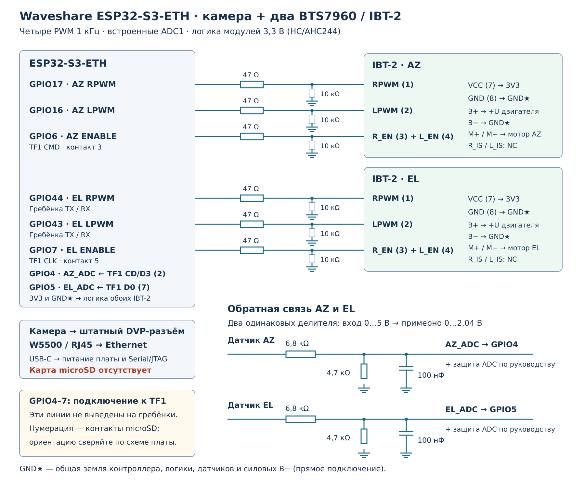

# Waveshare ESP32-S3-ETH: камера и два BTS7960

[Документация](../index.md)

Профиль для ESP32-S3-ETH / ESP32-S3-POE-ETH с 16 МиБ Flash, 8 МиБ OPI PSRAM, Ethernet W5500 и DVP-камерой OV5640 или OV2640. Камера подключается к штатному разъёму. Управление двумя осями использует встроенные ADC1 и четыре PWM ESP32; внешний АЦП или расширитель GPIO не нужен.

## Сборка

```sh
pio run -e waveshare_esp32s3_eth
```

Окружение включает камеру, веб-интерфейс и физический привод BTS7960 с прямой полярностью PWM. Для оптронного подключения выберите соответствующую полярность в **Настройки → Поворотка и привод → Оборудование**. Сохранённая ранее конфигурация имеет приоритет над начальными настройками сборки: проверьте тип привода и GPIO после смены профиля.

Arduino CLI: `DRIVE_INTERFACE=2 ./tools/build_arduino.sh waveshare-s3-eth`. В Arduino IDE выберите **ESP32S3 Dev Module**, Flash **16 MB**, **OPI PSRAM**, **Hardware CDC and JTAG**, **USB CDC On Boot: Enabled**; задайте `BOARD_PROFILE BOARD_WAVESHARE_S3_ETH` и `DRIVE_INTERFACE DRIVE_BTS7960` в `build_config.hpp` / `runtime_defaults.hpp`. Используйте [разметку S3 с OTA](../build.md).

Вариант `waveshare_esp32s3_eth_nocam` отключает камеру флагом `CAMERA_ENABLED=0`, сохраняя распиновку привода. Другие дисплеи в этом профиле отключены.

## Подключение привода

**Извлеките microSD и оставьте слот пустым.** Его четыре сигнала используются для датчиков и ENABLE. Они не выведены на гребёнки платы: подключите провода к соответствующим контактам слота TF1, сверяясь с [официальной схемой Waveshare](https://files.waveshare.com/wiki/ESP32-S3-ETH/ESP32-S3-ETH-Schematic.pdf). Номера относятся к электрическим контактам microSD, а не к порядку площадок при взгляде на плату.

| Сигнал | GPIO | Точка на плате / подключение |
|---|---:|---|
| AZ RPWM, положительное направление | 17 | Гребёнка → RPWM модуля AZ |
| AZ LPWM, отрицательное направление | 16 | Гребёнка → LPWM модуля AZ |
| EL RPWM, положительное направление | 44 | RX / GPIO44 → RPWM модуля EL |
| EL LPWM, отрицательное направление | 43 | TX / GPIO43 → LPWM модуля EL |
| AZ ENABLE | 6 | TF1 CMD, контакт 3 → R_EN + L_EN модуля AZ |
| EL ENABLE | 7 | TF1 CLK, контакт 5 → R_EN + L_EN модуля EL |
| Датчик AZ | 4 | TF1 CD/D3, контакт 2 ← защищённый делитель AZ |
| Датчик EL | 5 | TF1 D0, контакт 7 ← защищённый делитель EL |



[SVG](waveshare-esp32-s3-eth-bts7960.svg) · [PDF](waveshare-esp32-s3-eth-bts7960.pdf).

1. Отключите питание платы и двигателей. Установите камеру в DVP-разъём и зафиксируйте шлейф. Подключите цепи обратной связи и управления по таблице.
2. Выберите вариант [согласования входов BTS7960](../hardware/bts7960/index.md#выбор-подключения). На рисунке показана логика модулей от 3,3 В: последовательные резисторы 47 Ом и подтяжки 10 кОм к GND. Она предназначена для модулей с подходящим HC/AHC244. Для логики 5 В используйте буфер или оптронную схему из того же руководства, заменив GPIO по таблице выше.
3. Объедините R_EN и L_EN только внутри своей оси. Каждый ENABLE должен иметь подтяжку к GND у модуля, чтобы двигатель оставался отключённым при загрузке и сбросе. Силовое питание подключите к B+/B−; двигатель — к M+/M− своего модуля.
4. Подайте сигналы положения на GPIO4/5 через [делители и защиту ADC](../hardware/adc-input.md). Для датчика 0…5 В вариант 6,8 кОм / 4,7 кОм даёт около 0…2,04 В. Прямое подключение 5 В к GPIO недопустимо.
5. Сначала включите только логику. Проверьте уровни PWM/ENABLE при STOP и показания ADC. Затем подключите питание двигателей, проверьте направления короткими командами, выполните [калибровку обеих осей](../setup/az-range.md) и [настройку регуляторов](../setup/regulator-tuning.md).

PWM обоих BTS7960 — **1 кГц, 10 бит**; четыре сигнала формируются независимо. USB Serial/JTAG и BOOT доступны; внешний UART на GPIO43/44 занят приводом. microSD, внешний TFT/LCD и HC-05 в начальной конфигурации не используются. RGB-индикатор остаётся на GPIO21.

## Сеть и изображение

Подключите RJ45 к сети с DHCP. Ethernet запускается автоматически и имеет приоритет перед Wi-Fi STA. Адрес можно узнать в DHCP роутера либо через AP `G5500-Rotator-XXXXXX`: `http://192.168.4.1`, **Настройки → Сеть и подключение → Ethernet**. Веб, команды, телеметрия и камера доступны через Ethernet, Wi-Fi STA и AP. [Сетевые порты и резервная AP](../setup/network.md).

На главной странице **Управление** появляется блок **Камера**. JPEG 640×480 обновляется автоматически: запросы выполняются с периодом 125 мс — до 8 кадров/с. Пока предыдущий кадр загружается, новый запрос не отправляется; при медленной связи частота снижается. При переходе в настройки или скрытии страницы обновление приостанавливается; при возвращении возобновляется. После ошибки загрузки повтор выполняется через 3 секунды.

Отдельный снимок: `http://<адрес платы>:82/camera.jpg`. Разрешите доступ к TCP-порту 82 наряду с HTTP-портом 80. `/api/status` возвращает `cameraSupported`, `cameraReady`, `cameraPort`, `cameraError`; порт равен нулю, если камера не запущена. На других платах блок камеры скрыт.

Если камера не найдена, обесточьте плату, проверьте шлейф, положение контактов и питание, затем включите её снова. При сообщении об отсутствии PSRAM соберите прошивку с OPI PSRAM. Если нет Ethernet, проверьте питание, кабель и DHCP; используйте резервный Wi-Fi. Источник питания платы должен выдерживать одновременную работу камеры, W5500 и ESP32; двигатели питаются отдельно.

Распиновка камеры и W5500 соответствует [документации производителя](https://docs.waveshare.com/ESP32-S3-ETH/Development-Environment-Setup-Arduino). Занятые ими GPIO заблокированы для переназначения, включая имитацию. При `CAMERA_ENABLED=0` линии данных камеры освобождаются; GPIO8 управления её питанием остаётся зарезервированным.
