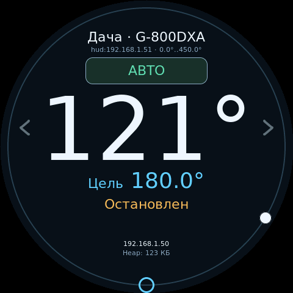

# HUD: удалённые пульты и несколько повороток

[Документация](../index.md)

Первую настройку можно выполнить через [мастер HUD](../setup/first-start.md#удалённый-пульт-hud).

HUD — роль обычной прошивки, выбираемая в веб-интерфейсе: **Настройки → Роль и связь → Роль устройства и связь → HUD — удалённый пульт**. Настройка сохраняется в NVS и применяется после перезагрузки. На устройстве возле двигателя оставьте **Контроллер поворотки**. Обновить прошивку нужно на обоих концах.

По умолчанию устройство работает как локальный контроллер. Калибровки, профили приводов и их пресеты при переключении роли сохраняются. В HUD моторные GPIO, PWM и ADC обратной связи положения не инициализируются и не используются, включая диагностику.

Чтобы добавить **Имитацию** — встроенный виртуальный контроллер с осями AZ/EL — включите **Настройки → Поворотки → Показывать имитацию в списке повороток**. По умолчанию настройка выключена; изменение сохраняется сразу и применяется без перезагрузки. Выберите его на экране пульта или в веб-интерфейсе на вкладке **Управление → Поворотки**, под предустановками, чтобы управлять виртуальным движением энкодером, сенсором или командами компьютерных программ. Подключение к другому устройству не требуется. Переключение между имитацией и реальными контроллерами выполняется без перезагрузки. На CrowPanel коснитесь имени поворотки: при двух пунктах касание переключает их напрямую, при большем количестве открывает список.

Координаты, цели, режим, скорости и пресеты имитации независимы от реальных контроллеров и сохраняются при переключении выбора до перезагрузки HUD. После перезагрузки имитация начинает с нулевых координат и стандартных настроек; сам выбор контроллера сохраняется. При смене выбора удержание направления прекращается, а принятая числовая цель продолжает выполняться, в том числе в имитации. При выключении настройки имитация останавливается и удаляется из списка; если она была выбрана, выбор сбрасывается. Реальная выбранная поворотка при этом сохраняется. Повторное включение создаёт имитацию с нулевыми координатами и стандартными настройками. Встроенный пункт нельзя переименовать или удалить кнопкой списка.

Для проводной схемы ПК → HUD → контроллер с двумя независимыми линиями см. [RS‑485](../integrations/rs485.md#компьютер-через-hud).

## Подключение

**Через роутер.** Подключите устройства к одной сети в настройках Wi-Fi. На HUD откройте «Добавить поворотку», выполните поиск и нажмите найденную запись, чтобы сохранить её. Обнаружение само по себе не разрешает управление. Если broadcast не проходит, введите IPv4 и порт контроллера вручную. Поддерживаются разные UDP-порты у разных сохранённых устройств.

**Без роутера.** На одном выбранном устройстве включите «Общая точка доступа». На остальных выберите «Клиент общей точки доступа» и сохраните её SSID/пароль в настройках Wi-Fi. Хозяином общей AP может быть HUD или контроллер. Все поворотки должны находиться в этой общей сети: переключение записи HUD не переключает Wi-Fi.

Имена AP различаются: `G5500-HUD-xxxxxx` или `G5500-Rotator-xxxxxx`, где суффикс зависит от ID устройства. Сервисная AP обычно доступна по `192.168.4.1`; при пересечении с STA выбирается другая частная подсеть. Актуальный адрес виден на дисплее и в диагностике. STA-клиент использует свою сервисную AP при потере основной сети.

**UART.** Включите «HUD ↔ поворотка / радиомост» на обоих концах. Это существующие выводы UART0/GS-232 выбранного профиля платы; точные GPIO приведены в описании выбранного профиля платы. Подключите:

| HUD | Контроллер |
| --- | --- |
| TX | RX |
| RX | TX |
| GND | GND |

В разделе оборудования **UART и RS‑485** задайте одинаковые параметры UART0 на обоих устройствах; начальное значение UART0 — **9600, 8N1**, сохранённые настройки не меняются при выборе HUD. Логические уровни — **3,3 В**. Это UART, не электрический RS-232. Не соединяйте одновременно выходы TX нескольких устройств. Встроенный USB–UART-мост на UART0 нужно изолировать от линии RX при соединении двух плат, если его TX остаётся подключённым; для загрузки прошивки межплатный кабель отсоединяют. Native USB на S2/S3 — отдельный интерфейс.

У обычной CrowPanel внешние RX/TX имеют преобразователи с подтяжкой к 5 В: перед соединением с UART 3,3 В нужен согласователь уровней. См. [распиновку CrowPanel](../boards/crowpanel-21.md#подключения).

### UART через радиомост

Для прозрачного радиомоста, например E220, откройте **Настройки → Пульт и связь → Роль устройства и связь**, выберите **HUD ↔ поворотка / радиомост** и настройте:

- В **Оборудование → UART и RS‑485** настройте скорость UART0 (1200–115200 бод), чётность и стоп-биты. Эти параметры должны совпадать с UART подключённого радиомодуля.
- **Частота обновления** — 0,1–10 Гц. Уменьшайте её, если радиомост не успевает передавать состояние. При отличии от стандартных 115200 бод / 10 Гц используется опрос вместо фоновой подписки.
- **Уровень готовности AUX / BUSY** — уровень, при котором модуль принимает данные. Для E220 это HIGH. Необязательный вход назначается в **Оборудование → Распиновка GPIO → Радиомост**; без назначенного входа передача разрешена постоянно.

Сохраните параметры на HUD и контроллере; оба устройства перезагрузятся. Для согласованного опроса используйте одинаковые параметры связи на обоих концах. Радиочастоту, эфирную скорость, адреса и прозрачный режим передачи настройте средствами самого радиомодуля. Отключите добавление служебных байтов, например RSSI, в поток UART.

Для E220 используйте TX/RX и общий GND с каждой платой, M0/M1 установите в обычный режим, AUX при необходимости подключите к назначенному входу. Соблюдайте уровни 3,3 В; для внешнего разъёма CrowPanel нужен согласователь уровней. Располагайте антенны вне металлических корпусов.

Частота обновления относится к состоянию; команды и STOP передаются без ожидания следующего опроса. Медленный режим увеличивает время ожидания ответа и срок актуальности полученного состояния. Уже передаваемый кадр завершается целиком перед STOP. Частота опроса не ограничивает ручные команды: темп их отправки учитывает скорость UART. Непрерывное ручное управление доступно от 9600 бод; остановка через 1 с без продления сохраняется. На меньших скоростях используйте числовые цели и пресеты.

Эти параметры относятся к обычному HUD UART0. Отдельный HUD RS‑485 и Modbus используют собственные настройки обмена. Скорость радиоканала и задержки зависят от радиомодулей: снижайте частоту опроса до устойчивой работы и проверяйте доставку STOP при выбранных настройках.

В этом режиме GS-232 на этих же проводах недоступен. На CrowPanel HC-05 и HUD UART нельзя назначать на одну пару GPIO. В профиле [`crowpanel_21_az`](../boards/crowpanel-az.md) UART по умолчанию отключён, RX/TX отведены под привод. Для UART нужна отдельная свободная пара GPIO, назначенная через `/hardware`; иначе используйте Wi-Fi. Остальные доступные входы программ, включая TCP, UDP, Bluetooth или native USB, сохраняются. В списке HUD UART-поворотка добавляется кнопкой «Найти по UART»; сетевые записи доступны одновременно. Физическая UART-линия соединяет ровно два устройства.

### Несколько контроллеров по RS‑485

Включите [Modbus RTU с маркером](../integrations/modbus-rtu.md#подключение-и-настройка) и назначьте контроллерам уникальные адреса. В **Настройки → Поворотки** задайте первый и последний адрес и нажмите **Найти на шине RS‑485**. Поиск идёт последовательно; найденные записи показывают адрес шины. Нажмите запись для сохранения и выберите поворотку из общего списка HUD. Сетевые и проводные записи доступны одновременно. Адреса и выбранная поворотка сохраняются после перезапуска.

## Выбор и управление

В вебе выбирайте поворотку на главной вкладке **Управление**, в блоке **Поворотки** сразу под предустановками. Выбранная запись выделена цветом. Список постраничный, по восемь записей: имя, углы, движение, доступность и возраст состояния. Поиск, добавление, переименование и удаление находятся в **Настройки → Поворотки**. Записи хранятся по стабильному ID, отдельно от адреса. После смены DHCP-адреса повторите поиск: существующая запись обновится без повторного добавления и смены выбора. Имя в каталоге можно изменить независимо от имени самого контроллера.

На CrowPanel:

- Вращение энкодера меняет цель выбранной оси с шагом 20°; двойное короткое нажатие меняет ось AZ/EL.
- Короткое нажатие во время движения отправляет STOP **после отпускания**. Следующее одиночное нажатие позволяет продолжить сохранённую числовую цель; чужой STOP и смена выбора очищают этот контекст. Ожидающая цель подтверждается коротким нажатием.
- Удержание энкодера временно выбирает другую ось; поворот нажатой ручки меняет её цель. Удержание не открывает выбор поворотки и не останавливает числовое наведение.
- Касание имени выбирает другое устройство при двух записях или открывает список при трёх и более, включая встроенную имитацию. В списке вращение ручки меняет выделение, короткое нажатие подтверждает выбор; касание верхней/нижней строки перемещает выделение, средней — подтверждает. Просмотр списка не меняет адресата логгера.
- Для остановки используйте короткое нажатие энкодера или STOP в вебе. Ручной/автоматический режим переключается экранной кнопкой.

На ILI9341 и GC9A01 доступен тот же [сенсорный интерфейс](display.md): выбор поворотки касанием имени, режим, удержание стрелок, подтверждение строки цели и «СТОП» во время движения. На LCD и платах без экрана выбирайте поворотку через веб. Пресеты запускаются и редактируются через веб HUD; калибровка, модель, диапазон и параметры привода изменяются через веб самого контроллера поворотки.

Любая программа, подключённая к HUD, управляет **подтверждённой выбранной записью**. Для N1MM задайте имя самого HUD в поле «Имя в N1MM» (при первом включении наследуется прежнее имя устройства, заводское — `G5500`): оно и имя в ответных отчётах остаются постоянными при переключении повороток. Имя HUD хранится отдельно от прежнего локального имени. Программы на контроллере поворотки продолжают управлять им напрямую. В настройках HUD можно отдельно выбрать подтверждение или автоследование в ручном режиме для N1MM UDP, PstRotator UDP, GS-232 и rotctld. Для автоследования через HUD обновите прошивку и пульта, и контроллера. Действует приоритет активного пресета; другой HUD может подтвердить ожидающую цель и отправить STOP.

При выборе другого устройства ещё не отправленные команды и незавершённый ввод отменяются; поля ввода угла в вебе очищаются. Уже отправленная команда остаётся адресованной исходному ID. TCP-сеанс логгера сохраняется: переподключение не требуется. Неполная строка отбрасывается до её завершающего CR/LF, а байты, накопленные до смены выбора, отменяются; последующие команды направляются выбранной поворотке. Подтверждения уже принятых команд возвращаются в исходный TCP-сеанс, даже если выбор успел измениться. UART/native USB и Bluetooth очищают незавершённый ввод, UDP — накопленные пакеты и контекст протокола. Полностью переданная последовательность исполняется контроллером самостоятельно.

## Обрыв связи и нагрузка

Числовая цель, пресет или последовательность, уже принятые контроллером, продолжаются без HUD. Непрерывное вращение от HUD требует продления каждые 250 мс; через 1 с без продления останавливается только соответствующее движение этого источника. Новая команда другого HUD или прямого входа не останавливается старым таймером. При смене выбора HUD освобождает своё непрерывное вращение на прежней поворотке. Восстановление связи само по себе не запускает движение.

Для удалённой поворотки HUD показывает полученную от контроллера позицию без местной имитации. При сетевой связи и стандартных параметрах UART совместимые стороны автоматически включают подписку выбранной поворотки: изменения управления передаются сразу, координаты и скорость — с шагом не менее 100 мс (10 Гц), heartbeat — 250 мс. Подписка продлевается каждые 250 мс и действует 1 с. Полные сведения выбранной записи обновляются раз в секунду. Со старой прошивкой сохраняется опрос выбранной записи 10 Гц; остальные — 1 Гц, но суммарно не более 20 полных запросов состояния в секунду. При большом каталоге фоновые опросы идут по кругу, возраст данных растёт и виден пользователю. Свежесть отсчитывается от получения проверенного ответа; ответы на запросы старше 1 с её не продлевают. Через 1 с в режиме подписки или 2 с в старом режиме выбранное устройство недоступно для новых команд. GS-232 отвечает `?>`, rotctld — ошибкой `RPRT`; UDP-отчёты положения прекращаются. На вебе/экране устаревшие координаты не выдаются как текущие.

При поддержке обеими сторонами HUD также передаёт выбранный регулятор AZ/EL, готовность настройки, фазу движения, заданную и измеренную скорость, удержание и причину ошибки. Расширение согласуется автоматически; со старой прошивкой сохраняется прежний формат состояния. Параметры ПИД и пуска настраиваются в вебе самого контроллера.

Каталог устройств ограничен доступной памятью пульта. При заполненной очереди команда возвращает `busy`; дождитесь результата предыдущей команды и повторите действие. Ошибка сохранения каталога видна в интерфейсе. Быстрые подписки доступны четырём HUD одновременно; остальные переходят на опрос. WebSocket поддерживает до четырёх подключений браузера на каждом устройстве.

Число клиентов общей AP дополнительно ограничено Wi-Fi-драйвером. Большие сети размещайте за роутером. Используйте HUD в доверенной локальной сети: аутентификации команд между устройствами нет.

## Веб

Оперативное управление и подтверждения идут по [WebSocket](../api/live.md) на порту 81. HTTP остаётся для страницы, настроек и совместимости; при недоступном WebSocket веб возвращается к HTTP.

## HTTP API

| Метод и путь | Действие |
| --- | --- |
| `GET /api/device` | Роль и параметры самого устройства, выбранная запись, связь |
| `POST /api/device` | `role=controller\|hud`, `wifi=existing\|host\|client`, `uart=0\|1`, `port=4534`; сохранение и перезагрузка |
| `POST /api/hud/discover` | Сетевой поиск; необязательные `address`, `port`; для UART — `transport=uart` |
| `GET /api/hud/peers?offset=0&limit=8` | Сохранённые записи; `discovered=1` — несохранённые результаты поиска |
| `POST /api/hud/peers` | Сохранить обнаруженный `id`; необязательное `name`; `action=remove` — удалить |
| `POST /api/hud/select` | Выбрать сохранённый `id` |
| `GET /api/hud/command?id=123` | Результат удалённой команды |

`POST /api/device` принимает необязательные параметры обмена `intervalMs` (100–10000) и `readyHigh` (0/1). Пропущенные поля сохраняют прежние значения. Скорость, чётность и стоп-биты меняются через [API оборудования](../api/index.md#мастер-настройки-и-адреса-сети) отдельно для UART0 и UART1. Старое поле `baud` в `/api/device` допускается только с уже настроенной скоростью выбранного порта; попытка изменить её возвращает HTTP 400 / `uart_settings_in_hardware`. `GET /api/device` и `/api/status` возвращают действующую скорость HUD как `hudBaud`, частоту опроса как `hudIntervalMs`, полярность готовности как `hudReadyHigh`. GPIO задаются через API оборудования как `pin.hudReady`; `-1` отключает сигнал. AUX / BUSY доступен только для обычного UART0. Недопустимые параметры обмена возвращают HTTP 400 / `invalid_uart_settings`.

В списке повороток `azCalibrated` и `elCalibrated` показывают готовность калибровки каждой оси, `hasEl` — наличие EL. Значения `az` и `el` остаются числовыми; при отсутствии калибровки интерфейс показывает **NC** вместо угла. При `online=false` актуальные данные недоступны.

Для включения имитации отправьте `POST /api/device` только с `simulationEnabled=1`, для выключения — с `simulationEnabled=0`. Значение сохраняется без перезагрузки, доступно только в роли HUD и возвращается как `hudSimulationEnabled` в `/api/device` и `/api/status`. При выключении выбранной имитации сохранённый выбор сбрасывается.

Включённая встроенная имитация имеет ID `fffffffffffe` и `transport="simulation"`; её можно выбрать через `POST /api/hud/select` с этим ID. Для неё `hudTransport="simulation"`, `remoteDrive="SIMULATED"`, а поле `hudHost` отсутствует. Запросы переименования или удаления встроенного пункта возвращают HTTP 400.

Маршруты `/api/target`, `/api/move`, `/api/mode`, `/api/execute`, `/api/preset/run`, `/api/preset` управляют выбранной повороткой. В HUD принятие удалённой команды возвращает **HTTP 202**, `{"ok":false,"result":"deferred","requestId":123}`. Проверяйте результат по ID: `202/deferred` означает ожидание, `200/ok` или `200/pending` — ответ контроллера, а не достижение угла. `pending` означает ожидание ручного подтверждения цели. Достижение цели проверяется по состоянию. Быстрый `GET /api/move?d=S` также возвращает 202 для HUD. Веб-команды добавляют `selection` из `hudSelectionEpoch`: устаревший жест или форма получают `409/cancelled`, включая быстрый STOP, и не затрагивают новый выбор. Внешним API-клиентам этот параметр также доступен.

Повторяются только сообщения той же транзакции: максимум три передачи с интервалом 150 мс, ожидание не дольше 1 с. После `timeout` проверьте состояние: команда могла быть исполнена, а подтверждение потеряно. Новая команда с новым ID — отдельное действие. Результаты последних 12 завершённых запросов доступны до 15 с; более старый результат недоступен.

`/api/status` содержит поля `deviceRole`, `deviceId`, `hudSelected`, `hudName`, `hudTransport`, `hudOnline`, `hudAgeMs`, `hudSelectionEpoch`, `hudPeers`, `hudCatalogError`, счётчиками ошибок и сведениями об удалённом приводе. `build` описывает плату HUD; модель, оси, пресеты, скорости и точность остановки относятся к выбранному приводу. Каталог возвращает `total`, `offset`, `items`; координаты в нём сопровождаются `online` и `ageMs` и могут быть историческими.

При диагностике разрывов сравните `hudReceived`, `hudSent`, `hudSendErrors` и
`hudSendErrno` в `/api/status` на обоих устройствах. Последнее поле содержит
код последней ошибки отправки UDP; при отсутствии известной ошибки — 0.
UDP-пакеты HUD используют IP precedence 4 (Wi-Fi AC_VI) для приоритета перед обычным веб-трафиком. Действие приоритета за пределами платы зависит от сети.

При отказе транспорта повтор телеметрии ограничивается по частоте. После
восстановления передаётся последнее состояние, накопленные координаты не
воспроизводятся по очереди.

## Совместимость связи

HUD использует отдельный UDP-порт **4534**, а TCP 4533 остаётся входом программ. Не назначайте HUD порт, занятый N1MM, PstRotator, ответами PST+1 или отчётами положения. Для UART выберите режим HUD на обоих концах. Обычный HUD UART занимает UART0; отдельная [линия RS‑485 на UART1](../integrations/rs485.md#компьютер-через-hud) оставляет UART0 для GS‑232.

Обновляйте прошивку на пульте и контроллере поворотки вместе. При соединении с версией без быстрых подписок пульт автоматически использует опрос положения.

Произвольный AZ при стандартном EL использует **HUD/2**, произвольный EL — **HUD/3**. Состояния содержат геометрию обеих осей, команды и подтверждения связаны с общей ревизией; при её изменении прежние команды отменяются. HUD/1 совместим с P36/P45 и EL 0…180°. Пульт, не поддерживающий выбранную геометрию, не получает её состояние и не может управлять повороткой, кроме STOP. Обновите обе стороны перед выбором [произвольного профиля EL](../setup/az-range.md).

## Кнопки и джойстик на пульте

[Кнопки направлений или резистивный джойстик](local-controls.md) подключаются к свободным входам пульта и настраиваются через его `/hardware`. Они управляют выбранной повороткой; отпускание, потеря связи или смена выбора прекращают удержание. После STOP и смены выбора верните входы в нейтраль. Калибровку джойстика выполняйте в веб-интерфейсе пульта, калибровку положения — на контроллере поворотки. Возможность подключения зависит от свободных GPIO/ADC1 конкретной платы; у штатной CrowPanel свободных ADC1 нет.
