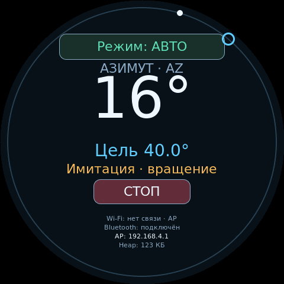

# CrowPanel 2.1: экран, энкодер и сеть

Профиль `crowpanel_21` предназначен для Elecrow **DHE03921D**: ESP32-S3, Flash 16 МБ, OPI PSRAM 8 МБ, круглый ST7701 480×480. Подключены экран, энкодер, сенсорные кнопки «Режим» и СТОП и существующие сетевые сервисы прошивки. Адаптер поворотки отсутствует: GPIO двигателя и ADC не используются. По умолчанию включена **имитация привода 13,4°/с** (`CROWPANEL_SIMULATION=1`); экран, веб и протоколы видят одни и те же моделируемые положения.

На экране: выбранная ось AZ/EL, текущий угол, целевой угол, ручной/автоматический режим (включая «авто на час»), Wi-Fi/точка доступа, Bluetooth, IP и свободная **внутренняя heap** в КиБ. Название модели на экране не выводится. Строки Wi-Fi, Bluetooth, IP и heap используют шрифт 11 пикселей вместо 22. PSRAM не прибавляется к heap. Моделируемое движение явно обозначено строкой «Имитация». Каждый шаг ручки сразу обновляет рабочую цель и запускает либо продолжает движение в любом режиме, без нажатия; ожидающая внешняя команда в ручном режиме обозначена «Ожидание». После локальной команды или принятия внешней команды в авто обе оси движутся независимо со скоростью 13,4°/с и останавливаются точно на своих целях. СТОП удерживает достигнутое положение; известная старая цель не запускает движение повторно. После загрузки моделируемые положения равны нулю.



По внешней окружности движутся маркеры выбранной оси: светлый заполненный кружок — текущее положение, голубое кольцо — цель (в том числе выбранная энкодером или ожидающая подтверждения). При совпадении углов видны оба маркера. Отсчёт от верха по часовой стрелке: 0° сверху, 90° справа, 180° снизу, 270° слева; 450° совпадает с 90°, а числовое поле сохраняет полный угол. Без заданной цели скрыто целевое кольцо.

`CROWPANEL_SIMULATION=0` возвращает режим без привода: движение блокируется (`crowpanel_no_drive`), вместо текущего угла показано «—», текущий маркер скрыт. Включение имитации не назначает моторных выводов и не требует физической калибровки.


## Энкодер и сенсор

- Поворот: каждый щелчок сразу изменяет рабочую цель на 20°, в пределах AZ 0…360/450° или EL 0…180°, включая вращение во время движения. Ось доезжает до последней цели без нажатия. Шаг считается от активной цели, после достижения или СТОП — от текущего положения. Работает в ручном и авто.
- Инверсия энкодера включена по умолчанию. Веб → «Поворотка и логгеры» → «Инверсия энкодера» → «Сохранить настройки». Значение сохраняется в `forkcfg/encinv`; отсутствие ключа означает включённую инверсию. API: `encoderInverted=true/false` в `/api/settings`.
- Короткое нажатие при движении — пауза с запоминанием незавершённых целей. Следующее короткое нажатие продолжает к ним после отпускания и интервала двойного нажатия 350 мс. Вращение сразу отправляет цель, дополнительное подтверждение не требуется. Новая ожидающая внешняя цель имеет приоритет.
- Двойное нажатие с интервалом до 350 мс: AZ/EL; у G-800DXA остаётся AZ. Одиночное подтверждение откладывается на этот интервал, чтобы двойное нажатие не запускало движение.
- Удержание 1,2 с: СТОП и переключение ручной/авто с сохранением режима. Авто на час, выбранное через веб, также отображается.
- Сенсорная кнопка «Режим»: одним касанием переключить ручной/авто с сохранением режима; перед переключением выполняется СТОП и отменяется незавершённое нажатие энкодера. Удержание пальца не повторяет переключение. «Авто на час» переключается в ручной режим.
- Сенсорная кнопка СТОП останавливает движение и отменяет возобновление ручкой. Обе кнопки подсвечиваются при касании. Меню настроек и экранная калибровка в этот этап не входят; используется существующий веб-интерфейс.

Энкодер использует два допустимых перехода квадратуры на щелчок, как исправленная реализация `uedx_rotator`. Ошибка чтения PCF8574 отменяет жест и выдаёт СТОП; восстановление требует устойчивого отпускания кнопки. Удержанная при включении кнопка не считается новым нажатием. Изменение модели, диапазона или внешний СТОП отменяют отложенное подтверждение кнопкой.

## Сборка

```sh
pio run -e crowpanel_21
# Или через общий скрипт выбора зависимостей:
python3 tools/build_platformio.py --env crowpanel_21
```

Дополнительная библиотека — **LVGL 9.6.0**; Arduino-ESP32 **3.3.11**, pioarduino **55.03.311** совпадают с остальным проектом. Используется существующая таблица `partitions_s3.csv`. Окружение выбирает `BOARD_CROWPANEL_21`, `DISPLAY_CROWPANEL_21`, `USER_BUTTON_GPIO=-1`, отключённый Bluetooth. Обычный `BOARD_AUTO` по чипу S3 не может отличить CrowPanel от DevKit: профиль нужно выбирать явно.

Arduino CLI:

```sh
arduino-cli lib install 'lvgl@9.6.0'
./tools/build_arduino.sh crowpanel
```

Скрипт готовит копию скетча, выбирает ESP32S3 Dev Module, Flash 16 MB, OPI PSRAM, Hardware CDC/JTAG и Custom partitions, передаёт флаги CrowPanel и путь к `lv_conf.h`. Для ручной сборки в IDE нужны те же флаги и доступность `lv_conf.h` при компиляции самой библиотеки LVGL; обычного выбора ESP32S3 Dev Module недостаточно. Используйте CLI-скрипт или PlatformIO для воспроизводимой конфигурации.

## Подключения

| Назначение | GPIO / адрес |
|---|---|
| I²C SDA / SCL | 38 / 39 |
| Энкодер A / B | 42 / 4, pull-up |
| Кнопка энкодера | PCF8574 0x21, P5, LOW |
| Подсветка | 6, включается после первого кадра |
| LCD CS / SCK / SDA | 16 / 2 / 1 |
| LCD DE / VSYNC / HSYNC / PCLK | 40 / 7 / 15 / 41 |
| RGB data0…15 с компенсацией BGR | 46, 3, 8, 18, 17, 14, 13, 12, 11, 10, 9, 5, 45, 48, 47, 21 |
| Питание / reset LCD | PCF8574 P3 / P4 |
| Touch reset / INT | PCF8574 P0 / P2 |
| Сенсор CST8xx | I²C 0x15 |
| USB Serial/JTAG | 19 / 20 |
| Внешний GS-232 UART RX / TX | 44 / 43, 9600 бод |

Обычная распиновка `board_s3.hpp` несовместима с этой платой. Сборка CrowPanel с другим дисплеем, обычной кнопкой GPIO или интерфейсами SEPARATE_PWM/BTS7960 отклоняется. PCF8574 всегда оставляет P5 и P2 входами: считанный уровень не записывается обратно в защёлку.

Bluetooth по умолчанию отображается как «выкл». ESP32-S3 не предоставляет Bluetooth Classic SPP. При необходимости существующий внешний HC-05 можно включить через `build_platformio.py --env crowpanel_21 --bluetooth 1`: RX44/TX43 займёт HC-05 вместо внешнего GS-232 UART, STATE — GPIO0. Нативный USB сохраняется. Подключение STATE к загрузочному GPIO0 требует отдельно согласованной проводки; этот вариант не нужен для текущего этапа и физически не проверен.

## Драйвер и границы проверки

Последовательность ST7701 type5, RGB-тайминги 12 МГц и 4/20/10, перестановка R/B, PCF8574, декодер энкодера и декодер CST8xx перенесены из `uedx_rotator`. Исходная последовательность Elecrow: [официальный репозиторий, ревизия 52c7721](https://github.com/Elecrow-RD/CrowPanel-2.1inch-HMI-ESP32-Rotary-Display-480-480-IPS-Round-Touch-Knob-Screen/tree/52c772195033bf0c08568fa21cfc8606bac75df0). Шрифты DejaVu также взяты из `uedx_rotator`; [лицензия](licenses/DejaVu.txt) сохранена.

Два RGB565 framebuffer по 460 800 байт расположены в PSRAM. LVGL использует `DIRECT` и рисует изменённые области в задний буфер; EDMA читает передний напрямую, без процессорного заполнения bounce-буферов. После последней области кадра IDF синхронизирует кеш и переключает DMA. Прошивка ожидает два VSYNC после передачи кадра, прежде чем разрешить LVGL переиспользовать прежний буфер: это покрывает гонку с первым прерыванием и предварительным чтением DMA-дескрипторов. Первый рендер выполняется во второй буфер, так как DMA начинает с первого. Пиксельная частота снижена до 8 МГц; интервалы 4/20/10 и полярности сохранены.

Неизменившиеся поля не перерисовываются. LVGL, опрос I²C и контроллер работают в одной Arduino loop-задаче; прерывания энкодера только накапливают шаги. При пропадании VSYNC ожидание ограничено 150 мс: дисплей выключает подсветку и прекращает обновления, сетевой контроллер продолжает работу. Счётчики кадров и ошибок доступны через H5. Программная синхронизация не доказывает отсутствие визуальных артефактов: результат нужно наблюдать на панели, в том числе при сохранении режима и настройке Wi-Fi.

Предыдущий вариант использовал bounce-буферы, как `uedx_rotator`, но стандартный Arduino SDK имеет кеш 32 КиБ/32 байта и не включает PSRAM XIP. Это отличает его от проверенного пользователем варианта `uedx_rotator` с XIP и кешем 64 КиБ/64 байта. Задержки заполнения bounce-буферов могут давать сдвиг и мерцание; XIP нельзя включить флагом скетча поверх готовых библиотек SDK. Поэтому выбран прямой EDMA с двумя кадрами и меньшей частотой. Ограничения обоих режимов описаны в [документации Espressif](https://docs.espressif.com/projects/esp-idf/en/v5.5.2/esp32s3/api-reference/peripherals/lcd/rgb_lcd.html). Аппаратный underrun непосредственно не измерялся.

В UI v4 используется локальная копия RGB-драйвера ESP-IDF 5.5.5 с отключённым `CONFIG_LCD_RGB_RESTART_IN_VSYNC`. В поставляемом SDK этот параметр включён, а на ESP32-S3 дескриптор принудительного перезапуска указывает на первый framebuffer. Поэтому такой перезапуск мешает нормальному чередованию двух кадров: DMA снова читает первый буфер, который LVGL уже может обновлять. Локальный драйвер продолжает обычную DMA-цепочку без этого перезапуска. Все его публичные имена имеют префикс `crowpanel_`; другие дисплеи используют штатный драйвер. При обновлении ESP-IDF требуется пересмотр этой правки. Источник, лицензия и точные изменения описаны в [заметке о драйвере](licenses/crowpanel-rgb-driver.md).

Нативный USB CrowPanel теперь принимает существующие GS-232/Hamlib-команды, `H4` (внутренняя heap, PSRAM, сеть) и `H5` (точные положения, счётчики VSYNC/кадров/таймаутов). Только при включённой имитации команда `SIM 33 16.5` на нативном USB задаёт локальную цель AZ=33°, EL=16,5° для проверки; `S` останавливает обе оси. Внешние числовые GS-232-команды в ручном режиме по-прежнему требуют подтверждения.

Настольные проверки:

```sh
./tools/build_native.sh
python3 tools/check_profiles.py
python3 -m unittest discover -s tests -p test_build_config.py
LVGL_DIR=/path/to/lvgl-9.6.0 ./tools/check_crowpanel_ui.sh
```

Последняя команда рендерит настоящий код UI в `build/crowpanel-preview/*.ppm`, включая отдельный макет с демонстрационным текущим углом, и проверяет отсутствие перерисовок при неизменных данных. Это проверка разметки, а не чтение положения с платы. Сборка и тесты не подтверждают физическое изображение, направление ручки, касания, стабильность Wi-Fi и runtime heap.

## Результат проверки 16 октября 2026

- PlatformIO: CrowPanel, S3 без дисплея и классический ESP32 со встроенным SPP — успешные сборки. Для проверки использован локальный кеш закреплённой платформы 55.03.311.
- CrowPanel PlatformIO: приложение 1 630 831 байт по отчёту линкера, статическая RAM 62 500 байт; слот приложения 6 553 600 байт. Файл `firmware.bin` — 1 651 648 байт.
- Arduino CLI, тот же исходный код и Arduino-ESP32 3.3.11: приложение 1 592 491 байт, статическая RAM 62 308 байт. Ядро из локального кеша зарегистрировано как `fork:esp32`; использованы стандартные настройки ESP32S3 Dev Module.
- 105 положительных/отрицательных проверок профилей и 8 тестов конфигурации; тесты энкодера, восстановления после ошибки кнопки, декодера касаний и запрета моторных/ADC GPIO; рендеринг LVGL и 100 обновлений неизменного экрана без перерисовки.

Локальные бинарники, хеши исходников и журнал сборки: `artifacts/crowpanel_21/manifest.json`, `SHA256SUMS`, `firmware.bin`. Отдельная Arduino-сборка находится в `artifacts/arduino-crowpanel/`. Эти файлы не включены в Git.

По отдельному указанию пользователя CrowPanel прошита без резервной копии. Проверены ESP32-S3, Flash 16 МБ, встроенная PSRAM 8 МБ и соответствие бинарников текущим исходникам. При переходе с `uedx_rotator` записаны загрузчик, новая таблица разделов, OTA-селектор и приложение; `verify-flash` подтвердил все четыре области. SHA-256 приложения: `1b1f079132543a41e68a1163790e649f584282752c0731e5ad7309f38f88957c`.

USB-журнал подтверждает завершение запуска, инициализацию ST7701 и энкодера, профиль `drive=NONE`, Bluetooth `NONE` и запуск AP `G5500-Rotator` на `192.168.4.1`. За 30 секунд наблюдения panic и повторных загрузок не обнаружено. Пространства настроек G5500 при первом запуске отсутствовали (`Preferences: NOT_FOUND`); сохранённой сети STA нет. Для настройки Wi-Fi нужно подключиться к открытой точке `G5500-Rotator` и открыть `http://192.168.4.1/`.

Журналы записи, проверки и запуска: `artifacts/flashing/crowpanel_21-g5500-2026-10-16/`. Физическое изображение, жесты энкодера и касания требуют проверки на панели; runtime heap и доступность HTTP с клиента AP пока не измерены.

### Обновление UI: маркеры, шаг 10° и кнопка режима

Повторная сборка CrowPanel: приложение 1 635 567 байт по отчёту линкера, статическая RAM 62 524 байта. Бинарники и хеши соответствующих исходников сохранены отдельно в `artifacts/crowpanel_21-ui-v2/`; первая сборка сохранена в прежнем каталоге.

Тесты подтверждают шаг энкодера 10°, ограничения диапазона, однократное переключение режима при удержании касания, отмену отложенного подтверждения при смене режима и блокировку движения без привода. Настольный рендер LVGL проверяет маркеры в четырёх направлениях, перекрытие при одинаковых углах, угол 450°, скрытие недостоверных значений, подсветку кнопки и отсутствие лишней перерисовки. Обновлённые изображения выше получены из реального кода UI.

Обновление записано без бэкапа только в раздел приложения `0x10000`; NVS и загрузочные компоненты не записывались. Перед обновлением проверено соответствие загрузчика и таблицы разделов, после записи выполнен `verify-flash`. SHA-256 приложения: `32a2d1cd5ea8617dc49249bd2db81d57328f657e773e45afa7b4e7bbffa147d8`. USB-журнал подтверждает один успешный запуск, инициализацию дисплея и AP, отсутствие panic и повторных загрузок за 30 секунд. Журналы: `artifacts/flashing/crowpanel_21-ui-v2-2026-10-16/`. Физическое отображение и касания пока не подтверждены пользователем.

### Обновление UI v3: прямой EDMA и имитация привода

После сообщения пользователя о сдвиге изображения вверх и артефактах заменён режим передачи RGB, как описано выше; добавлены шаг 20° и имитация движения. Сборка: приложение 1 652 823 байта по отчёту линкера, статическая RAM 63 084 байта. Файл приложения — 1 673 792 байта, SHA-256 `8c954c62819d6f620bfeeea83dc430b0838024ab1641811d623450d846ac8224`. Только приложение записано без бэкапа, `verify-flash` успешно; NVS не записывалась. Бинарники и соответствующие исходникам хеши: `artifacts/crowpanel_21-ui-v3/`.

Полный native-набор, 8 тестов конфигурации, 105 проверок профилей и рендер LVGL в обоих режимах (`PARTIAL` и `DIRECT`) прошли. Тесты имитации покрывают скорость, точное достижение цели, СТОП, ожидание внешней цели в ручном режиме, авто, реверс, пределы и переполнение millis. Отдельно проверено отсутствие моторных/ADC-вызовов как с имитацией, так и без неё.

На физической CrowPanel через USB выполнены цель AZ=33°/EL=16,5°, движение к 90°/90° со СТОП и удержанием положения, возврат к нулю. Измеренная по времени платы скорость — **3,3002°/с**. За 33,3 с получено 257 обновлений кадра, ноль таймаутов VSYNC; максимальное ожидание границ кадров 66 871 мкс. Перед/после нагрузки внутренняя свободная heap 216 848/216 536 байт, минимум 209 432, наибольший блок 176 116 байт. PSRAM: всего 8 388 608, свободно до/после 7 455 924, минимум 7 450 800, наибольший блок 7 340 020 байт. Ошибок выделения памяти и panic нет. Тест завершён с обеими осями на 0° и остановкой.

Журналы и измерения: `artifacts/flashing/crowpanel_21-ui-v3-2026-10-16/`. Нулевая статистика таймаутов подтверждает работу синхронизации, но не является визуальной проверкой изображения или прямым счётчиком underrun. Пользователь подтвердил: изображение по центру, но в обновляемых местах остаются артефакты. Поэтому v3 не считается исправлением артефактов; следующий вариант меняет RGB-драйвер.

### Обновление UI v4: исправление чередования кадров

В локальном RGB-драйвере отключён принудительный перезапуск с первого framebuffer. После прошивки пользователь подтвердил: **артефакты исчезли, изображение по центру**. Шаг энкодера 20°, имитация 3,3°/с, маркеры и сенсорная кнопка режима сохранены.

PlatformIO и Arduino CLI собрали CrowPanel успешно; отдельно прошли сборки обычных S3 и ESP32 и 8 тестов конфигурации. ELF использует функции `crowpanel_esp_lcd_*`. Приложение занимает 1 653 063 байта по отчёту линкера, статическая RAM — 63 084 байта. Файл приложения: 1 674 032 байта, SHA-256 `128bbbf14bb60e612aa88d8f6af4637f82fecf935661e25dae812df724ca9ed7`. Записано только приложение по `0x10000`, без бэкапа по указанию пользователя; загрузчик и таблица разделов предварительно сверены, `verify-flash` прошёл. Раздел настроек не записывался.

На плате повторены движение к AZ=33°/EL=16,5°, СТОП с удержанием и возврат к нулю. Скорость **3,2998°/с**, цели достигнуты точно. За 33,3 с — 257 обновлений кадра, ноль таймаутов, максимальное ожидание VSYNC 66 728 мкс. Перед/после основного теста внутренняя heap свободна на 216 448 байт, минимум 209 284, наибольший блок 176 116 байт. PSRAM: всего 8 388 608, свободно 7 455 924, минимум 7 450 800, наибольший блок 7 340 020 байт. Ошибок выделения памяти и panic не обнаружено. В конце обе оси остановлены на 0°.

Первый запуск проверочного скрипта застал уже изменённое пользователем положение и не смог измерить скорость в рассчитанном интервале. Его журнал сохранён отдельно; повторный тест сначала вернул оси к нулю и прошёл полностью. Бинарники, хеши исходников и журналы сборок: `artifacts/crowpanel_21-ui-v4/`; прошивка и проверка платы: `artifacts/flashing/crowpanel_21-ui-v4-2026-10-16/`. Эта проверка не включает длительную работу при сохранении настроек и подключении STA к роутеру.


### Обновление UI v5: компактные статусы, скорость и управление

Название модели убрано с панели. Wi-Fi, Bluetooth, IP и heap переведены с DejaVu Sans 22 px (строка 26 px) на 11 px (строка 13 px). Скорость имитации повышена до 13,4°/с. Шаг энкодера остаётся 20°. Из покоя вращение запускает движение сразу; во время движения вращение выбирает следующую цель, нажатие подтверждает её без СТОП. Если нового выбора нет, нажатие останавливает. Кнопка СТОП и переключение режима отменяют выбор. Инверсия включена по умолчанию и доступна в веб-настройках с сохранением `forkcfg/encinv`.

Проверены полный native-набор, 8 тестов конфигурации, рендер LVGL PARTIAL/DIRECT, сборки PlatformIO и Arduino CLI. Тесты контроллера покрывают запуск без нажатия, выбор во время движения, подтверждение без СТОП, отпускание без повторного действия, отмену выбора, инверсию и её сохранение/загрузку через типизированный NVS. Браузерный тест `tools/check_crowpanel_web.cjs` проверяет реальную HTML-форму с подставным API: видимость настройки только на CrowPanel, отправку обоих значений и восстановление состояния формы после загрузки.

PlatformIO: приложение 1 660 667 байт, статическая RAM 63 084 байта. Arduino CLI: 1 622 467 / 62 884 байта соответственно. Записан файл приложения 1 681 648 байт, SHA-256 `ec0f1130c682a70fa876e38b0a54b3e073ea84715cd7fb9e3238f7bd309379e0`. Прошивка без бэкапа, только `0x10000`; `verify-flash` прошёл, раздел настроек не записывался. Бинарники и хеши: `artifacts/crowpanel_21-ui-v5/`; журналы платы: `artifacts/flashing/crowpanel_21-ui-v5-2026-10-16/`.

На физической плате по H5 подтверждены `sim=1`, `inv=1` и скорость **13,4001°/с**. Цели AZ=134°/EL=67° достигнуты точно; СТОП удерживает положение, возврат к 0°/0° завершён. За 33,3 с — 257 обновлений кадра, ноль таймаутов, максимальное ожидание 66 443 мкс. Внутренняя heap перед/после основного теста 216 816 байт, минимум 209 644, наибольший блок 176 116. PSRAM свободно 7 455 924 байта, минимум 7 450 800. Ошибок выделения памяти не обнаружено. Первый тест прервался при переподключении USB; причина не установлена. Повторный тест прошёл без сброса и повторной прошивки. Жесты физического энкодера и внешний вид v5 отдельно пользователем пока не подтверждены.


### Обновление UI v6: достижение последней цели энкодера без нажатия

Исправлена ошибочная семантика v5: при серии щелчков первая цель запускала движение, а следующие оставались только в локальном выборе. Например, пять шагов показывали выбор 100°, но рабочая цель оставалась 20°. Это не ошибка скорости или порога остановки. Теперь каждый щелчок сразу передаётся в контроллер, включая вращение во время движения; экран и маркер показывают рабочую цель. Нажатие после изменения энкодером повторно подтверждает её без СТОП, следующее нажатие без вращения останавливает. После достижения цели или замены другой командой старое подтверждение не воспроизводится.

Регрессионный тест серии щелчков без нажатия воспроизвёл ошибку до исправления и прошёл после него: обе оси, оба направления, ручной/авто. Проверены жесты, СТОП, отсутствие повторной остановки при отпускании, отмена устаревшего подтверждения, инверсия, сохранение настроек и прежние проверки имитации 13,4°/с. Рендер LVGL PARTIAL/DIRECT, PlatformIO и Arduino CLI прошли. Изменения ограничены энкодером и его отображением; драйвер RGB и расчёт движения не менялись.

PlatformIO: приложение 1 660 591 байт, статическая RAM 63 084 байта. Arduino CLI: 1 622 395 / 62 884 байта. Файл приложения 1 681 568 байт, SHA-256 `a2f730fb3cd6230998c583d5fc75366aa657e62e9fa30eab0199ce03173c2ac1`. Бинарники и хеши исходников: `artifacts/crowpanel_21-ui-v6/`; журналы: `artifacts/flashing/crowpanel_21-ui-v6-2026-10-16/`.

Прошито без бэкапа, только приложение; проверка записи и загрузка прошли. Пользователь подтвердил достижение последней цели без нажатия. Во время 60-секундного наблюдения по USB без команд движения зарегистрированы изменения цели от 80° до 240°, обратные изменения до 160° и конечная цель 200°. Финал: AZ=200,000°, цель AZ=200,000°, EL=0°, движение остановлено. Инверсия включена. Таймаутов дисплея и ошибок выделения памяти нет; внутренняя heap в конце 216 752 байта, минимум 209 608, наибольший блок 176 116; PSRAM свободно 7 455 924. Журнал и все отсчёты сохранены в `encoder-observation.log/json`.


### Обновление UI v7: продолжение после паузы ручкой

Нажатие ручки, которое останавливает движение, запоминает цели только незавершённых отслеживаемых осей. Повторное короткое нажатие продолжает к ним с текущего положения. Возобновление распознаётся после отпускания и 350 мс ожидания второго щелчка, поэтому удержание не запускает движение, а двойное нажатие сохраняет выбор оси. Подтверждение цели первым нажатием после вращения энкодера сохранено. Новое вращение, сенсорный/внешний СТОП, смена оси/инверсии, переключение режима сенсором или удержанием и ошибка I²C отменяют сохранённое продолжение. Новая внешняя цель имеет приоритет. Пауза не сохраняется при перезагрузке.

Проверены жесты паузы/возобновления, остановка обеих осей, удержание, двойное нажатие и отмена внешним СТОП; в имитации — неподвижность во время паузы и точное достижение исходных целей AZ=100°/EL=50° после возобновления в ручном и авто. Прежние проверки скорости, энкодера и настроек проходят. Сборка PlatformIO успешна: приложение 1 660 823 байта, статическая RAM 63 100 байт. Файл приложения 1 681 792 байта, SHA-256 `a974914c61c64cd67b3003ccf1345826587a6ad082a9e2bc904f9ece0b0bf9a0`. Бинарники: `artifacts/crowpanel_21-ui-v7/`; журналы платы: `artifacts/flashing/crowpanel_21-ui-v7-2026-10-16/`.

### Обновление UI v8: одно нажатие для паузы

Удалено повторное подтверждение уже отправленной энкодером цели: оно поглощало первое нажатие после вращения. Теперь первое короткое нажатие останавливает движение, следующее продолжает к сохранённой цели. Продолжение распознаётся после отпускания и 350 мс; двойной щелчок и удержание сохраняют прежние функции.

Прошли нативные тесты жестов и имитации, включая первое нажатие сразу после изменения цели, неподвижность во время паузы и точное достижение цели после продолжения. Сборка PlatformIO: приложение 1 660 651 байт, статическая RAM 63 092 байта. Бинарники и исходные SHA-256: `artifacts/crowpanel_21-ui-v8/manifest.json`.

Записано без бэкапа только приложение; verify-flash успешен. За 30 с загрузка завершилась без panic, дисплей и Wi-Fi запущены. Короткое чтение H4/H5 зафиксировало паузу и продолжение движения с прежней целью; количество физических нажатий этим не проверяется. Таймаутов кадров и ошибок выделения памяти нет. Внутренняя heap 211 932 байта, свободная PSRAM 7 455 924 байта. Физическая работа одиночного нажатия требует подтверждения пользователя. Журналы: artifacts/flashing/crowpanel_21-ui-v8-2026-10-16/.
