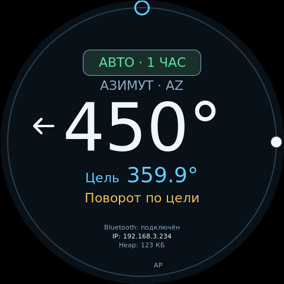
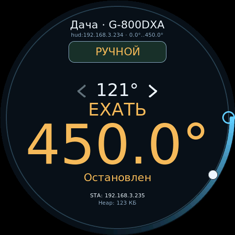

# CrowPanel 2.1: экран и управление

[Документация](index.md)

Профиль `crowpanel_21` предназначен для Elecrow **DHE03921D**: ESP32-S3, Flash 16 МБ, OPI PSRAM 8 МБ, круглый ST7701 480×480.

Для переделанной платы с GPIO6/P48 вместо управления подсветкой доступен [локальный привод AZ: Yaesu G-800DXA или BTS7960](crowpanel-az.md), профиль `crowpanel_21_az`. Описанные ниже ограничения местных выходов относятся к обычному профилю `crowpanel_21`.

## Режим работы

Для управления реальной повороткой выберите в вебе роль **HUD — удалённый пульт** и добавьте контроллер возле двигателя по [инструкции HUD](hud.md). CrowPanel показывает полученные от него положения и передаёт команды по Wi-Fi или UART. Датчики и двигатели к CrowPanel не подключаются.

В роли локального контроллера по умолчанию включена **имитация привода с регулировкой скорости до 13,4°/с** (режим выбирается в веб-настройках оборудования). Экран, веб и протоколы показывают одинаковые моделируемые положения. Калибровка не требуется; после загрузки обе оси находятся на 0°. STOP удерживает достигнутое положение. Обычная плата не имеет свободного ADC1 для физического привода: неполная или конфликтующая распиновка отклоняется. Настройка имитации не влияет на управление удалённой повороткой в роли HUD.

## Экран

В центре показаны текущие углы, цель и режим. Для G-5500 азимут всегда слева, элевация справа; выбранная ось выделяется крупным шрифтом. Для G-800DXA доступен только азимут. Серые стрелки около текущих углов служат кнопками ручного движения; направление движения подсвечивается белым. При выборе «С подтверждением» для протокола в ручном режиме внешняя цель появляется крупно под словом **«ЕХАТЬ»**. Коснитесь этой надписи или угла для подтверждения.

В роли HUD сверху показаны имя выбранной поворотки и адрес её контроллера. Внизу находятся состояние Bluetooth, IP и свободная внутренняя память в КиБ. При слабом Wi-Fi (−80 dBm и ниже) появляется жёлтый значок, без соединения — красный перечёркнутый. Метка AP означает включённую точку доступа. Строка Bluetooth скрыта, если он выключен в настройках. Строка «Имитация» обозначает моделируемое движение.


Светлый заполненный маркер на окружности показывает положение, голубое кольцо — цель. Отсчёт идёт по часовой стрелке: 0° сверху, 90° справа, 180° снизу, 270° слева. В диапазоне 450° положения 90° и 450° совпадают на кольце; числовое поле сохраняет полный механический угол.



При расстоянии менее 120° до упора появляется красная полоса с внутренней стороны кольца. Она показывает недоступное направление и становится ярче при приближении к упору. Голубая полоса снаружи аналогично показывает близость выбранной цели к упору. Ограничения учитывают [настроенный диапазон](az-range.md) выбранной оси, включая произвольные AZ и EL.




## Энкодер и сенсор

| Действие | Локальный контроллер с имитацией | HUD |
|---|---|---|
| Поворот ручки | Изменить цель выбранной оси на 20° за щелчок и сразу начать движение | Отправить новую цель выбранной поворотке с шагом 20° |
| Короткое нажатие во время движения | Остановить при обнаружении нажатия и запомнить незавершённые цели | Отправить STOP после отпускания и запомнить незавершённые цели |
| Следующее одиночное нажатие после паузы | Продолжить к сохранённой цели | Продолжить к сохранённой цели удалённой поворотки |
| Короткое нажатие при ожидающей внешней цели | Подтвердить цель | Подтвердить цель выбранной поворотки |
| Двойное нажатие в покое, интервал до 350 мс | Переключить AZ/EL | Переключить AZ/EL |
| Удержание 1,2 с | STOP и переключение ручного/автоматического режима | При двух устройствах выбрать другое; при трёх и более открыть список |
| Касание кнопки режима | STOP и переключение ручного/автоматического режима | Переключить режим выбранной поворотки |

Одиночное подтверждение и продолжение после паузы распознаются после отпускания и ожидания 350 мс для второго нажатия. Для G-800DXA переключения оси нет. В HUD удержание не останавливает движение; для STOP используйте короткое нажатие или веб. Отдельной сенсорной кнопки STOP на панели нет.

Каждый щелчок ручки сразу передаёт новую цель, включая вращение во время движения. После достижения цели или STOP отсчёт начинается от текущего положения. Внешний STOP, новый выбор устройства и новая команда могут отменить сохранённое продолжение; ожидающая внешняя цель имеет приоритет. Пауза не сохраняется после перезапуска.

В HUD коснитесь имени поворотки для выбора устройства. При двух сохранённых устройствах касание переключает на другое, при трёх и более открывает список. В списке вращайте ручку и подтвердите коротким нажатием; касание верхней/нижней строки перемещает выделение, средней — подтверждает выбор.

Инверсия энкодера включена по умолчанию. Для изменения откройте веб → «Поворотка и привод» → «Инверсия энкодера» и сохраните настройки. Калибровка, пресеты и настройки доступны через веб; для HUD параметры привода меняются на контроллере возле двигателя.

## Установка цели по кольцу

Коснитесь внешнего кольца, чтобы сразу задать цель выбранной оси. Ведите палец
по кольцу без отрыва: цель обновляется при каждом изменении угла с шагом 1°.
После отпускания сохраняется последняя заданная цель. Для AZ выбирается
ближайший допустимый механический угол. Для EL действует тот же выбор
в её диапазоне: например, касание 340° задаёт −20° при диапазоне −30…210°.
Углы и упоры задаются в [настройке диапазонов](az-range.md).
При открытом списке повороток кольцо не задаёт цель.

Начинайте касание на свободной части кольца. До отпускания оно остаётся
установкой цели, даже при проходе над кнопками. При выходе с кольца цель
сохраняется; верните палец на кольцо, чтобы продолжить её менять.

## Тап по цели

Короткий тап по всей строке «Цель …» или блоку «ЕХАТЬ …» запускает обе доступные
цели. По каждой оси ожидающая внешняя цель имеет приоритет над последней
принятой. Цель неизвестной оси не подставляется нулём. Подтверждение ожидающей
последовательности сохраняет её последующие точки.

Действие выполняется при отпускании пальца; смещение более 12 px переводит
касание в ручное управление скоростью обеих осей.
Ручное управление сохраняет принятые цели: после отпускания их можно снова
запустить тапом по строке цели.

## Ручное движение

Серые шевроны около текущей позиции служат кнопками удержания. Влево/вправо
всегда управляют азимутом, вверх/вниз — элевацией. Направления фактического
движения подсвечены белым; две оси могут подсвечиваться одновременно.
Удержание стрелки задаёт настроенную рабочую скорость её оси, отпускание
останавливает её. Зоны стрелок не меньше 44×44 px.

Нажатие на строку текущих углов или цели с последующим смещением пальца управляет
скоростью обеих осей. Горизонталь соответствует AZ, вертикаль — EL, даже когда
EL показана крупнее. Мёртвая зона каждой координаты — 12 px; от 12 до 100 px
скорость линейно растёт до настроенной рабочей скорости данной оси. На приводе
без регулировки скорости выход из мёртвой зоны включает постоянную скорость.

Жест перехватывает только затронутые оси. Возврат в мёртвую зону останавливает
захваченную ось; отпускание — все оси этого жеста. Оси, не затронутые жестом,
продолжают прежнюю задачу. Начатый свайп удерживается до отпускания по всему
экрану: проход над стрелками, кнопкой режима, именем поворотки и внешним кольцом
продолжает ручное управление. Смещение отсчитывается от места начала касания;
переведите палец через него к противоположному краю, чтобы изменить направление.

Для ручного управления через HUD обновите оба устройства. При потере связи
контроллер прекращает ручное движение этого источника не позднее чем через 1 с;
правила числового наведения — в [инструкции HUD](hud.md#обрыв-связи-и-нагрузка).

## Сборка

Выберите `crowpanel_21` в [инструкции сборки](build.md), для переделанного локального AZ — `crowpanel_21_az`. `BOARD_AUTO` по чипу S3 не отличает CrowPanel от DevKit: профиль задаётся явно.

```sh
pio run -e crowpanel_21
```

Дополнительная библиотека — LVGL 9.6.0. Для Arduino CLI установите её командой `arduino-cli lib install 'lvgl@9.6.0'` и выполните `./tools/build_arduino.sh crowpanel`. Скрипт передаёт настройки платы и путь к `lv_conf.h`; одного выбора ESP32S3 Dev Module в IDE недостаточно. [Запись через USB](build.md#первая-прошивка-через-usb).

## Подключения

| Назначение | GPIO / адрес |
|---|---|
| I²C SDA / SCL | 38 / 39 |
| Энкодер A / B | 42 / 4, pull-up |
| Кнопка энкодера | PCF8574 0x21, P5, LOW |
| Подсветка | 6, включается после первого кадра |
| LCD CS / SCK / SDA | 16 / 2 / 1 |
| LCD DE / VSYNC / HSYNC / PCLK | 40 / 7 / 15 / 41 |
| RGB data0…15 с компенсацией BGR | 46, 3, 8, 18, 17, 14, 13, 12, 11, 10, 9, 5, 45, 48, 47, 21 |
| Питание / reset LCD | PCF8574 P3 / P4 |
| Touch reset / INT | PCF8574 P0 / P2 |
| Сенсор CST8xx | I²C 0x15 |
| USB Serial/JTAG | 19 / 20 |
| Внешний GS-232 UART RX / TX | 44 / 43, 9600 бод |

У DHE03921D V1.0 внешние TX **P38 / J10.4** и RX **P33 / J10.3** проходят через преобразователи с подтяжкой 10 кОм к **5 В**; выводы самого ESP32 работают с 3,3 В. Для подключения внешних UART 3,3 В нужен согласователь уровней. BOOT **P44 / J10.10** выведен непосредственно как GPIO0, только 3,3 В. Проверяйте ревизию и соединения по [официальной схеме Elecrow](https://github.com/Elecrow-RD/CrowPanel-2.1inch-HMI-ESP32-Rotary-Display-480-480-IPS-Round-Touch-Knob-Screen/tree/master/Eagle_SCH%26PCB).

Обычная распиновка `board_s3.hpp` несовместима с этой платой. Сборка CrowPanel с другим дисплеем отклоняется; отдельную кнопку и внешние сигналы можно назначить на свободные GPIO через [настройки оборудования](configuration.md#распиновка-gpio). Встроенные соединения экрана и органов управления остаются занятыми; для физической обратной связи обычной платы требуется переделка.

Bluetooth по умолчанию выключен, его строка на дисплее скрыта. ESP32-S3 не предоставляет Bluetooth Classic SPP. Внешний HC-05 включается в `/hardware`: назначьте HC-05 RX44/TX43/STATE0, а UART0 отключите парой `uartRx=-1`, `uartTx=-1`, чтобы освободить выводы. Нативный USB сохраняется. STATE подключён к загрузочному GPIO0: модуль не должен удерживать этот вывод в LOW при сбросе, иначе плата войдёт в загрузчик. При включённом HC-05 режим HUD UART недоступен, используйте сеть.

## Диагностика

Нативный USB принимает GS-232, команды положения Hamlib и диагностику. Отправьте `H4` для сведений о памяти и сети, `H5` — для положения и состояния дисплея. Завершайте команды CR или LF. Внешняя числовая цель в ручном режиме следует настройке соответствующего протокола: GS-232 либо rotctld / Hamlib. По умолчанию требуется подтверждение; можно включить автоследование в [настройках](usage.md#режимы).

В локальной имитации команда `SIM 33 16.5` задаёт цель AZ=33°, EL=16,5°; `S` останавливает обе оси. В роли HUD используйте обычные команды выбранной поворотки.

Если дисплей перестал обновляться или погас, проверьте доступность веба и сохраните ответы `H4`/`H5`. Ошибка дисплея не отключает сетевое управление. Ошибка чтения кнопки отменяет жест и отправляет STOP; после восстановления отпустите кнопку перед следующим действием.
