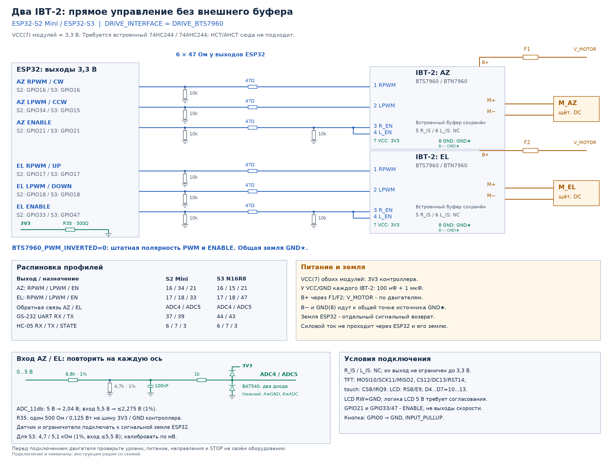
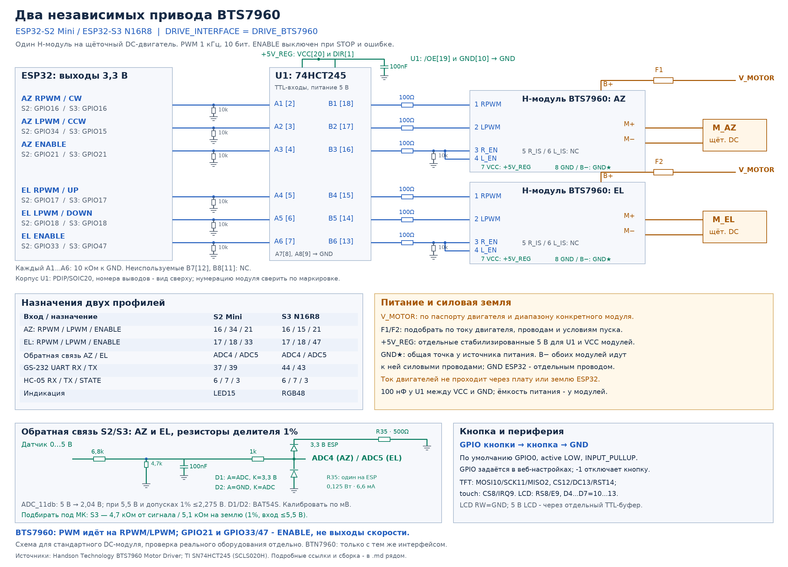
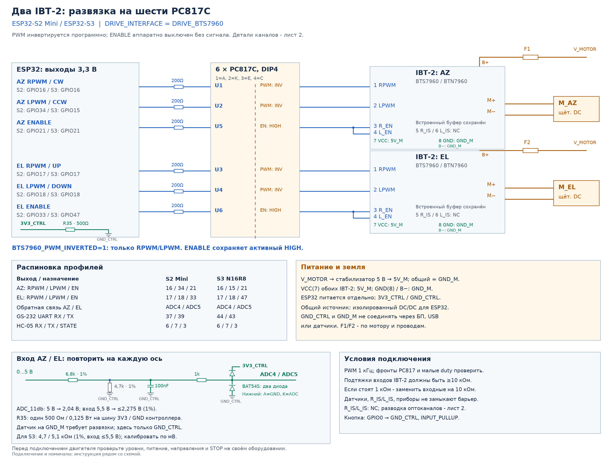
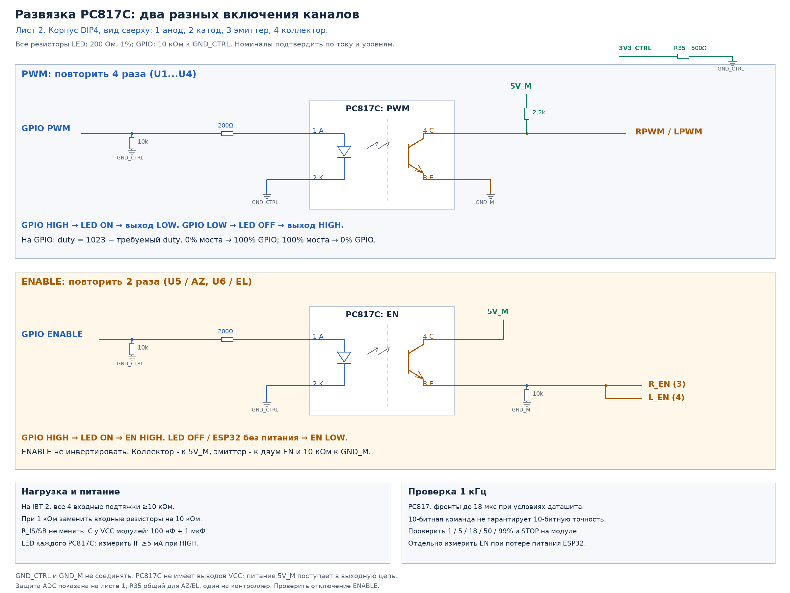

# Два независимых DC-привода BTS7960 / BTN7960

[Документация](../../index.md)

Руководство описывает подключение двух модулей IBT-2 к ESP32 для управления осями AZ и EL. На каждый двигатель нужен свой модуль. Силовое питание двигателей подаётся отдельно на B+ / B−; GPIO передают команды входной логике.

## Выбор подключения

| Вариант | Логическое VCC модулей | Внешний каскад | Режим PWM в настройках |
|---|---|---|---|
| [А. Прямое подключение](#вариант-а-прямое-подключение-33-в) | 3,3 В | Шесть последовательных резисторов и подтяжки | Прямое подключение PWM |
| [Б. Буфер 74HCT245](#вариант-б-74hct245-и-логика-5-в) | 5 В | Один 74HCT245 на шесть сигналов | Прямое подключение PWM |
| [В. Оптопары PC817C](#вариант-в-шесть-pc817c) | 5V_M на стороне двигателей | Четыре инвертирующих PWM и два неинвертирующих ENABLE | Инвертирующие оптроны RPWM / LPWM |

**PWM независимых приводов — 1 кГц, 10 бит. Вариант В с PC817C в каналах PWM рассчитан на эту частоту.**

Варианты А/Б имеют общую землю контроллера и модулей. Вариант В сохраняет гальваническую развязку только при разделённых питании, земле и обратной связи; требования приведены в его разделе. Номиналы резисторов и питание логики выбирайте по одному варианту.

Для CrowPanel с одной локальной осью используйте [отдельную инструкцию](../../boards/crowpanel-az.md): там другие точки подключения и обязательная инверсия BOOT. Для штатного блока Yaesu EXT CONTROL предназначено [руководство G-800DXA](../g800dxa/index.md).

## Модули и совместимость

Распиновка стандартного IBT-2 приведена в [Handson Technology, стр. 3–4](https://www.handsontec.com/dataspecs/module/BTS7960%20Motor%20Driver.pdf). Перед подключением проверьте на своей плате номера контактов, маркировку входного буфера, подтяжки и отсутствие связи VCC с другим источником питания.

| Контакт модуля | Назначение |
|---|---|
| 1 RPWM | PWM одного направления |
| 2 LPWM | PWM противоположного направления |
| 3 R_EN, 4 L_EN | Разрешение двух половин моста; объединить только внутри своей оси |
| 5 R_IS, 6 L_IS | Выходы контроля тока, в этих схемах NC |
| 7 VCC, 8 GND | Питание входной логики |
| B+, B− | Силовое питание |
| M+, M− | Свой двигатель |

RPWM/LPWM/R_EN/L_EN должны быть активными HIGH и проходить через неинвертирующий буфер модуля. Типовое исполнение содержит **74HC244 или 74AHC244**; он остаётся на модуле во всех вариантах.

74HC244 допускает 2…6 В, 74AHC244 — 2…5,5 В. В варианте А их выходы при питании 3,3 В подходят для BTN7960: максимальный порог HIGH составляет 2 В для IN и 2,15 В для INH. Платы с HCT/AHCT или иной входной схемой требуют отдельной проверки; VCC=3,3 В к ним автоматически не применяйте.

## Прошивка и GPIO

1. Соберите профиль своей платы по [инструкции сборки](../../build.md); для S2 Mini без дисплея можно использовать `python3 tools/build_platformio.py --env esp32s2_mini --display none`.
2. Откройте `/hardware` через **Настройки → Оборудование**. Выберите **BTS7960 / IBT-2**, физический привод и полярность PWM из таблицы вариантов. Сохраните и подтвердите конфигурацию после перезапуска по [процедуре оборудования](../../setup/configuration.md#применение-и-восстановление-доступа).
3. Выберите роль контроллера поворотки. В имитации и HUD локальные выходы не управляют двигателями.
4. Проверьте направления, откалибруйте обе оси и настройте остановку по механическому выбегу: [диапазоны и калибровка](../../setup/az-range.md), [регуляторы движения](../../setup/regulator-tuning.md).

| Сигнал | S2 Mini GPIO | S3 DevKit GPIO | Вход IBT-2 |
|---|---:|---:|---|
| AZ CW | 16 | 16 | RPWM(1) |
| AZ CCW | 34 | 15 | LPWM(2) |
| AZ ENABLE | 21 | 21 | R_EN(3) + L_EN(4) |
| EL UP | 17 | 17 | RPWM(1) |
| EL DOWN | 18 | 18 | LPWM(2) |
| EL ENABLE | 33 | 47 | R_EN(3) + L_EN(4) |

**GPIO21/33/47 — ENABLE, а PWM формируется на RPWM или LPWM.** ENABLE разных осей не объединяйте. У интерфейса SEPARATE_PWM эти GPIO имеют другое назначение: отдельные выходы скорости; его нельзя подключать по этой схеме. Распиновки других ESP32 и дисплеев находятся в [конфигурации](../../setup/configuration.md).

PWM работает на **1 кГц, 10 бит**. При движении активен один вход RPWM/LPWM; другой логически равен нулю. При загрузке, STOP и ошибке оба ENABLE выключены. Перед реверсом выход снижается до нуля; пауза по умолчанию — 300 мс. В серворежиме её можно изменить или отключить настройкой **Пауза реверса в серворежиме, мс**. Отказ инициализации LEDC блокирует движение до перезапуска: мосты отключаются, уже подключённые PWM обнуляются с учётом инверсии и снимаются.

В вариантах А/Б логические 0% соответствуют LOW GPIO. В варианте В прошивка инвертирует **только четыре PWM**, но не ENABLE: физическая команда GPIO равна `1023 − logicalDuty`. Логические 0% требуют HIGH GPIO, логические 100% — LOW. При загрузке с подтверждённой инверсией и после снятия LEDC PWM удерживается HIGH; при STOP/ошибке сначала выключаются ENABLE.

## Силовое питание и датчики

### Двигатели и возвраты тока

B+ каждого модуля подключите к V_MOTOR через **отдельный предохранитель F1/F2**, M+/M− — к своему двигателю. Напряжение, предохранители, провода и силовую ёмкость выбирайте по двигателям, пусковому току и конкретному модулю. Референсы предназначены для щёточных DC-двигателей; направление проверьте на механизме.

У VCC(7)/GND(8) каждого модуля поставьте 100 нФ и 1 мкФ рядом с платой, учитывая уже установленные ёмкости. Номинал VCC зависит от выбранного варианта и не равен силовому напряжению V_MOTOR.

В вариантах А/Б GND ESP32, GND(8) и B− соединяются в общей точке GND★ у источника. Силовые возвраты B− идут непосредственно к источнику; ток двигателей не должен проходить через ESP32 и сигнальные провода земли. В варианте В силовые возвраты относятся к GND_M; его отделение от GND_CTRL описано ниже.

**R_IS/L_IS оставьте неподключёнными.** Питание логики от 3,3 В не ограничивает напряжение этих выходов до 3,3 В; для подключения к ADC нужен отдельный расчёт.

### Обратная связь AZ и EL

На каждый датчик 0…5 В нужен свой делитель:

- 6,8 кОм от сигнала к узлу делителя, 4,7 кОм от узла на землю измерительного канала, оба 1%;
- 100 нФ от узла на ту же землю, затем 1 кОм к ADC4 (AZ) или ADC5 (EL);
- Schottky-ограничители у ADC: анод ADC / катод 3,3 В, анод GND / катод ADC, как на схеме с BAT54S.

Нижний диод ограничивает отрицательные выбросы, верхний отводит положительные выбросы в шину питания контроллера. На каждый вход нужен свой комплект ограничителей; размещайте их рядом с ADC.

Установите **один R35 500 Ом, 1%, не менее 0,125 Вт между 3,3 В и GND контроллера**, общий для AZ и EL. При включённом ESP он потребляет дополнительно **6,6 мА** и рассеивает около **22 мВт**; учитывайте это в нагрузке стабилизатора. В варианте В точки подключения — только **3V3_CTRL/GND_CTRL**: R35 не соединяет домены и не подключается к 5V_M.

R35 снижает остаточное напряжение при подпитке через верхние диоды. Если оба датчика остаются запитаны после отключения ESP, их токи складываются: измерьте шину 3,3 В при максимальном сигнале на обоих входах. Один резистор не гарантирует полного обесточивания при любых подключённых интерфейсах.

Коэффициент деления около 0,4087: входные 5 В дают примерно 2,04 В на ADC. При 5,5 В и худшем сочетании допусков 1% максимум 2,275 В. Это общий вариант S2/S3 при `ADC_11db`. Для S3 допускается больший размах с 4,7 кОм от сигнала / 5,1 кОм на землю; условия и расчёт приведены в [таблице ADC](../adc-input.md#номиналы-под-конкретный-контроллер). После изменения делителя повторите калибровку по фактическим мВ.

Питание датчика выбирайте по его паспорту. В вариантах А/Б его общий относится к GND★; в варианте В датчик, делитель и ограничители относятся к **GND_CTRL/3V3_CTRL**, а не к земле двигателя.

Для отдельного плавающего потенциометра в варианте В крайние выводы подключаются к 5V_CTRL/GND_CTRL, ползунок — к делителю. Его корпус и проводка не должны замыкать GND_CTRL на GND_M. Активному датчику с общей землёй двигателя нужен отдельный изолированный измерительный канал; он не входит в шесть оптоканалов управления.

### Кнопка, дисплей и связь

Кнопка подключается от выбранного GPIO к GND контроллера; по умолчанию GPIO0, INPUT_PULLUP. TFT: MOSI10/SCK11/MISO2, CS12/DC13/RST14; touch CS8/IRQ9. LCD1602: RS8/E9, D4…D7=10…13, RW=GND. Логике LCD 5 В требуется собственное согласование. HC-05 и UART подключайте по [профилям плат](../../setup/configuration.md).

## Вариант А: прямое подключение 3,3 В

[SVG для увеличения](independent-pwm-bts7960.svg) · [PDF](independent-pwm-bts7960.pdf).

Внешнего буфера нет; встроенные HC/AHC244 остаются на модулях. VCC(7) обоих модулей питается от **3V3 контроллера**. Проверьте маркировку входной логики и допустимую нагрузку стабилизатора 3,3 В.

Каждый из шести GPIO идёт к соответствующему входу модуля через **47 Ом у контроллера** и имеет внешнюю подтяжку **10 кОм к GND★**. Объединённые R_EN/L_EN каждой оси дополнительно имеют 10 кОм к GND★ после последовательного резистора. Подтяжек входов к другому источнику 5 В быть не должно.

## Вариант Б: 74HCT245 и логика 5 В

[SVG для увеличения](independent-pwm-bts7960-hct.svg) · [PDF](independent-pwm-bts7960-hct.pdf).

VCC обоих модулей и U1 получает стабилизированные **5 В**; земля общая с ESP32. Используется один внешний 74HCT245 на шесть сигналов.

| Сигнал из общей таблицы GPIO | U1, вход → выход |
|---|---|
| AZ RPWM / CW | A1(2) → B1(18) |
| AZ LPWM / CCW | A2(3) → B2(17) |
| AZ ENABLE | A3(4) → B3(16) |
| EL RPWM / UP | A4(5) → B4(15) |
| EL LPWM / DOWN | A5(6) → B5(14) |
| EL ENABLE | A6(7) → B6(13) |

U1 VCC(20) и DIR(1) → 5 В; /OE(19), GND(10), A7(8), A8(9) → GND★. B7(12)/B8(11) оставьте NC. Каждый A1…A6 имеет 10 кОм к GND★, каждый B1…B6 идёт на модуль через **100 Ом**. Объединённые R_EN/L_EN каждой оси дополнительно имеют 10 кОм к GND★. У питания U1 поставьте 100 нФ.

Нужен именно **HCT** с TTL-совместимыми входами: HC245 при питании 5 В не является прямой заменой для сигнала ESP32 3,3 В. Периферия LCD с логикой 5 В имеет своё согласование.

## Вариант В: шесть PC817C

**Показанный PWM-каскад рассчитан на 1 кГц — частоту независимых приводов этой прошивки.**

[SVG общей схемы](independent-pwm-bts7960-isolated.svg) · [PDF, два листа](independent-pwm-bts7960-isolated.pdf).

[SVG каскадов PWM и ENABLE](independent-pwm-bts7960-isolated-channels.svg).

Используются **шесть PC817C DIP4**: U1…U4 — инвертирующие PWM, U5/U6 — неинвертирующие ENABLE. Обозначения относятся к оптическому рисунку; U1 в варианте Б — другая микросхема.

| Оптопара | Сигнал |
|---|---|
| U1/U2 | AZ RPWM / LPWM |
| U3/U4 | EL RPWM / LPWM |
| U5/U6 | AZ ENABLE / EL ENABLE |

### Вход шести оптопар

GPIO → **200 Ом, 1%** → анод 1 PC817C; катод 2 → GND_CTRL. У каждого GPIO — 10 кОм на GND_CTRL. DIP4, вид сверху: 1 анод, 2 катод, 3 эмиттер, 4 коллектор.

При 3,3 В GPIO и VF=1,2 В ток LED ориентировочно 10,5 мА. Измерьте ток при HIGH и обеспечьте минимум 5 мА с учётом GPIO, температуры и выбранного оптрона. Шесть включённых LED добавляют около 60 мА к питанию контроллера.

Используйте группу CTR **C**, 200–400% при IF=5 мА, VCE=5 В. PC817 без группы не считать равноценной заменой без проверки. Для EL817C сверяйте распиновку, CTR, ток и времена переключения по документации производителя.

### PWM U1…U4

Эмиттер 3 → GND_M. Коллектор 4 → RPWM/LPWM и через **2,2 кОм** → 5V_M. LED ON даёт LOW, LED OFF — HIGH; прошивка компенсирует эту инверсию.

Подтяжки каждого из входов RPWM/LPWM/R_EN/L_EN модуля к GND_M должны быть **не менее 10 кОм**. При 10 кОм и верхнем резисторе 2,2 кОм уровень отпущенного PWM около 0,82×5V_M, при 1 кОм — только 0,31×5V_M. Если стоят 1 кОм, замените именно **входные подтяжки** на 10 кОм. При штатных 10/30 кОм замена не требуется. Резисторы **SR и IS не меняйте**.

### ENABLE U5/U6

Коллектор 4 → 5V_M. Эмиттер 3 → объединённые R_EN/L_EN **своей оси**, а также через **10 кОм** → GND_M. LED ON поднимает EN, LED OFF оставляет EN в LOW. **ENABLE программно не инвертируется.**

Две подтяжки модуля по 10 кОм и внешняя 10 кОм дают нагрузку около 3,33 кОм, примерно 1,5 мА при 5 В. Реальный HIGH зависит от CTR и VCE; измеряйте под этой нагрузкой. Для HC/AHC при питании 5 В ориентиры: HIGH ≥3,5 В, LOW ≤1,5 В; EN HIGH желательно около 4 В или выше. Нормирование CTR при VCE=5 В не гарантирует насыщение при другом VCE.

При отключении питания ESP LED гаснет, EN опускается подтяжками. Инвертирующий каскад с общим эмиттером не подходит для EN без дополнительного аппаратного запрета: погасший LED разрешил бы мост. PC817 не является watchdog и не обнаруживает зависание с HIGH на EN.

PC817 имеет задержку отпускания: проверьте, что оптический EN выключается раньше существенного изменения силового режима при STOP. Пауза реверса по умолчанию (300 мс) длиннее типичных оптических задержек, но измерение конкретного каскада требуется.

### Частота и точность PWM

Прошивка формирует **1 кГц, 10 бит**: период 1000 мкс, шаг команды LEDC около 0,977 мкс. Показанные схемы PC817C рассчитаны на эту частоту. У PC817 времена нарастания/спада по [Sharp, стр. 4](https://global.sharp/products/device/lineup/data/pdf/datasheet/PC817XxNSZ1B_e.pdf) достигают 18 мкс при VCE=2 В, IC=2 мА, RL=100 Ом; с нагрузкой этой схемы задержки и выход из насыщения могут отличаться.

Для перехода на более высокую частоту замените четыре PWM-канала отдельным рассчитанным быстрым каскадом, например на 6N137, с подбором LED-резисторов, питания, подтяжек и общей полярности. Простая замена PC817C на 6N137 без изменения схемы невозможна. ENABLE может остаться на PC817C.

До подключения двигателей проверьте осциллографом на нагруженных входах частоту, фронты, 1/5/18/50/99%, крайние 0/100%, оба направления, загрузку и STOP. **10-битная команда не означает 10-битную точность после изолятора.**

### Питание и изоляционный барьер

На стороне двигателей V_MOTOR питает обычный стабилизатор **5V_M** с общим **GND_M**. К 5V_M подключается VCC(7) обоих IBT-2 и выходные цепи оптопар; GND(8) и B− — GND_M. У PC817 собственного VCC нет.

ESP32 получает отдельное изолированное питание или USB без пути к GND_M. Если источник V_MOTOR общий, питание **контроллера** должно проходить через изолированный DC/DC. Обычный buck с общей землёй между ESP32 и V_MOTOR соединяет домены.

GND_CTRL и GND_M не соединяйте через питание, USB, медь платы, датчик, экран или землю прибора; сохраните барьер в разводке PCB. Подключение датчиков и потенциометров — в [разделе обратной связи](#обратная-связь-az-и-el).

## Детали для сборки

| Деталь | Общая часть |
|---|---|
| IBT-2 | 2 модуля, каждый на свой двигатель |
| F1/F2, силовые провода и ёмкость | По напряжению и пусковому току своих двигателей |
| Питание VCC IBT-2 | 2 пары 100 нФ + 1 мкФ рядом с модулями |
| Входы AZ/EL | По одному делителю, 100 нФ, 1 кОм и ограничителям на ось |
| R35 | Один 500 Ом, 1%, не менее 0,125 Вт между 3,3 В и GND контроллера |

| Деталь каскада управления | А, прямые 3,3 В | Б, HCT и 5 В | В, PC817C |
|---|---|---|---|
| Активные компоненты | Нет внешнего буфера | 1 × 74HCT245 | 6 × PC817C DIP4 |
| Последовательные резисторы | 6 × 47 Ом | 6 × 100 Ом | 6 × 200 Ом, 1%, в цепях LED |
| Подтяжки GPIO | 6 × 10 кОм | 6 × 10 кОм у входов A | 6 × 10 кОм |
| Выходные подтяжки PWM | По входной схеме модуля | По входной схеме модуля | 4 × 2,2 кОм к 5V_M |
| Внешние подтяжки ENABLE | 2 × 10 кОм на землю своей оси | 2 × 10 кОм на землю | 2 × 10 кОм к GND_M |
| Логическое питание | 3V3 контроллера | Стабилизированные 5 В и 100 нФ у U1 | 5V_M; контроллер и датчик отделены от GND_M |

В оптическом варианте отдельно проверьте номиналы входных подтяжек на обоих модулях. При покупке сверяйте производителя и корпус: электрически похожие детали могут иметь другую распиновку.

## Проверка перед первым вращением

1. При отключённых двигателях и снятом силовом питании проверьте распайку, полярность питания, номинал VCC, подтяжки и режим инверсии. Силовые и сигнальные возвраты подключайте по выбранному варианту.
2. Подайте питание контроллера и логики. Измерьте фактические VCC, PWM и ENABLE на входах модулей, включая нагруженный HIGH. Для PC817C используйте набор duty из его раздела.
3. Проверьте загрузку, RESET, STOP, отключение питания контроллера и повторное включение. Оба ENABLE должны быть выключены без команды; у варианта В отпущенные PWM могут быть HIGH при LOW на ENABLE. При снятом питании ESP и включённых датчиках измерьте остаточное напряжение 3,3 В с R35 при максимальных сигналах AZ/EL.
4. Осциллографом проверьте выключение ENABLE и оба входа PWM при STOP, смене направления и ошибке. Учитывайте, что земля прибора может объединить домены.
5. При выключенном питании подключите двигатели. С ограниченным током проверьте каждую ось, направление и реверс, затем показания датчиков.
6. Откалибруйте AZ/EL и подберите регулятор, разгон, торможение и выбег по реакции механизма. Проверка электрических уровней не заменяет проверку остановки двигателя.

## Документация компонентов

- [Handson Technology: распиновка и устройство IBT-2](https://www.handsontec.com/dataspecs/module/BTS7960%20Motor%20Driver.pdf).
- [TI SN74HC244](https://www.ti.com/lit/ds/symlink/sn74hc244.pdf), [TI SN74AHC244](https://www.ti.com/lit/ds/symlink/sn74ahc244.pdf).
- [Infineon BTN7960: пороги IN/INH](https://www.mouser.com/datasheet/2/196/Infineon-BTN7960-DS-v01_01-en-785559.pdf).
- [TI SN74HCT245: выводы и TTL-совместимые входы](https://www.ti.com/lit/gpn/sn74hct245).
- [Sharp PC817X](https://www.farnell.com/datasheets/73758.pdf), [Everlight EL817-G](https://www.everlight.com/wp-content/plugins/ItemRelationship/product_files/pdf/EL817-G.pdf).
