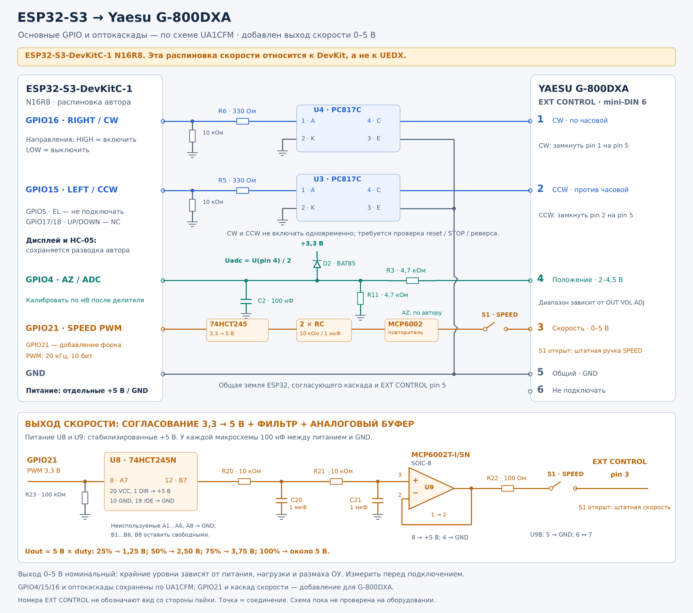

# Подключение ESP32-S3 к G-800DXA

Это исходный вариант **с общей землёй**. Новый [гальванически развязанный канал скорости](g800dxa-speed-isolated.md) использует 6N137 и отдельное изолированное питание. Для полной развязки устройства требуется также изолировать обратную связь AZ: прямой делитель на рисунке ниже объединяет домены.

[SVG для увеличения, печати и редактирования](g800dxa-connection.svg).

Основные GPIO, направления через PC817C и измерение AZ взяты из схемы UA1CFM для ESP32-S3-DevKitC-1 N16R8. Каскад скорости добавлен для G-800DXA. Это проект схемы: измерений реального устройства пока нет.

## Основные соединения

| ESP32-S3 | Каскад | EXT CONTROL G-800DXA |
|---|---|---|
| GPIO16, RIGHT / CW | R6 330 Ом → U4 PC817C, вход 1–2 | Коллектор 4 → pin 1; эмиттер 3 → pin 5 |
| GPIO15, LEFT / CCW | R5 330 Ом → U3 PC817C, вход 1–2 | Коллектор 4 → pin 2; эмиттер 3 → pin 5 |
| GPIO4, AZ ADC | R3/R11 4,7 кОм / 4,7 кОм; C2 100 нФ; D2 BAT85 | Сигнал pin 4; общий pin 5 |
| GPIO21, PWM скорости | U8 74HCT245 → два RC-звена → U9 MCP6002 → R22 → S1 | pin 3 |
| GND | Общий провод ESP32 и согласующего каскада | pin 5 |

GPIO5 (EL), GPIO17/18 (UP/DOWN) и EXT CONTROL pin 6 в профиле G-800DXA не подключаются. Дисплей и HC-05 сохраняют назначения из текущего проекта; полная таблица находится в [аппаратной документации](../hardware.md).

GPIO4/15/16 — исходные назначения UA1CFM. GPIO21 и аппаратное управление скоростью — добавление форка, отсутствующее в исходной схеме G-5500. **GPIO21 нельзя переносить на UEDX: там он занят RGB-дисплеем.**

## Выход скорости 0–5 В

Каскад использует преобразование логических уровней перед фильтрацией. При питании 5 В TTL-совместимый вход 74HCT245 принимает PWM 3,3 В, а на выходе формируются импульсы с уровнями около 0/5 В. После двух пассивных RC-звеньев получается среднее напряжение, которое MCP6002 передаёт на вход скорости как повторитель.

1. GPIO21 подключить к U8 74HCT245N, A7, вывод 8. R23 100 кОм между A7 и GND задаёт LOW при высокоимпедансном GPIO.
2. U8: VCC (20) и DIR (1) → стабилизированные +5 В; GND (10) и /OE (19) → GND. Выход B7 (12) → R20.
3. R20 10 кОм последовательно; после него C20 1 мкФ на GND. Затем R21 10 кОм последовательно; после него C21 1 мкФ на GND. Конденсаторы предпочтительно неполярные, с рабочим напряжением не менее 10 В и проверенной эффективной ёмкостью при 5 В.
4. Выход фильтра → U9 MCP6002T-I/SN **SOIC-8**, канал A, IN+ (3). OUT (1) соединить с IN− (2): это повторитель с усилением 1. VDD (8) → +5 В; VSS (4) → GND. Неиспользуемый канал B: IN+ (5) → GND, IN− (6) соединить с OUT (7). MCP6002-I/P в DIP8 имеет те же номера; MCP6001 не является заменой по выводам.
5. OUT U9 → R22 100 Ом → S1 SPEED → EXT CONTROL pin 3. Обратная связь U9 берётся до R22. Резистор отделяет ОУ от ёмкости кабеля; его падение напряжения под реальной нагрузкой нужно измерить. Размещать каскад рядом с блоком Yaesu, с коротким сигнальным соединением.
6. У U8 и U9 поставить по 100 нФ между питанием и землёй рядом с корпусом; добавить локальную ёмкость питания 1–10 мкФ.

На рисунке U8 — отдельная микросхема. Её неиспользуемые входы A1…A6, A8 соединяются с GND; выходы B1…B6, B8 остаются свободными. В исходной версии с LCD1602 допускается использовать свободный A7/B7 уже установленного 74HCT245 при тех же DIR и /OE. При этом занятые дисплеем входы не заземлять.

Нужен именно **HCT**, с TTL-совместимыми входами: замена на HC при питании 5 В не гарантирует распознавание HIGH от ESP32. MCP6002 имеет rail-to-rail вход и выход; обычный LM358 при питании 5 В не обеспечивает верхний уровень около 5 В.

Номинально `Uout ≈ 5 В × duty`: 25/50/75/100% дают примерно 1,25/2,5/3,75/5 В. Это не точный источник напряжения: уровни зависят от питания, VOH/VOL буфера, размаха ОУ и нагрузки Yaesu. На концах диапазона ОУ имеет отступ от шин питания, поэтому ровно 0,000 и 5,000 В не гарантируются. Перед подключением измерить фактические уровни и отсутствие выбросов, затем повторить измерение под нагрузкой pin 3.

Текущий форк выдаёт GPIO21 PWM 20 кГц, 10 бит. Рабочая настройка скорости 25–100%; STOP даёт duty 0. Два одинаковых нагруженных RC-звена имеют передаточную функцию `H(s) = 1 / ((RC)²s² + 3RCs + 1)`; при 10 кОм и 1 мкФ `RC = 10 мс`. Полное установление скорости после изменения duty занимает порядка 0,2 с. STOP должен немедленно выключать направления, независимо от остаточного напряжения фильтра.

S1 физически отсоединяет каскад от pin 3 для работы штатной ручкой SPEED. Программное выключение PWM не заменяет размыкание S1: LOW оставляет pin 3 нагруженным буфером.

## Направления, ADC и проверка

Входы PC817C: анод 1 через 330 Ом к GPIO, катод 2 к GND. На рисунке добавлены внешние подтяжки GPIO15/16 к GND по 10 кОм. При HIGH оптопара замыкает соответствующий вход Yaesu на pin 5. Это повторяет оптокаскад автора; он сам по себе не реализует аппаратную взаимную блокировку направлений. Для рабочего исполнения предусмотреть запрет одновременного CW/CCW и независимый способ отключения команд движения. Проверить OFF при включении, reset, STOP и реверсе.

R3/R11 по 4,7 кОм делят сигнал положения примерно пополам. При 4,5 В на pin 4 ожидается около 2,25 В на GPIO4. C2 100 нФ фильтрует ADC; D2 BAT85 подключён анодом к ADC, катодом к +3,3 В, как в схеме автора. Эта цепь не заменяет защиту от любых перенапряжений; при отключённом ESP32 возможна подпитка шины 3,3 В через диод. Согласовать питание и порядок включения, измерить входной диапазон, затем калибровать фактические мВ ADC по шкале Yaesu.

U8/U9 и ESP32 получают отдельное стабильное питание. На EXT CONTROL нет питания для контроллера. Все земли соединены, поэтому полной гальванической развязки нет. Соединение выполняется со штатным блоком управления Yaesu через mini-DIN EXT CONTROL; мотор питается штатным блоком.

Схема проверена по исходным назначениям и документации компонентов, но не собрана и не испытана. Изменений прошивки и прошивания в рамках рисунка не выполнялось.

## Источники

- Автор исходного проекта и схем: [UA1CFM/G5500-ESP32S3-Controller](https://github.com/ua1cfm/G5500-ESP32S3-Controller). Для AZ использована его схема с TFT: [оригинал PDF](g5500-esp32s3-tft-schematic.pdf).
- Назначения GPIO и PWM сверены с `G5500_Fork/firmware.cpp` текущего форка.
- [Yaesu G-800DXA, External Control, печатная стр. 14](https://www.yaesu.com/Files/4CB6273C-1018-01AF-FA4D504B591F641A/G-800DXA_1000DXA_2800DXA_OM_ENG_EAA67X101_2102B-BS.pdf).
- [TI SN74HCT245: распиновка и согласование уровней](https://www.ti.com/lit/gpn/sn74hct245).
- [Microchip MCP6002: распиновка SOIC-8 и rail-to-rail повторитель](https://ww1.microchip.com/downloads/aemDocuments/documents/MSLD/ProductDocuments/DataSheets/MCP6001-1R-1U-2-4-1-MHz-Low-Power-Op-Amp-DS20001733L.pdf).

Компоненты подобраны по доступности у российских продавцов: [перечень и источники наличия](g800dxa-components-ru.md). Горизонтальные и вертикальные резисторы на рисунке имеют одинаковый размер корпуса с поворотом на 90°.
