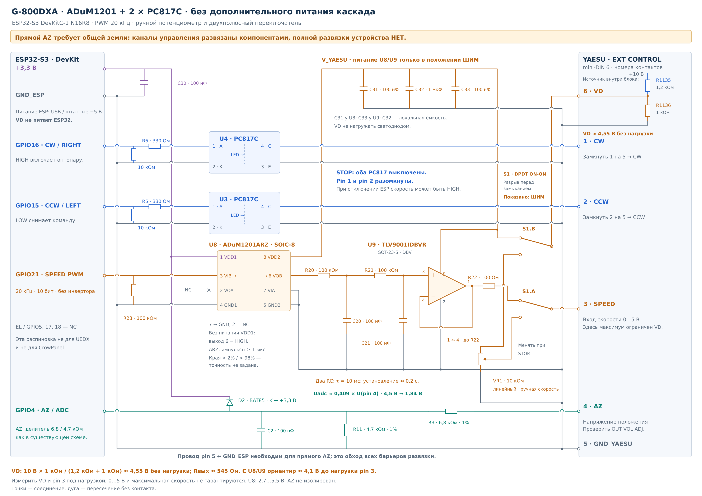

# Yaesu G-800DXA: полная инструкция подключения

Руководство описывает подключение ESP32 к **штатному блоку управления G-800DXA через EXT CONTROL**, проверку направлений и скорости, настройку прошивки и калибровку AZ. Мотор и его штатный кабель остаются подключены к блоку Yaesu.

## Выбор схемы

| Вариант | Канал скорости | Питание каскада | Материалы |
|---|---|---|---|
| А. Неизолированный, общая земля | 74HCT245 → два RC → MCP6002 | Стабилизированные +5 В от питания контроллера; pin 6 используется для ручного задания | [Описание](g800dxa-connection.md), [SVG](g800dxa-connection.svg), [PNG](g800dxa-connection.png) |
| Б. Развязка каналов управления компонентами | ADuM1201ARZ → два RC → TLV9001; направления через два PC817C | Вход ADuM от 3,3 В ESP, выход ADuM и ОУ от pin 6 Yaesu; дополнительного источника нет | [Описание](g800dxa-adum1201.md), [SVG](g800dxa-adum1201.svg), [PNG](g800dxa-adum1201.png), [PDF A3](g800dxa-adum1201.pdf) |

**В обоих вариантах AZ остаётся прямым аналоговым входом через делитель, поэтому pin 5 соединяется с GND ESP32. Полной гальванической развязки между устройствами нет, включая вариант Б.** Для полной развязки нужен также отдельный изолированный измерительный канал AZ; это другая схема.

Существующий [управление скоростью с DC/DC гальванически развязаным DC\DC](g800dxa-speed-isolated.md) описан отдельно. Его питание и номиналы нельзя смешивать с вариантом Б, этот вариант вероятно более стабильный и позволяет организовать гальваническую разявзку обратной связи положения.

В таблицах ниже используется **ESP32-S3-DevKitC-1 N16R8**: AZ ADC GPIO4, CCW GPIO15, CW GPIO16, скорость GPIO21. Плата, корпус микросхемы и вид разъёма определяют физические выводы — номер GPIO не означает номер контакта гребёнки.

- Для сборки S3 без дисплея используйте `pio run -e esp32s3_n16r8`; порядок установки и прошивки — в [инструкции сборки](../build.md).
- Для S2 Mini, классического ESP32 и других плат перенесите соединения по назначению сигнала из [таблиц профилей](../configuration.md). У S2 Mini CCW — GPIO34.
- На UEDX GPIO21 занят RGB-дисплеем. Для CrowPanel используйте [отдельную схему локального AZ](../crowpanel-az.md), включая её инверсию BOOT; показанные здесь GPIO и прямая цепь PWM к ней не относятся.

## Разъём EXT CONTROL

Подключайтесь к **mini-DIN 6 EXT CONTROL**, а не к силовому разъёму кабеля ротатора. Номера ниже — электрические номера контактов. Вид на гнездо блока снаружи и вид на сопрягаемую сторону вилки зеркальны; вид со стороны пайки также необходимо учитывать. Сверьте рисунок External Control в [руководстве Yaesu, печатная стр. 14](https://www.yaesu.com/Files/4CB6273C-1018-01AF-FA4D504B591F641A/G-800DXA_1000DXA_2800DXA_OM_ENG_EAA67X101_2102B-BS.pdf) с ключом вашего разъёма, маркировкой контактов и прозвонкой кабеля. Функциональные схемы проекта не изображают расположение контактов по окружности. На цвета проводов готового кабеля не полагайтесь.

| Pin | Назначение | Подключение |
|---|---|---|
| 1 | CW / RIGHT, вращение по часовой | Коллектор U4 PC817C, вывод 4; команда замыкает pin 1 на pin 5 |
| 2 | CCW / LEFT, против часовой | Коллектор U3 PC817C, вывод 4; команда замыкает pin 2 на pin 5 |
| 3 | Вход задания скорости 0…5 В | Общий контакт сигнальной группы S1; выбирает выход буфера или движок VR1 |
| 4 | Выход напряжения положения AZ | Через R3 к ADC; штатная настройка OUT VOL ADJ влияет на диапазон |
| 5 | Общий провод блока Yaesu | Эмиттеры PC817, земля выходного каскада, низ VR1 и GND ESP для прямого AZ |
| 6 | VD, если установлен в этой ревизии | Источник ручного задания; в варианте Б также питает выходную электронику через S1 |

В руководстве Yaesu pin 6 отмечен **N.C.** В блоках с цепью **+10 В → R1135 1,2 кОм → pin 6 → R1136 1 кОм → pin 5** на нём есть напряжение. Измерьте pin 6 относительно pin 5 до монтажа. Обозначение «+5 В» в прежних рисунках означает этот проверяемый источник задания, а не стабилизированный выход питания.

При номинальных +10 В делитель даёт:

```text
U6 без нагрузки = 10 × 1 / (1,2 + 1) ≈ 4,55 В
Rист = 1,2 кОм || 1 кОм ≈ 545 Ом
U6 под нагрузкой ≈ 4,55 В − Iдоп × 545 Ом
```

`Iдоп` — дополнительная внешняя нагрузка pin 6, без тока собственного R1136. Это расчётная модель по номиналам. Не подключайте к pin 6 ESP32, USB-питание, светодиод индикации или прежний каскад с 6N137/MCP6002. Если VD отсутствует, вариант Б без дополнительного питания неприменим; для ручного задания варианта А можно использовать отдельные стабилизированные +5 В относительно pin 5, оставив pin 6 неподключённым.

## Общие соединения: направления и AZ

### Две оптопары направлений

PC817C в DIP4: анод 1, катод 2, эмиттер 3, коллектор 4. Перед пайкой сверяйте корпус и метку вывода 1.

| Цепь | CW: U4 | CCW: U3 |
|---|---|---|
| Управляющий GPIO | GPIO16 → R6 330 Ом → анод 1 | GPIO15 → R5 330 Ом → анод 1 |
| Подтяжка GPIO | R7 10 кОм от GPIO16 на GND ESP | R8 10 кОм от GPIO15 на GND ESP |
| Катод 2 | GND ESP | GND ESP |
| Коллектор 4 | EXT CONTROL pin 1 | EXT CONTROL pin 2 |
| Эмиттер 3 | EXT CONTROL pin 5 | EXT CONTROL pin 5 |

HIGH включает LED оптопары и замыкает соответствующий вход Yaesu на pin 5. LOW снимает команду. Ток LED с 330 Ом — ориентировочно 6 мА от ESP при активном направлении; pin 6 для этих оптопар не нужен. Не подключайте входы направлений Yaesu напрямую к GPIO. Не подавайте обе команды одновременно: отдельной аппаратной взаимной блокировки в этих схемах нет.

### Существующий вход положения AZ

| Элемент | Подключение |
|---|---|
| R3 6,8 кОм, 1% | Между EXT CONTROL pin 4 и узлом ADC |
| R11 4,7 кОм, 1% | Между узлом ADC и GND ESP / pin 5 |
| C2 100 нФ | Между узлом ADC и GND |
| D2 BAT85 | Анод к ADC, катод к +3,3 В ESP |
| GPIO4 | К узлу ADC |
| Общий провод | GND ESP соединить с EXT CONTROL pin 5 |

Это тот же делитель, что на существующей схеме. `Uadc ≈ 0,4087 × U4`: при 4,5 В на pin 4 получается около 1,84 В на GPIO4; при 5 В — около 2,04 В. Режим АЦП в прошивке — `ADC_11db`. Напрямую подавать 5 В на GPIO нельзя. Если уже установлен иной проверенный делитель, сверяйтесь с [таблицей номиналов ADC](adc-input.md#номиналы-под-конкретный-контроллер); после замены нужна повторная калибровка.

BAT85 может подпитывать отключённую шину 3,3 В от включённого Yaesu. Для работы с отключённым ESP сначала отключайте Yaesu либо размыкайте сигнальный кабель; при проверке исчезновения питания ESP обязательно проверяйте фактическое напряжение 3,3 В и выключение обеих оптопар. Одна эта цепь не защищает от любых перенапряжений.

## Вариант А: общая земля, 74HCT245 и MCP6002

[](g800dxa-connection.svg)

Откройте [схему с общей землёй](g800dxa-connection.svg). ESP32 питается штатным способом, U8 и U9 — от **стабилизированных +5 В**. Земли ESP, буфера, ОУ и pin 5 соединены. Pin 6 не питает U8/U9.

1. **U8 74HCT245N DIP20:** GPIO21 → A7, вывод 8. R23 100 кОм между входом и GND. VCC 20 и DIR 1 → +5 В; GND 10 и /OE 19 → GND. Выход B7, вывод 12, идёт на R20. Для отдельной микросхемы неиспользуемые входы A1…A6 и A8 заземлите: выводы 2…7 и 9; выходы 11 и 13…18 оставьте свободными. Если используется уже установленный буфер LCD, занятые дисплеем входы не заземляйте.
2. **Фильтр:** выход U8 → R20 10 кОм → первый узел; C20 1 мкФ с этого узла на GND. Затем R21 10 кОм → второй узел; C21 1 мкФ со второго узла на GND.
3. **U9 MCP6002T-I/SN SOIC8:** второй узел → IN+ 3; OUT 1 соединить с IN− 2. VDD 8 → +5 В, VSS 4 → GND. Неиспользуемый канал: IN+ 5 → GND, IN− 6 соединить с OUT 7. DIP8 MCP6002-I/P имеет те же номера.
4. OUT 1 → R22 100 Ом → вход A переключателя S1. Обратная связь ОУ подключена **до R22**.
5. **S1 SPDT ON-ON, break-before-make:** общий → pin 3 Yaesu, A → R22, B → движок VR1. VR1 10 кОм линейный: один край к pin 6 VD, другой к pin 5. Проверьте реальное расположение общих контактов переключателя омметром.
6. У U8 и U9 поставьте по 100 нФ между питанием и GND рядом с корпусом; добавьте 1–10 мкФ на локальную шину +5 В.

Нужен именно **HCT**, поскольку вход питаемой от 5 В микросхемы HC не гарантирует HIGH от GPIO 3,3 В. MCP6002 используется как rail-to-rail повторитель; LM358 не является равноценной заменой для верхней части диапазона. MCP6001 не совпадает по выводам с MCP6002.

В положении ШИМ ожидается `U3 ≈ 5 В × duty`, с отклонением из-за питания, уровней буфера, размаха ОУ и тока pin 3. Ровно 0 и 5 В не гарантируются. В ручном положении напряжение задаёт VR1; сам потенциометр 10 кОм нагружает источник VD примерно до **4,31 В** при номинальном внутреннем делителе ещё без нагрузки pin 3. Поэтому верхний предел ручного и электронного вариантов может отличаться.

## Вариант Б: ADuM1201, TLV9001 и pin 6

[](g800dxa-adum1201.svg)

Откройте [новую схему SVG](g800dxa-adum1201.svg) или [PDF A3](g800dxa-adum1201.pdf). Здесь используются **один ADuM1201ARZ и два PC817C**. Установите общие цепи направлений и AZ из таблиц выше. Сохраняется прямой PWM без инвертора.

### ADuM1201ARZ, SOIC8

| Вывод | Сигнал | Соединение |
|---|---|---|
| 1 | VDD1 | +3,3 В ESP; C30 100 нФ между 1 и 4 |
| 2 | VOA | Не подключать: выход неиспользуемого обратного канала |
| 3 | VIB | GPIO21; R23 100 кОм на GND ESP |
| 4 | GND1 | GND ESP |
| 5 | GND2 | EXT CONTROL pin 5 |
| 6 | VOB | Выход PWM → R20 |
| 7 | VIA | Соединить с выводом 5; не оставлять вход плавающим |
| 8 | VDD2 | Переключаемая шина `V_YAESU` от S1.B.A; C31 100 нФ между 8 и 5 |

**Рабочий канал — 3 → 6.** ADuM1201 имеет противоположно направленные каналы; схема 2 → 7 относится к ADuM1200 и здесь не работает. Сверяйте маркировку корпуса, а не только общий вид SOIC8.

### RC и ОУ

1. Вывод 6 U8 → **R20 100 кОм** → первый узел; **C20 100 нФ** с первого узла на pin 5.
2. Первый узел → **R21 100 кОм** → второй узел; **C21 100 нФ** со второго узла на pin 5.
3. Второй узел → IN+ 3 U9 **TLV9001IDBVR, SOT-23-5 DBV**.
4. OUT 1 U9 соединить с IN− 4. V− 2 → pin 5, V+ 5 → `V_YAESU`; C33 100 нФ рядом с выводами 5 и 2. Другие исполнения TLV9001, включая U и SC70, могут иметь другую распиновку.
5. OUT 1 → R22 100 Ом → S1.A.A. Обратная связь ОУ — до R22. Поставьте C32 1 мкФ между `V_YAESU` и pin 5.

Оба RC имеют `RC = 10 мс`; установление после изменения duty занимает порядка 0,2 с. Большие сопротивления уменьшают нагрузку на питание Yaesu. Конденсаторы сигнала — неполярные, желательно X7R/C0G с проверенной ёмкостью, не менее 10 В. Разместите выходной каскад рядом с Yaesu и используйте короткое соединение pin 3/pin 5.

### Двухполюсный переключатель ШИМ / ручная скорость

S1 — **DPDT ON-ON, break-before-make**, без среднего OFF. Его две механически связанные группы обозначены A и B; контакты каждой группы — C (общий), A (ШИМ), B (ручная). Обозначения являются именами в схеме, а не номерами ножек переключателя. Омметром установите общие контакты и соответствие двух положений; обе группы должны выбирать один режим.

| Группа и контакт | Соединение |
|---|---|
| S1.A.C, общий сигнальной группы | EXT CONTROL pin 3 |
| S1.A.A, ШИМ | R22 100 Ом от выхода U9 |
| S1.A.B, ручная | Движок VR1 |
| S1.B.C, общий группы питания | EXT CONTROL pin 6 VD |
| S1.B.A, ШИМ | `V_YAESU`: U8.8, U9.5, C31/C32/C33 |
| S1.B.B, ручная | Верхний вывод VR1 10 кОм |
| Нижний вывод VR1 | EXT CONTROL pin 5 |

В положении **ШИМ** VD питает U8/U9, а pin 3 получает выход ОУ. Верх VR1 отсоединён от VD и не создаёт постоянной нагрузки. В положении **Ручная** питание U8/U9 отключено, VD питает VR1, а pin 3 получает напряжение движка. Не соединяйте выход ОУ с VD параллельно. Переключайте при STOP: независимые группы переключателя не гарантируют идеальной одновременности переходов.

Передняя ручка SPEED блока Yaesu действует при работе передними кнопками. Для внешнего управления нужна показанная отдельная VR1; размыкание pin 3 не переключает управление на переднюю ручку и не обеспечивает движение.

### Доступное питание и ограничения

Ориентировочный ток со стороны Yaesu: ADuM1201 около **0,8 мА тип.** по таблице при 5 В, TLV9001 около **60 мкА тип.**, фильтр около **10–12 мкА** при duty 50%. Получается примерно **0,87 мА** и около **4,07 В** на VD при номинальном делителе, до нагрузки pin 3. Ток обратного канала ADuM уже входит в эту оценку, даже если канал не используется. При 100% duty установившийся ток фильтра меньше, а при переходах возникает дополнительная нагрузка.

| Дополнительный ток в pin 3 от буфера | Расчётный VD при прочей нагрузке около 0,87 мА |
|---|---:|
| 0 мА | 4,07 В |
| 0,1 мА | 4,02 В |
| 0,3 мА | 3,91 В |
| 0,5 мА | 3,80 В |

Эти значения — ориентир по номиналам, а не проверенный диапазон конкретного блока. Напряжение pin 3 дополнительно уменьшается на отступ выхода ОУ от питания и падение на R22: например, при 0,5 мА на R22 теряется ещё 0,05 В. Потребление ADuM при просевшем питании нужно уточнить измерением; таблица при 5 В не задаёт точный ток при 4 В.

Измерьте `V_YAESU` во всех рабочих режимах: ADuM должен оставаться в диапазоне **2,7…5,5 В**, без провалов при переключениях. Если требуемая скорость не достигается из-за верхнего напряжения, этот вариант не подходит по диапазону; программные 100% не поднимут выход выше питания. Не шунтируйте R1135 и не подавайте +5 В ESP в pin 6. Вернитесь к варианту А с отдельными стабилизированными +5 В для каскада.

ADuM1201**ARZ** нормирован для импульсов не короче **1 мкс**. При 20 кГц период 50 мкс; импульсы около краёв duty ниже 2% и выше 98% могут передаваться с ненормированной ошибкой. Это касается разгона и торможения, даже если рабочий выход 25–75%. Статические 0% и 100% передаются, но полные 10 бит точности всего аналогового тракта не гарантируются. Не снижайте частоту до сотен герц ради этого каскада; штатные 20 кГц сохраняются.

При пропадании питания входной стороны выход 6 ADuM переходит в **HIGH**, если выходная сторона остаётся запитанной. Напряжение скорости может подняться к верхнему пределу. **Остановку обеспечивают выключенные PC817 и отсутствие CW/CCW**, а не обнуление скорости. Проверка reset и исчезновения питания ESP обязательна с учётом возможной подпитки через AZ.

## Детали для сборки

| Общие детали обоих вариантов | Количество / номинал |
|---|---|
| U3/U4 | 2 × PC817C DIP4, группа CTR C |
| R5/R6 | 2 × 330 Ом |
| R7/R8 | 2 × 10 кОм, подтяжки направлений |
| R23 | 100 кОм, подтяжка PWM |
| R3/R11, C2, D2 | 6,8 кОм / 4,7 кОм, оба 1%; 100 нФ; BAT85 |
| R22 | 100 Ом |
| VR1 | 10 кОм, линейный |
| Кабель | Вилка mini-DIN 6 EXT CONTROL с проверенной распайкой |

| Только вариант А | Только вариант Б |
|---|---|
| 74HCT245N DIP20 | ADuM1201ARZ SOIC8 |
| MCP6002T-I/SN SOIC8 или MCP6002-I/P DIP8 | TLV9001IDBVR SOT-23-5 DBV |
| R20/R21: 2 × 10 кОм | R20/R21: 2 × 100 кОм |
| C20/C21: 2 × 1 мкФ | C20/C21: 2 × 100 нФ |
| Развязка питания: 2 × 100 нФ и 1–10 мкФ | C30/C31/C33: 3 × 100 нФ; C32: 1 мкФ |
| S1 SPDT ON-ON | S1 DPDT ON-ON |
| Стабилизированные +5 В для U8/U9 | VD от pin 6; дополнительного источника нет |

Резисторы — 1%, 0,125–0,25 Вт; конденсаторы не менее 10 В. R1135/R1136 на рисунке находятся **внутри Yaesu**: повторять их снаружи не нужно. Детали U8/U9 и S1 двух вариантов различаются; выбирайте один полный комплект. Для прежних схем также есть [перечень исполнений](g800dxa-components-ru.md).

## Настройка прошивки

1. До подключения привода соберите и прошейте профиль своей платы по [инструкции сборки](../build.md). Включите ESP, подключитесь к `G5500-Rotator-XXXXXX`, откройте `http://192.168.4.1/` или его адрес в локальной сети.
2. В **Настройки → Пульт и связь** выберите роль **Контроллер поворотки**. В **Оборудование** (`/hardware`) выберите интерфейс **Yaesu**, физический привод без имитации. После изменения оборудования выполните сохранение, перезапуск и подтверждение по [процедуре настройки](../configuration.md#применение-и-восстановление-доступа). В HUD локальные выходы не работают.
3. В **Настройки → Поворотка и привод** выберите **G-800DXA**. EL не используется; GPIO5/17/18 к Yaesu не подключайте.
4. Для ручного положения S1 отключите **Управлять скоростью через внешний модуль 0–5 В** и задавайте скорость VR1. Для положения ШИМ включите эту настройку. Выберите простой регулятор и начните с рабочего выхода 50%; настройки разгона и торможения — в [разделе скорости](../usage.md#плавная-скорость-g-800dxa).
5. У DevKit обе схемы передают PWM без инверсии; полярность менять не нужно. Для Yaesu прошивка выдаёт 20 кГц, 10 бит. Команда STOP сразу снимает оба направления и обнуляет duty. Остаточное напряжение RC и механический выбег могут сохраняться: проверьте реальное время остановки.
6. Проверьте направления, затем выберите реальный диапазон AZ и выполните калибровку ниже. До калибровки пользуйтесь короткими ручными командами, а не числовыми целями.

## Первое подключение и проверка

### Без вращения

1. Выключите питание ESP и Yaesu, отсоедините сигнальный кабель. Проверьте пайку, корпуса и номера выводов, отсутствие замыканий +3,3/+5 В на сигналы. Прозвоните все контакты mini-DIN. Измерьте группы S1 в обоих положениях; в варианте Б ручное положение должно отключать питание U8/U9 от VD.
2. При выключенном Yaesu отсоедините кабель двигателя для проверки электроники без вращения. Затем включите блок, не подключая ESP: измерьте pin 6 и pin 4 относительно pin 5. Верните SELECT SWITCH блока в **OPERATION MODE**, если он установлен в ADJ. MODE; не меняйте штатные FULL SCALE/PRESET-регулировки без необходимости.
3. Если VD есть, подключите только питание выходного каскада и землю, сохранив pin 3, pin 1/2 и ADC отключёнными. В варианте А проверьте стабильные +5 В, в варианте Б — VD и `V_YAESU` при S1=ШИМ. Убедитесь, что напряжения соответствуют выбранным микросхемам.
4. Включите ESP. С отсоединёнными pin 1/2 и мотором задайте короткое ручное направление для активации PWM. После окончания разгона измерьте выход R22 на 25/50/75/100%. Пользуйтесь текущим `speedOutputPercent` в [API состояния](../usage.md#веб-api), поскольку рабочая настройка и текущий выход во время рампы различаются. Ограничивайте длительность команды и учитывайте защиту отсутствия движения. Само изменение процента при STOP PWM не включает.
5. В варианте А ориентир — 1,25/2,50/3,75/около 5 В. В варианте Б ориентир — 25/50/75/100% от **измеренного** `V_YAESU`: при 4,1 В примерно 1,03/2,05/3,08/4,1 В без нагрузки. Проверяйте также VD на каждом уровне. Дождитесь установления фильтра; при 100% выход ограничен реальным размахом ОУ.
6. Нажмите STOP: проверьте немедленное выключение обеих оптопар и снижение напряжения после RC. Повторите при RESET ESP и отключении его питания. В варианте Б рост напряжения скорости допустим только при разомкнутых командах CW/CCW. При отключении ESP контролируйте возможную подпитку его 3,3 В через AZ.
7. Снимите питание, подключите pin 3 и повторите измерения под реальной нагрузкой входа скорости с отключённым мотором. В ручном положении проверьте VR1 от минимума до максимума; выход ОУ не должен соединяться с VD. Затем, при выключенном питании, подключите AZ и направления. Проверьте напряжение GPIO4 при включённом Yaesu.
8. С отключённым мотором проверьте команды на pin 1/2 относительно pin 5: при CW активен только pin 1, при CCW — только pin 2, при остановке оба отпущены. При реверсе обе команды выключаются на паузу 300 мс. Никакое включение питания или восстановление ESP не должно само запускать направление.

Все измерения схемы выполняются относительно pin 5 / общей земли. Подключение заземлённого осциллографа также объединяет земли; оно не является проверкой гальванической изоляции.

### Вращение и калибровка

1. Выключите питание, верните штатный кабель двигателя и освободите зону вращения. Начните с S1=Ручная и умеренного положения VR1. Убедитесь, что антенна находится вдали от упоров.
2. Коротко включите RIGHT: угол должен увеличиваться по принятой шкале, LEFT — уменьшаться. Если направления перепутаны, при выключенном питании поменяйте подключения коллекторов к pin 1/2. Не исправляйте это сменой полярности PWM.
3. Проверьте STOP и реверс. Подберите торможение с учётом механического выбега; программная остановка не заменяет снятие питания при неисправности.
4. Откройте **Настройки → Диапазоны и калибровка**. Для штатного хода 450° выберите **P45**, для фактического хода 360° — P36; при смещённой шкале задайте соответствующий произвольный диапазон. Руководствуйтесь реальными пределами установки.
5. Для начала выберите двухточечную калибровку AZ. Подведите антенну к началу диапазона, остановите и нажмите **Запомнить положение** для начала. Повторите для конца диапазона. Сохраняются фактические мВ на ADC, а не напряжение pin 4 до делителя. Проверьте несколько промежуточных углов; при необходимости используйте многоточечную калибровку по [инструкции AZ](../az-range.md).
6. Переключите S1 на ШИМ при STOP, включите управление скоростью в настройках и проверьте движение на 25/50/75/100%. Измерьте верхнее напряжение под нагрузкой и сравните доступную скорость с ручным режимом. Подберите рабочий выход, подход и торможение по [инструкции управления](../usage.md#плавная-скорость-g-800dxa); автотюн запускайте только после исправной калибровки и проверки остановки.

После изменения OUT VOL ADJ, делителя ADC, модели или механических пределов повторите проверку диапазона и калибровку.

## Если что-то не работает

| Признак | Что проверить |
|---|---|
| Не вращается ни в одну сторону | Роль контроллера, имитацию, интерфейс Yaesu, модель, подтверждение оборудования, ошибки привода, GPIO15/16, полярность LED PC817 и наличие задания на pin 3 |
| Работает только одно направление | Соответствующие R5/R6, PC817, контакты 1/2, активный LOW коллектора и отсутствие одновременных команд |
| Положение не меняется или неверно | Pin 4/5, напряжение до и после делителя, GPIO4, OUT VOL ADJ, диапазон и калибровку AZ |
| При ШИМ скорость не меняется | Разрешение внешнего модуля, S1, фактический PWM GPIO21, подключение 3 → 6 ADuM, питание, RC и обратную связь ОУ |
| В варианте Б проседает VD | Наличие нужного внутреннего делителя, перепутанную распиновку U8/U9, лишние нагрузки, DPDT и отсоединение VR1 в положении ШИМ |
| В варианте Б недостаточна максимальная скорость | `V_YAESU` и pin 3 при 100% под нагрузкой; поднять напряжение прошивкой нельзя, используйте вариант А |
| ESP остаётся частично запитанным после отключения USB | Подпитку через BAT85 от AZ и другие подключённые интерфейсы; отключите Yaesu/сигнальный кабель перед работами |
| После STOP остаётся напряжение на pin 3 | RC-фильтр, ручное положение или default HIGH ADuM; отдельно проверьте, что CW/CCW сняты |
| Самопроизвольное направление при загрузке/reset | Подтяжки GPIO, полярность и утечки оптопар, подпитку ESP; не подключайте мотор до устранения причины |

## Источники и авторство

- [Yaesu G-800DXA/G-1000DXA/G-2800DXA: External Control, печатная стр. 14; регулировки задней панели, стр. 3](https://www.yaesu.com/Files/4CB6273C-1018-01AF-FA4D504B591F641A/G-800DXA_1000DXA_2800DXA_OM_ENG_EAA67X101_2102B-BS.pdf).
- [Analog Devices ADuM1200/ADuM1201: выводы, питание, выход при потере питания и ограничение импульса ARZ](https://www.analog.com/media/en/technical-documentation/data-sheets/ADuM1200_1201.pdf).
- [TI TLV9001: распиновка DBV, потребление и диапазон питания](https://www.ti.com/lit/gpn/tlv9001).
- [TI SN74HCT245](https://www.ti.com/lit/gpn/sn74hct245), [Microchip MCP6002](https://ww1.microchip.com/downloads/aemDocuments/documents/MSLD/ProductDocuments/DataSheets/MCP6001-1R-1U-2-4-1-MHz-Low-Power-Op-Amp-DS20001733L.pdf).
- Исходные GPIO и каскады направлений — [UA1CFM](https://github.com/ua1cfm/G5500-ESP32S3-Controller), [оригинальная схема TFT](g5500-esp32s3-tft-schematic.pdf). Каскады скорости и инструкция форка — RA3VLD; [лицензия проекта](../../LICENSE).
