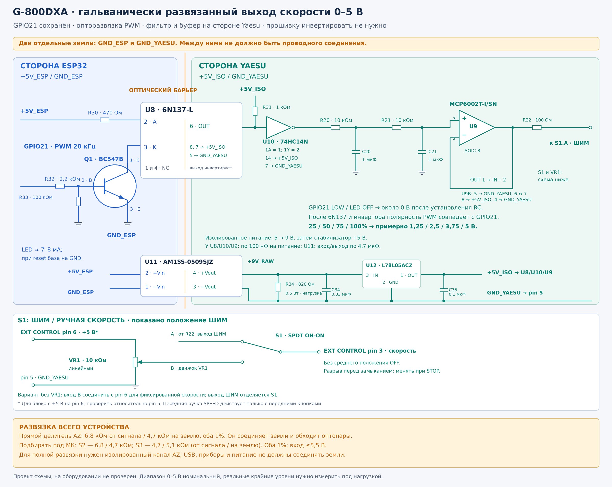

# Гальванически развязанный выход скорости G-800DXA

[SVG для печати](g800dxa-speed-isolated.svg) · [Компоненты и наличие в России](g800dxa-components-ru.md).

GPIO21 сохранён. Канал скорости: BC547B → 6N137-L → 74HC14N → два RC-звена → MCP6002 → EXT CONTROL pin 3. Оптопары направлений GPIO15/16 остаются по автору. Элементы заменены на варианты с заявленным наличием у российских продавцов; номинальный диапазон выхода остаётся 0–5 В.

## Два домена питания# Гальванически развязанный выход скорости G-800DXA

[SVG для печати](g800dxa-speed-isolated.svg) · [Компоненты и наличие в России](g800dxa-components-ru.md).

GPIO21 сохранён. Канал скорости: BC547B → 6N137-L → 74HC14N → два RC-звена → MCP6002 → EXT CONTROL pin 3. Оптопары направлений GPIO15/16 остаются по автору. Номинальный диапазон выхода остаётся 0–5 В.

## Два домена питания

`+5V_ESP`, `GND_ESP` питают ESP32 и вход оптопары. `+5V_ISO`, `GND_YAESU` питают приёмник U8, инвертор U10, RC и U9. `GND_YAESU` соединяется с EXT CONTROL pin 5; с `GND_ESP` она не соединяется.

Доступный изолированный DC/DC U11 **Aimtec AM1SS-0509SJZ** преобразует 5 В в номинальные 9 В. Это **нерегулируемый** модуль, поэтому после него добавлен U12 **ST L78L05ACZ**, TO-92, для питания логики и ОУ напряжением 5 В:

- U11: pin 2 +Vin → `+5V_ESP`; pin 1 −Vin → `GND_ESP`; pin 4 +Vout → `+9V_RAW`; pin 3 −Vout → `GND_YAESU`.
- U12: pin 3 IN → `+9V_RAW`; pin 2 GND → `GND_YAESU`; pin 1 OUT → `+5V_ISO`. Номера относятся к указанному исполнению ST; другие 78L05 выбирать с проверкой распиновки.
- R34 820 Ом, 0,5 Вт между `+9V_RAW` и `GND_YAESU` — дополнительная нагрузка DC/DC. Вместе с потреблением приёмника и стабилизатора она обеспечивает нагрузку выше указанного для модуля минимума 12 мА. Только R34 при 9 В потребляет около 11 мА.
- У U11 поставить по 4,7 мкФ на входе и выходе, с отдельной землёй каждой стороны; выходной конденсатор не менее 25 В. У U12 C34 0,33 мкФ на входе и C35 0,1 мкФ на выходе. У U8/U10/U9 дополнительно по 100 нФ рядом с выводами питания.

На малой нагрузке выход DC/DC может быть выше 9 В. До подключения проверить вход U12, выход 5 В, запуск и пульсации. У дешёвых регуляторов есть допуск выходного напряжения: если фактическое напряжение при duty 100% превышает 5 В, ограничить максимальный duty по измерению до подключения pin 3. В этом задании прошивка не менялась.

B0509S-1WR3 допускается как запасной функциональный вариант после сверки производителя, минимальной нагрузки, распиновки и конденсаторов. Нельзя заменять весь узел на нерегулируемый B0505S и подавать его выход непосредственно на U8/U10/U9.

## Вход и опторазвязка

Q1 **BC547B, Diotec, TO-92**: база 2 от GPIO21 через R32 2,2 кОм; эмиттер 3 на `GND_ESP`; коллектор 1 на катод U8, вывод 3. R33 100 кОм между базой и эмиттером удерживает вход неактивным при высокоимпедансном GPIO. Анод U8, вывод 2, через R30 470 Ом подключается к `+5V_ESP`. Ток LED около 7–8 мА; измерить его перед запуском. Здесь используется биполярный транзистор: AO3400A нельзя подставлять без изменения назначения выводов и базового резистора.

U8 **6N137-L, Lite-On, DIP8**: VCC 8 и enable 7 → `+5V_ISO`; GND 5 → `GND_YAESU`; OUT 6 → подтяжка R31 1 кОм к `+5V_ISO` и вход U10. Выводы 1 и 4 не используются.

U10 **74HC14N, DIP14**: IN 1 ← U8 OUT 6; OUT 2 → R20. VCC 14 → `+5V_ISO`; GND 7 → `GND_YAESU`. Неиспользуемые входы 3/5/9/11/13 → `GND_YAESU`; выходы остаются свободными. HC здесь подходит, поскольку сигнал уже имеет уровни 0/5 В после оптопары и подтяжки. В неизолированной схеме 74HCT245 принимает 3,3 В от ESP32 и должен оставаться **HCT**.

6N137 инвертирует, а 74HC14 восстанавливает полярность. GPIO21 HIGH включает LED и даёт HIGH после U10; GPIO21 LOW или LED OFF дают LOW. Полярность PWM в прошивке сохраняется. PC817C в направлениях CW/CCW оставлен для медленных команд; в канал PWM 20 кГц установлена быстрая логическая оптопара. У BC547B есть задержки, включая хранение заряда: фактический duty после оптопары нужно измерить, точность преобразования 10 бит аппаратно не подтверждена.

## Аналоговый выход

R20/R21 по 10 кОм, C20/C21 по 1 мкФ образуют два нагруженных RC-звена. Их выход подключён к IN+ 3 канала A U9 **MCP6002T-I/SN, SOIC-8**. OUT 1 соединён с IN− 2; VDD 8 → `+5V_ISO`; VSS 4 → `GND_YAESU`. Неиспользуемый канал B: IN+ 5 → `GND_YAESU`; IN− 6 соединён с OUT 7. MCP6002-I/P в DIP8 имеет ту же распиновку и может применяться для ручного монтажа, но для основного перечня выбран имеющийся на складе SOIC-8.

OUT U9 → R22 100 Ом → S1 → EXT CONTROL pin 3. Обратная связь берётся до R22. S1 размыкается для штатной ручки SPEED; программный LOW не отсоединяет выход физически.

Номинально `Uout ≈ +5V_ISO × duty`: 25/50/75/100% дают около 1,25/2,5/3,75/5 В. Питание, задержки оптопары/транзистора, размах ОУ и нагрузка влияют на фактические уровни. Ровно 0,000/5,000 В не гарантируются. RC устанавливается примерно за 0,2 с; STOP немедленно выключает направления независимо от остаточного напряжения фильтра.

## Обратная связь AZ

Этот канал скорости не соединяет земли, но прямой делитель pin 4 → GPIO4 вместе с общим проводом pin 5 → `GND_ESP` обходят оптопары. Для полной развязки нужен отдельный изолированный измерительный канал AZ. Его реальная схема пока уточняется; этот рисунок показывает проект изолированного выхода скорости.

При разделённых доменах эмиттеры PC817C направлений подключаются к `GND_YAESU`, катоды LED — к `GND_ESP`. Питание, USB, измерительные приборы и экраны кабелей не должны создавать обходное соединение. На плате выдержать зазор между доменами по спецификациям компонентов.

Схема не добавляет аппаратную взаимную блокировку CW/CCW. Она пока не собрана и не испытана; прошивка не изменялась.

## Документация производителей

- [Lite-On 6N137-L](https://optoelectronics.liteon.com/upload/download/DS70-2008-0035/6N137-L%20series%20May22%20RevE.PDF).
- [TI 74HC14](https://www.ti.com/lit/ds/symlink/sn74hc14.pdf).
- [Diotec BC547B](https://diotec.com/tl_files/diotec/files/pdf/datasheets/bc546.pdf).
- [Microchip MCP6002](https://ww1.microchip.com/downloads/aemDocuments/documents/MSLD/ProductDocuments/DataSheets/MCP6001-1R-1U-2-4-1-MHz-Low-Power-Op-Amp-DS20001733L.pdf).
- [Aimtec AM1SS-JZ](https://aimtec.com/site/Aimtec/files/Datasheet/HighResolution/am1ss-jz.pdf).
- [ST L78L](https://www.st.com/resource/en/datasheet/l78l.pdf).

`+5V_ESP`, `GND_ESP` питают ESP32 и вход оптопары. `+5V_ISO`, `GND_YAESU` питают приёмник U8, инвертор U10, RC и U9. `GND_YAESU` соединяется с EXT CONTROL pin 5; с `GND_ESP` она не соединяется.

Доступный изолированный DC/DC U11 **Aimtec AM1SS-0509SJZ** преобразует 5 В в номинальные 9 В. Это **нерегулируемый** модуль, поэтому после него добавлен U12 **ST L78L05ACZ**, TO-92, для питания логики и ОУ напряжением 5 В:

- U11: pin 2 +Vin → `+5V_ESP`; pin 1 −Vin → `GND_ESP`; pin 4 +Vout → `+9V_RAW`; pin 3 −Vout → `GND_YAESU`.
- U12: pin 3 IN → `+9V_RAW`; pin 2 GND → `GND_YAESU`; pin 1 OUT → `+5V_ISO`. Номера относятся к указанному исполнению ST; другие 78L05 выбирать с проверкой распиновки.
- R34 820 Ом, 0,5 Вт между `+9V_RAW` и `GND_YAESU` — дополнительная нагрузка DC/DC. Вместе с потреблением приёмника и стабилизатора она обеспечивает нагрузку выше указанного для модуля минимума 12 мА. Только R34 при 9 В потребляет около 11 мА; это не отдельная гарантия минимальной нагрузки при отключении остальных цепей.
- У U11 поставить по 4,7 мкФ на входе и выходе, с отдельной землёй каждой стороны; выходной конденсатор не менее 25 В. У U12 C34 0,33 мкФ на входе и C35 0,1 мкФ на выходе. У U8/U10/U9 дополнительно по 100 нФ рядом с выводами питания.

На малой нагрузке выход DC/DC может быть выше 9 В. До подключения проверить вход U12, выход 5 В, запуск и пульсации. У дешёвых регуляторов есть допуск выходного напряжения: если фактическое напряжение при duty 100% превышает 5 В, ограничить максимальный duty по измерению до подключения pin 3. В этом задании прошивка не менялась.

B0509S-1WR3 допускается как запасной функциональный вариант после сверки производителя, минимальной нагрузки, распиновки и конденсаторов. Нельзя заменять весь узел на нерегулируемый B0505S и подавать его выход непосредственно на U8/U10/U9.

## Вход и опторазвязка

Q1 **BC547B, Diotec, TO-92**: база 2 от GPIO21 через R32 2,2 кОм; эмиттер 3 на `GND_ESP`; коллектор 1 на катод U8, вывод 3. R33 100 кОм между базой и эмиттером удерживает вход неактивным при высокоимпедансном GPIO. Анод U8, вывод 2, через R30 470 Ом подключается к `+5V_ESP`. Ток LED около 7–8 мА; измерить его перед запуском. Здесь используется биполярный транзистор: AO3400A нельзя подставлять без изменения назначения выводов и базового резистора.

U8 **6N137-L, Lite-On, DIP8**: VCC 8 и enable 7 → `+5V_ISO`; GND 5 → `GND_YAESU`; OUT 6 → подтяжка R31 1 кОм к `+5V_ISO` и вход U10. Выводы 1 и 4 не используются.

U10 **74HC14N, DIP14**: IN 1 ← U8 OUT 6; OUT 2 → R20. VCC 14 → `+5V_ISO`; GND 7 → `GND_YAESU`. Неиспользуемые входы 3/5/9/11/13 → `GND_YAESU`; выходы остаются свободными. HC здесь подходит, поскольку сигнал уже имеет уровни 0/5 В после оптопары и подтяжки. В неизолированной схеме 74HCT245 принимает 3,3 В от ESP32 и должен оставаться **HCT**.

6N137 инвертирует, а 74HC14 восстанавливает полярность. GPIO21 HIGH включает LED и даёт HIGH после U10; GPIO21 LOW или LED OFF дают LOW. Полярность PWM в прошивке сохраняется. PC817C в направлениях CW/CCW оставлен для медленных команд; в канал PWM 20 кГц установлена быстрая логическая оптопара. У BC547B есть задержки, включая хранение заряда: фактический duty после оптопары нужно измерить, точность преобразования 10 бит аппаратно не подтверждена.

## Аналоговый выход

R20/R21 по 10 кОм, C20/C21 по 1 мкФ образуют два нагруженных RC-звена. Их выход подключён к IN+ 3 канала A U9 **MCP6002T-I/SN, SOIC-8**. OUT 1 соединён с IN− 2; VDD 8 → `+5V_ISO`; VSS 4 → `GND_YAESU`. Неиспользуемый канал B: IN+ 5 → `GND_YAESU`; IN− 6 соединён с OUT 7. MCP6002-I/P в DIP8 имеет ту же распиновку и может применяться для ручного монтажа, но для основного перечня выбран имеющийся на складе SOIC-8.

OUT U9 → R22 100 Ом → S1 → EXT CONTROL pin 3. Обратная связь берётся до R22. S1 размыкается для штатной ручки SPEED; программный LOW не отсоединяет выход физически.

Номинально `Uout ≈ +5V_ISO × duty`: 25/50/75/100% дают около 1,25/2,5/3,75/5 В. Питание, задержки оптопары/транзистора, размах ОУ и нагрузка влияют на фактические уровни. Ровно 0,000/5,000 В не гарантируются. RC устанавливается примерно за 0,2 с; STOP немедленно выключает направления независимо от остаточного напряжения фильтра.

## Обратная связь AZ

Этот канал скорости не соединяет земли, но прямой делитель pin 4 → GPIO4 вместе с общим проводом pin 5 → `GND_ESP` обходят оптопары. Для полной развязки нужен отдельный изолированный измерительный канал AZ. Его реальная схема пока уточняется; этот рисунок показывает проект изолированного выхода скорости.

При разделённых доменах эмиттеры PC817C направлений подключаются к `GND_YAESU`, катоды LED — к `GND_ESP`. Питание, USB, измерительные приборы и экраны кабелей не должны создавать обходное соединение. На плате выдержать зазор между доменами по спецификациям компонентов.

Схема не добавляет аппаратную взаимную блокировку CW/CCW. Она пока не собрана и не испытана; прошивка не изменялась.

## Документация производителей

- [Lite-On 6N137-L](https://optoelectronics.liteon.com/upload/download/DS70-2008-0035/6N137-L%20series%20May22%20RevE.PDF).
- [TI 74HC14](https://www.ti.com/lit/ds/symlink/sn74hc14.pdf).
- [Diotec BC547B](https://diotec.com/tl_files/diotec/files/pdf/datasheets/bc546.pdf).
- [Microchip MCP6002](https://ww1.microchip.com/downloads/aemDocuments/documents/MSLD/ProductDocuments/DataSheets/MCP6001-1R-1U-2-4-1-MHz-Low-Power-Op-Amp-DS20001733L.pdf).
- [Aimtec AM1SS-JZ](https://aimtec.com/site/Aimtec/files/Datasheet/HighResolution/am1ss-jz.pdf).
- [ST L78L](https://www.st.com/resource/en/datasheet/l78l.pdf).
