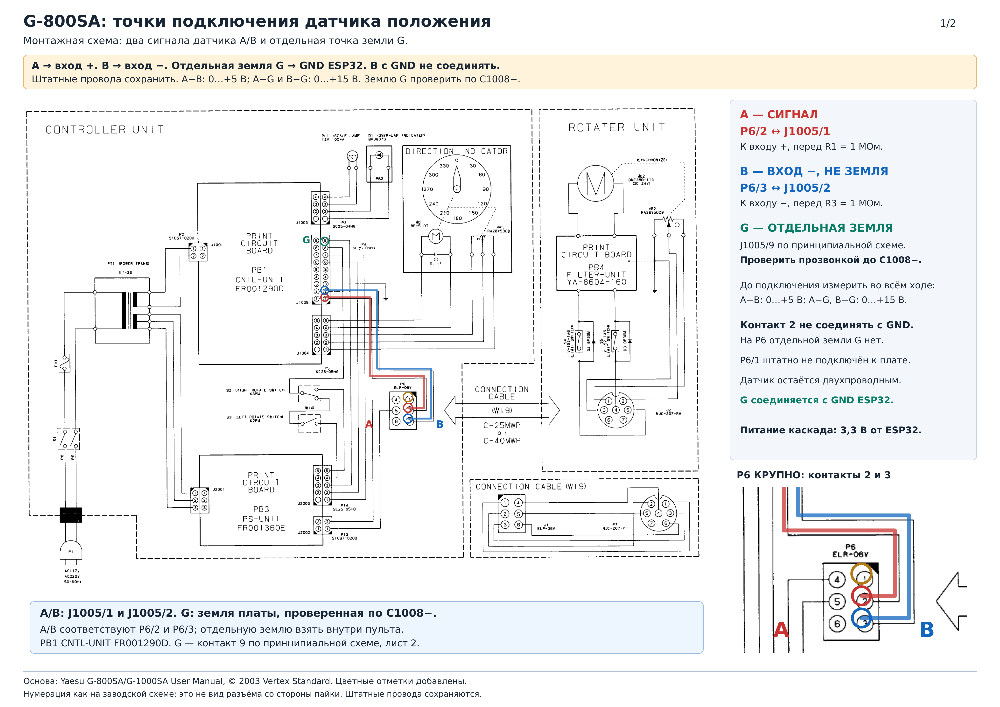
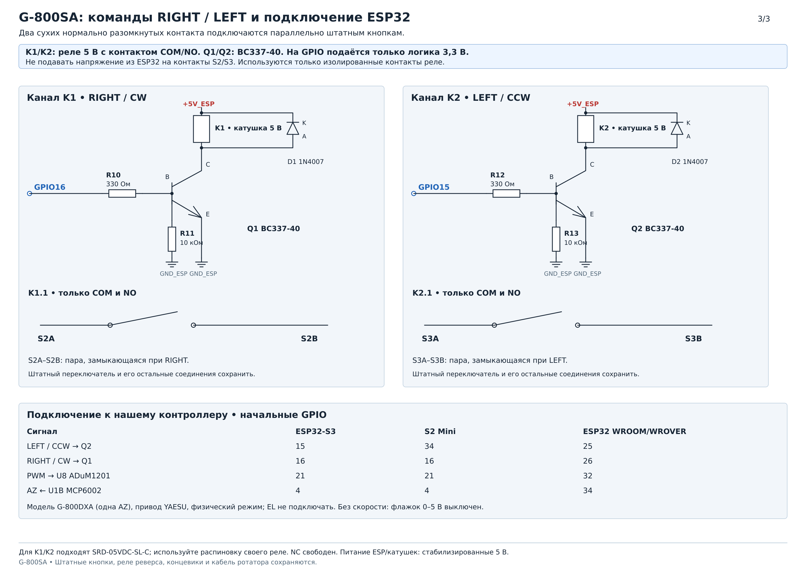
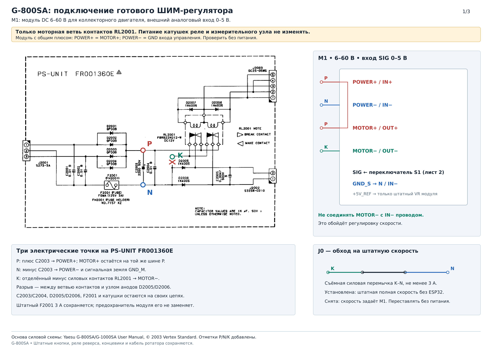
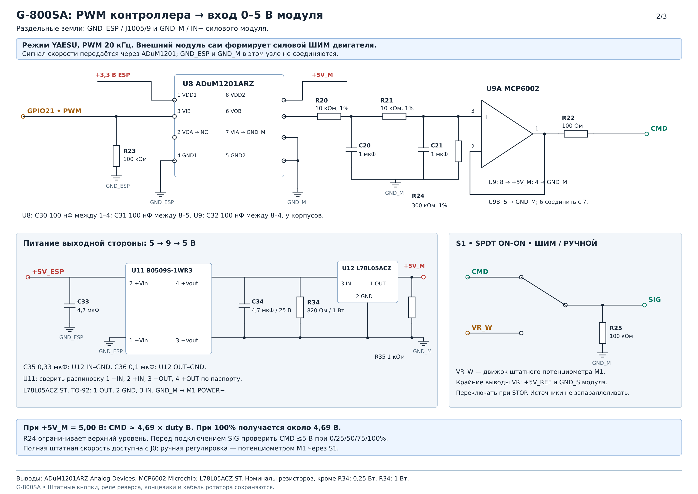

# Yaesu G-800SA: подключение и регулировка скорости

[Документация](../../index.md) · [Силовые интерфейсы](../index.md)

ESP32 подключается к штатному пульту G-800SA: считывает положение и замыкает контакты RIGHT/LEFT. Для изменения скорости в пульт добавляется **готовый силовой ШИМ-регулятор DC 6–60 В с внешним аналоговым входом 0–5 В**. Штатные кнопки, реле реверса, концевики и кабель ротатора сохраняются.

## Схемы и варианты подключения

| Узел | Изображение | Схема для печати / исходник |
|---|---|---|
| Точки датчика в пульте | [Монтажная](g800sa-tap-points-wiring.png), [принципиальная](g800sa-tap-points-circuit.png) | [PDF, 2 листа](g800sa-tap-points.pdf), [SVG монтажной](g800sa-tap-points-wiring.svg), [SVG принципиальной](g800sa-tap-points-circuit.svg) |
| Дифференциальный вход положения: разность 0–5 В | [PNG](g800sa-feedback-5v.png) | [PDF](g800sa-feedback-5v.pdf), [SVG](g800sa-feedback-5v.svg) |
| Включение готового регулятора в PS-UNIT | [PNG](g800sa-speed-power.png) | [PDF, все 3 листа](g800sa-speed-module.pdf), [SVG](g800sa-speed-power.svg) |
| Команда скорости PWM → аналоговый вход модуля | [PNG](g800sa-speed-command.png) | [SVG](g800sa-speed-command.svg) |
| RIGHT/LEFT через сухие контакты | [PNG](g800sa-directions.png) | [SVG](g800sa-directions.svg) |

Без регулировки скорости соберите вход положения и два канала RIGHT/LEFT. Силовую плату пульта менять не требуется. Для регулировки дополнительно установите M1 и канал задания скорости.

Нумерация на рисунках соответствует заводской электрической схеме, а не виду разъёма со стороны пайки. Сверьте маркировку платы и контактов перед монтажом. Внешний разъём **P6 G-800SA не является mini-DIN EXT CONTROL модели DXA**.

## Датчик положения: два сигнала и отдельная земля

| Цепь | Задний разъём | Внутренний разъём PB1 CNTL-UNIT FR001290D | Подключение |
|---|---|---|---|
| A, положительный измерительный вход | P6/2 | J1005/1 | К R1 1 МОм, далее к IN+ U1A |
| B, отрицательный измерительный вход | P6/3 | J1005/2 | К R3 1 МОм, далее к IN− U1A; **не к GND** |
| G, земля платы CNTL-UNIT | На P6 не выведена | J1005/9 по принципиальной схеме | GND ESP32, вывод 4 U1 и общий измерительного каскада |

В заводской монтажной схеме **P6/1 не подключён к плате пульта**. Хотя VR2 нарисован с тремя выводами, пульт использует его как двухпроводный датчик. Не подавайте на датчик дополнительное питание от ESP32 и не отключайте его штатные провода. К добавленному измерительному каскаду идут **три провода A/B/G**: отдельный G берётся внутри пульта.

**J1005/2 и J1005/3 по принципиальной схеме соединены между собой, а с землёй связаны через R1018 1,5 кОм.** Ни один из этих двух контактов не используйте как GND ESP32. Соединение B с G замкнёт R1018 проводом и изменит работу штатной цепи. Точку G определяйте прозвонкой до **минуса C1008**, электролитического конденсатора после стабилизатора Q1001: один значок земли на монтажном рисунке не заменяет эту проверку.

1. Отключите пульт от сети. Проверьте землю G по минусу C1008 и присоедините отдельный провод G. Провода A/B присоедините параллельно штатному датчику, через входные резисторы каскада.
2. До соединения с ESP32 измерьте **A−G, B−G и A−B** во всём ходе. Для этой схемы каждый сигнал относительно G должен находиться в пределах **0…+15 В**, а разность A−B — **0…+5 В**. Это два независимых условия. Если хотя бы одно не выполняется, подберите другой входной каскад.
3. Соберите [дифференциальный каскад на MCP6002](g800sa-feedback-5v.svg) по таблице ниже. U1A вычитает B из A, U1B усиливает полученный сигнал. Обе половины U1 используются; перемычки неиспользуемой половины от варианта с повторителем здесь не ставятся.
4. U1: вывод 8 → 3,3 В ESP32, вывод 4 → G. G соедините с GND ESP32. **A и B подключаются только через входные резисторы; B с GND не соединяется.**
5. При питании 3,30 В проверьте выход: `UADC ≈ 0,45375 + 0,33 × (A−B)`, в вольтах. При нулевой разности ожидается около **0,454 В**, при 1,2 В — около **0,850 В**, при 5 В — около **2,104 В**. Смещение предусмотрено схемой и учитывается калибровкой. Напряжение на ADC перед подключением платы должно быть в диапазоне **0…2,4 В**; номинальные значения могут отличаться из-за допусков деталей.
6. Выход через R9 подключайте **непосредственно к выбранному ADC**, обходя типовой делитель 6,8/4,7 кОм. Не добавляйте связь G → силовой минус N ради скорости: канал скорости ниже имеет отдельную развязку.

| Деталь | Соединение |
|---|---|
| R1 1 МОм | A → U1A IN+ 3 |
| R2 160 кОм | IN+ 3 → G |
| R7 2,4 МОм | 3,3 В ESP32 → IN+ 3; создаёт смещение |
| R3 1 МОм | B → U1A IN− 2 |
| R4 150 кОм и C5 10 нФ параллельно | U1A OUT 1 → IN− 2 |
| C1 10 нФ | IN+ 3 → G |
| U1B | IN+ 5 → OUT 1 U1A; R6 12 кОм между OUT 7 и IN− 6; R5 10 кОм между IN− 6 и G |
| R9 1 кОм | OUT 7 U1B → AZ ADC |
| C2 100 нФ | AZ ADC после R9 → G |
| D1/D2 BAT85 | D1: анод к ADC, катод к 3,3 В; D2: анод к G, катод к ADC |
| Питание | C3 100 нФ, C4 1 мкФ и R8 510 Ом параллельно между 3,3 В и G; C3 у выводов 8/4 U1 |

R1–R7 — 1%, обычные металлоплёночные резисторы. Для подавления общего напряжения важны отношения **R1 = R3** и **R4 = R2∥R7 = 150 кОм**. Подбор отношений до 0,1% уменьшает влияние общего напряжения A/B; после сборки выполняйте многоточечную калибровку. C1/C5 возьмите одинакового типа и номинала. Входные резисторы по 1 МОм ограничивают нагрузку штатной цепи; не заменяйте их номиналами в десятки кОм без пересчёта всего каскада.

При отсутствии нужного номинала R2 160 кОм можно собрать из **150 кОм + 10 кОм последовательно**, а R7 2,4 МОм — из **2,2 МОм + 200 кОм последовательно**. Каждый резистор в такой цепочке — 1%.

Канал положения имеет общую землю с пультом и не является гальванически изолированным. Подключение USB также соединяет G с землёй компьютера. Многоточечная калибровка учитывает нелинейность сигнала относительно угла; после замены входного каскада или изменения штатных подстроечников выполните её заново.

## RIGHT и LEFT

Для каждого направления нужен сухой нормально разомкнутый контакт. K1 COM/NO включается параллельно паре S2A–S2B, замыкающейся при **RIGHT/CW**; K2 COM/NO — параллельно паре S3A–S3B, замыкающейся при **LEFT/CCW**. При отключённом питании определите эти пары омметром по действию кнопок. Другие соединения штатного переключателя, включая перемычку W14, сохраните.

На третьем листе показаны два одинаковых драйвера реле 5 В: BC337-40, базовый резистор 330 Ом, подтяжка базы к GND ESP32 10 кОм и защитный диод 1N4007 параллельно катушке. Катод диода — к +5V_ESP. Выводы C/B/E определяйте по паспорту конкретного производителя BC337-40. Контакт NC реле не используется.

Подойдут SRD-05VDC-SL-C или готовая двухканальная релейная плата с **активным HIGH и входами, совместимыми с 3,3 В**. Не переносите распиновку драйвера на произвольную плату с активным LOW. Контакты реле не соединяются с +5V_ESP или GND ESP32. Питание контроллера и катушек — стабилизированные 5 В с достаточным током; поставьте 100 нФ и 100–470 мкФ возле катушек.

Во время управления от ESP32 не задавайте противоположное направление штатной кнопкой. Переключайте способ управления после STOP. Перед автоматическим наведением проверьте обе команды и остановку короткими включениями.

## Выбор готового ШИМ-модуля

Для M1 выбирайте **регулятор коллекторного DC-двигателя 6–60 В, без реверса, с четырьмя силовыми клеммами и явно указанным внешним аналоговым управлением 0–5 В**. Подходящий тип продаётся как «6–60 V 30 A, PLC 0–5 V, 15 kHz», например [Elecbee SKU 1267453](https://www.elecbee.com/en/product-detail/dc-6-60v-30a-pwm-dc-motor-speed-regulator-high-power-speed-controller_31933). Проверяйте описание конкретной ревизии: одинаковые по виду платы могут иметь разные входы.

Для показанной схемы нужны следующие свойства модуля:

- **POWER+ электрически соединён с MOTOR+**: общий плюс, ШИМ в отрицательном выходе MOTOR−.
- Сигнальная земля входа **GND_S соединена с POWER−**, а не с коммутируемым MOTOR−.
- Средний провод потенциометра — внешний вход **SIG 0–5 В**; крайние провода — +5V_REF и GND_S.
- Допустимый ток учитывает пуск двигателя. Надпись «30 A» не заменяет штатный предохранитель F2001 3 А, подбор проводов и охлаждение.

Проверьте первые два соединения омметром при полностью отключённом питании. Номера и цвета проводов потенциометра определяйте по документации модуля, не по фотографии похожей платы. Готовый генератор импульсов XY-PWM1, регулятор бесколлекторного трёхфазного двигателя и сетевой симисторный диммер для этого подключения не подходят.

**SIG ожидает аналоговое напряжение. Сырые импульсы GPIO напрямую на него не подавать.** Частота 15 кГц в описании M1 относится к силовому выходу модуля; PWM 20 кГц нашего контроллера преобразуется в напряжение отдельным узлом.

## Переделка PS-UNIT

Работайте с отключённым от сети пультом. Модуль включается **до реверсирующих контактов RL2001**, поэтому на его POWER не меняется полярность при RIGHT/LEFT.

На плате **PS-UNIT FR001360E** найдите:

| Метка | Узел пульта | Подключение M1 |
|---|---|---|
| P | Плюс C2003, положительная шина выпрямителя | POWER+; MOTOR+ относится к той же шине P |
| N | Минус C2003, постоянная отрицательная шина | POWER− и сигнальная земля GND_M |
| K | Отрицательная ветвь только силовых контактов RL2001 | MOTOR−, после отделения этой ветви от N |

1. Измерьте напряжение на C2003 и сверьте его с допустимым диапазоном M1. Напряжение на конденсаторе без нагрузки может быть выше рабочего напряжения двигателя.
2. Отключите питание. Разорвите **только ветвь N → отрицательные силовые контакты RL2001**, показанную крестом. На электрической схеме разрыв расположен между контактной ветвью и узлом анодов D2005/D2006. Физическую дорожку найдите прозвонкой своей платы.
3. Сохраните соединения C2003/C2004, F2001, D2005/D2006 и катушек реле. Не разрывайте общую землю всей платы, провод датчика или цепь питания катушек.
4. Подключите POWER+ к P, POWER− к N и MOTOR− к K. При общем плюсе модуля MOTOR+ относится к той же шине P; отдельного разрыва плюсовой шины не требуется.
5. Убедитесь, что K не соединён напрямую с N другой дорожкой или монтажным проводом. Иначе ШИМ будет обойдён.
6. Установите M1 на изолирующих стойках, сократите силовую петлю, отделите её от проводов датчика. Не пускайте моторный ток по земле ESP32 или тонкому сигнальному кабелю.

### Возврат к штатной полной скорости

Предусмотрите **J0 — съёмную силовую перемычку K–N** с проводом и клеммами на ток не менее 3 А. Установленная J0 восстанавливает заводское соединение отрицательной контактной ветви; штатные кнопки работают на полной скорости независимо от ESP32. Для регулировки скорости J0 снимается. Переставляйте её только при отключённом питании.

Это силовой обход M1. Переключатель S1 ниже выбирает лишь источник задания скорости и не заменяет J0.

## Внешнее задание скорости 0–5 В

Используйте второй лист схемы:

1. **U8 ADuM1201ARZ, SOIC8:** 1 VDD1 → 3,3 В ESP; 4 GND1 → GND ESP; PWM → **3 VIB**; **6 VOB** → R20. 8 VDD2 → +5V_M; 5 GND2 и неиспользуемый вход 7 VIA → GND_M; выход 2 VOA свободен. У U8 установите C30/C31 по 100 нФ между 1–4 и 8–5. Можно использовать готовую плату ADuM1201 с доступными этими цепями.
2. **Фильтр:** R20 10 кОм → C20 1 мкФ на GND_M → R21 10 кОм → второй узел. C21 1 мкФ и R24 300 кОм подключены между вторым узлом и GND_M. R20/R21/R24 — 1%. Сигнальные конденсаторы неполярные, не менее 10 В.
3. **U9 MCP6002-I/SN:** второй узел → IN+ 3; OUT 1 соединить с IN− 2; OUT 1 через R22 100 Ом → CMD. Питание 8 → +5V_M, 4 → GND_M; C32 100 нФ у корпуса. Неиспользуемая половина: 5 → GND_M, 6 соединить с 7.
4. **U11 B0509S-1WR3, изолированный DC/DC 5 → 9 В:** 2 +IN → +5V_ESP, 1 −IN → GND ESP; 4 +OUT → +9V_RAW, 3 −OUT → GND_M. Сверьте распиновку с паспортом выбранного производителя. Вход и выход — по 4,7 мкФ; выходной конденсатор не менее 25 В. R34 820 Ом / 1 Вт между +9V_RAW и GND_M обеспечивает нагрузку преобразователя.
5. **U12 ST L78L05ACZ, TO-92:** 3 IN → +9V_RAW, 2 GND → GND_M, 1 OUT → +5V_M. C35 0,33 мкФ между IN–GND; C36 0,1 мкФ между OUT–GND; R35 1 кОм между +5V_M и GND_M обеспечивает минимальную нагрузку стабилизатора. Используйте исполнение **ACZ**, а не произвольный 78L05 с другой точностью или распиновкой. Перед подключением U8/U9 проверьте выход питания: 4,75…5,25 В.
6. **S1 SPDT ON-ON, break-before-make:** общий контакт → SIG M1; вход «ШИМ» → CMD; вход «Ручной» → движок потенциометра M1. Крайние выводы потенциометра остаются на +5V_REF и GND_S модуля. R25 100 кОм от SIG к GND_M. Снимите прямое соединение движка с SIG, иначе потенциометр и ОУ окажутся запараллелены.
7. Соедините GND_M с **POWER− / N** модуля. Через этот канал не соединяйте GND_M с GND ESP / G, проводом B датчика или MOTOR−.

При +5V_M = 5,00 В и заполнении PWM 100% напряжение CMD составляет около **4,69 В**: R24 ограничивает верхний уровень команды. При 50% получается около 2,34 В. Точная скорость двигателя зависит от модуля, нагрузки и напряжения питания. Максимум в автоматическом режиме может быть ниже штатного; полная штатная скорость доступна с J0, а ручная регулировка — потенциометром M1 через S1.

Перед подключением SIG измерьте CMD относительно GND_M при 0/25/50/75/100%; во всех точках требуется **0…+5 В**. Проверяйте команду под нагрузкой реального входа M1. Постоянная времени каждого RC-звена около 10 мс; после изменения заполнения дайте выходу установиться. STOP снимает команды направления независимо от остаточного напряжения фильтра.

Не питайте ESP32 или интерфейсную плату от +5V_REF потенциометра M1. Канал положения питается от 3,3 В ESP, канал скорости после развязки — от собственного +5V_M.

## Подключение к контроллеру и настройки

| Назначение | Поле GPIO | ESP32-S3 | S2 Mini | ESP32 WROOM/WROVER |
|---|---|---:|---:|---:|
| LEFT / CCW → Q2 / K2 | azNegative | 15 | 34 | 25 |
| RIGHT / CW → Q1 / K1 | azPositive | 16 | 16 | 26 |
| PWM скорости → U8/3 | azSpeedEnable | 21 | 21 | 32 |
| AZ ADC ← дифференциальный каскад U1B | azAdc | 4 | 4 | 34 |

Это начальные назначения; текущие проверяйте на `/hardware` и в [таблице профилей](../../setup/configuration.md#распиновка-gpio). Схемы показывают S3. Для локального AZ CrowPanel используйте [отдельную инструкцию](../../boards/crowpanel-az.md): её инверсия GPIO0 и согласование выходов отличаются.

1. Соберите выбранную конфигурацию по [инструкции сборки](../../build.md). В `/hardware` выберите **YAESU**, физический привод и свои GPIO. Для EL установите `−1` у `elAdc`, `elNegative`, `elPositive` и `elSpeedEnable`; сохраните и подтвердите настройки. Режимы BTS7960 и SEPARATE_PWM для приведённой схемы не выбирайте.
2. В **Настройки → Поворотка и привод → Модель** выберите **G-800DXA**: в прошивке это имеющийся профиль одной оси AZ. Отдельного пункта G-800SA нет; электрические соединения выполняются по этой инструкции SA. EL не подключается.
3. Если M1 и канал задания собраны, включите **«Управлять скоростью через внешний модуль 0–5 В»**. В режиме YAESU GPIO скорости выдаёт PWM 20 кГц, 10 бит. Без регулятора скорости оставьте флажок выключенным.
4. При остановленном приводе выберите S1 «ШИМ», снимите J0 при отключённом питании. Сначала проверьте направления и STOP с отключённым моторным кабелем, затем короткими включениями на рабочей скорости. При обратном направлении исправьте назначения/проводку и повторите проверку.
5. В **Настройки → Диапазоны и калибровка** задайте полный ход своей поворотки и выберите **«Несколько точек»**. Запишите оба упора и промежуточные положения; подробности — в [инструкции калибровки](../../setup/az-range.md). При изменении входного каскада выполняйте калибровку заново.
6. Проверьте 25/50/75/100% задания. Подберите минимальный устойчивый выход и стартовый импульс под реальную нагрузку: слишком малое заполнение может не запускать двигатель. Затем настройте разгон, подход к цели и торможение по [инструкции регуляторов](../../setup/regulator-tuning.md).

Для управления штатными кнопками выберите S1 «Ручной» и задайте скорость потенциометром M1, либо восстановите J0 для заводской полной скорости. Меняйте режим после STOP. Снятие питания только с ESP32 не отключает сетевое питание пульта.

## Детали

| Узел | Основные детали |
|---|---|
| Готовая силовая плата | M1 6–60 В, коллекторный DC, четыре силовые клеммы, общий плюс, внешний SIG 0–5 В; штатный потенциометр |
| Положение | MCP6002-I/SN; два 1 МОм, 160 кОм, 150 кОм, 10 кОм, 12 кОм и 2,4 МОм — 1%; 1 кОм; 510 Ом; два BAT85; два 10 нФ, два 100 нФ, 1 мкФ |
| Команда скорости | ADuM1201ARZ или готовая плата; MCP6002-I/SN; B0509S-1WR3; ST L78L05ACZ; два 10 кОм и 300 кОм 1%; 100 Ом; два 100 кОм; 1 кОм; 820 Ом / 1 Вт; конденсаторы по листу 2 |
| Направления | Два SRD-05VDC-SL-C, два BC337-40, два 1N4007, два 330 Ом и два 10 кОм; либо совместимая двухканальная плата |
| Переключение | S1 SPDT ON-ON break-before-make для сигнала; J0 — отдельная силовая перемычка K–N |

Обычные резисторы — 0,25 Вт, кроме R34 1 Вт. Проверяйте корпус и распиновку выбранных деталей. Нерегулируемый B0505S не заменяет цепочку B0509S + L78L05ACZ.

Для заказа: [готовая плата ADuM1201](https://smdx.ru/adum1201), [MCP6002-I/SN](https://dip8.ru/shop/product/mcp6002_i_sn_mchp/), [B0509S-1WR3 в разделе DC/DC](https://tagradio.ru/index.php?path=13000040_13000041&route=product%2Fcategory), [ST L78L05ACZ](https://eltix.ru/item/l78l05acz-ctabilizator-napryageniya-%2B5v-0-1a-to-92). Сверяйте производителя и исполнение с указанными на схеме.

## Источники

- [Yaesu G-800SA/G-1000SA User Manual](https://public2024cf.yaesu.com/downloadFile.cfm?FileCatID=155&FileContentType=application/pdf&FileID=818&FileName=G-800SA_1000SA.pdf): заводские схемы CNTL-UNIT, PS-UNIT и соединений; © 2003 Vertex Standard.
- [ERC Installation Guide, стр. 55](https://www.vibroplex.com/techdocs/ERC/eng_Installationguide_ERC.pdf#page=55): точки датчика и подключение параллельно RIGHT/LEFT.
- [PA0PLY: переделка родственной G-1000C](https://www.pa0ply.nl/wp-content/uploads/2025/02/Yeasu-G-1000C-controller.pdf): регулировка скорости в моторной цепи перед реле реверса.
- [ADuM1201](https://www.analog.com/media/en/technical-documentation/data-sheets/ADuM1200_1201.pdf), [MCP6002](https://www.microchip.com/en-us/product/MCP6002), [ST L78L](https://www.st.com/resource/en/datasheet/l78l.pdf): питание, выводы и характеристики интерфейсных деталей.

Схемы интерфейса и инструкция форка — RA3VLD; [лицензия проекта](../../../LICENSE). Заводские фрагменты сохраняют обозначения и авторство Yaesu/Vertex Standard.
