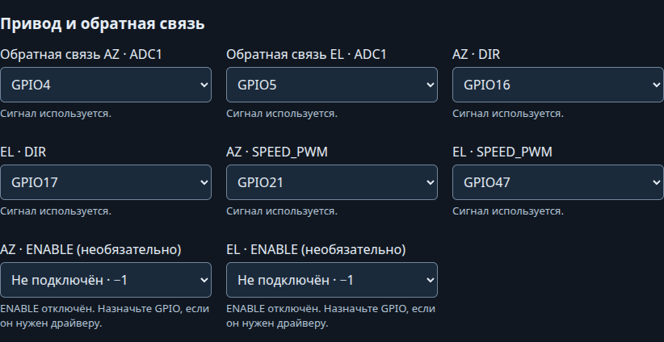

# Отдельные направления и PWM

[Силовые интерфейсы](index.md) · [Документация](../index.md)

Интерфейс **SEPARATE_PWM** предназначен для драйвера с двумя входами направления и отдельным входом скорости. Для модуля IBT-2 с RPWM/LPWM используйте [режим BTS7960](bts7960/index.md).

## Сигналы

| Назначение | Поле GPIO | S3 | S2 Mini | ESP32 |
|---|---|---:|---:|---:|
| AZ − / AZ + | `azNegative` / `azPositive` | 15 / 16 | 34 / 16 | 25 / 26 |
| EL − / EL + | `elNegative` / `elPositive` | 18 / 17 | 18 / 17 | 14 / 27 |
| PWM AZ / EL | `azSpeedEnable` / `elSpeedEnable` | 21 / 47 | 21 / 33 | 32 / 33 |
| ENABLE AZ / EL (необязательно) | `azEnable` / `elEnable` | −1 | −1 | −1 |
| Датчик AZ / EL | `azAdc` / `elAdc` | 4 / 5 | 4 / 5 | 34 / 35 |

Это начальные назначения; текущие доступны на `/hardware`. У прежней S2 назначьте свободный `elSpeedEnable`. Профиль локального AZ CrowPanel этот интерфейс не поддерживает.

Направления активны HIGH: при движении включён один из двух выходов оси. Скорость — отдельный PWM **1 кГц, 10 бит**, обычной полярности. Необязательный ENABLE каждой оси активен HIGH только при движении с ненулевым PWM. В GPIO выберите «Не подключён · −1», если драйвер не использует этот сигнал. При STOP оба направления LOW, PWM 0%, назначенный ENABLE — LOW; перед реверсом по умолчанию выдерживается пауза 300 мс. В серворежиме её можно изменить или отключить настройкой **Пауза реверса в серворежиме, мс**. Фактическая остановка зависит от драйвера и механики.

## Подключение и запуск

1. По паспорту своего драйвера проверьте назначение входов, допустимые уровни и частоту PWM. GPIO дают логику 3,3 В; для входов 5 В или иной полярности нужен согласующий каскад. Входы DIR+ENABLE или RPWM+LPWM не равнозначны этой схеме.
2. При выключенном питании подключите три управляющих сигнала каждой оси. Питание двигателя подайте через подходящий предохранитель; силовой ток не должен идти через землю ESP32. Для неизолированных входов соедините сигнальные земли; для изолированных соблюдайте разделение доменов.
3. Подключите датчики положения через [делители и защиту](adc-input.md). Измерьте уровни перед подключением ADC. Выход измерения тока драйвера не заменяет датчик положения.
4. В `/hardware` выберите **направления и отдельный PWM каждой оси**, физический привод и GPIO; сохраните и подтвердите. Инверсия BTS7960 к этому интерфейсу не относится.
5. Без силового питания проверьте направления, PWM, STOP, сброс и отключение ESP32. Затем с ограничением тока проверьте движение и реверс.
6. Выполните [калибровку](../setup/az-range.md) и [настройку регулятора](../setup/regulator-tuning.md) для каждой оси.

Если входная схема драйвера не соответствует этим сигналам, сначала согласуйте интерфейс. Универсальной распайки силовой части для всех драйверов нет.

## Один DIR и отдельный PWM

Для драйвера с одним входом направления выберите **DIR + SPEED_PWM** (`DIR_PWM`). На каждой используемой оси назначьте **DIR** и **SPEED_PWM**. При необходимости назначьте отдельный **ENABLE**; −1 оставляет его отключённым. DIR = HIGH соответствует положительному направлению, LOW — отрицательному; PWM = 0 останавливает привод. Это отдельная схема от двух выходов LEFT/RIGHT.

В HTTP API DIR использует `pins.azPositive` / `pins.elPositive`, PWM — `pins.azSpeedEnable` / `pins.elSpeedEnable`. Поля `azNegative` / `elNegative` в этом режиме не используются и не занимают GPIO. Перед подключением проверьте уровни управляющих входов драйвера.

Для обоих режимов отдельный ENABLE задаётся через `pin.azEnable` / `pin.elEnable`. При запуске, STOP и ошибке назначенные выходы ENABLE выключены (LOW). Перед изменением направления ENABLE выключается, после установки направления и PWM включается. Если ENABLE не подключён, остановка выполняется выходами направления и PWM.

