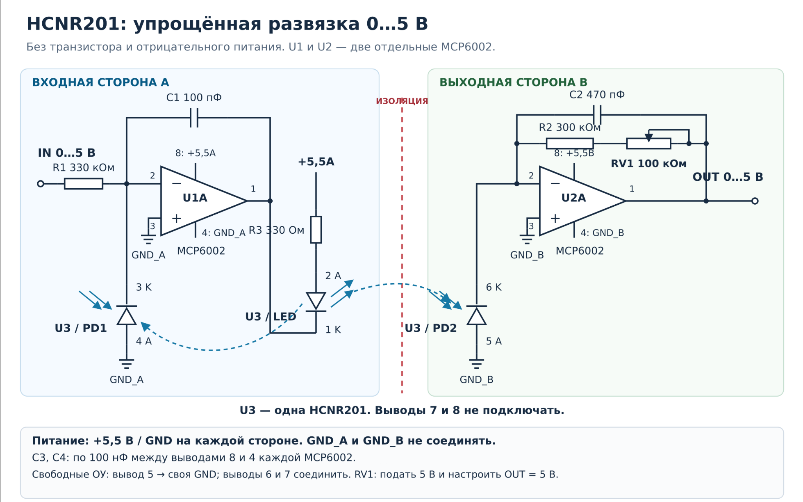

# Yaesu: пример изоляции обратной связи на HCNR201

[Силовые интерфейсы](../hardware.md) · [G-5500](g5500-guide.md) · [G-800DXA](g800dxa-guide.md)

Пример аналоговой развязки сигнала положения **0–5 В** на HCNR201 и двух отдельных MCP6002. Для G-5500 нужны отдельные каналы AZ и EL; для G-800DXA — один канал AZ.

## Подключение и настройка

1. Подайте **+5,5 В на каждой стороне** относительно её земли: сторона A — `GND_A`, сторона B — `GND_B`. Источники питания сторон должны быть гальванически изолированы друг от друга; **GND_A и GND_B не соединяйте**. U1 и U2 — две отдельные MCP6002, размещённые по разные стороны барьера.
2. Подключите сигнал положения Yaesu к `IN`, общий провод Yaesu — к `GND_A`. Используйте сигналы и номера контактов из руководства своей модели: [G-5500](g5500-guide.md#разъём-и-сигналы) или [G-800DXA](g800dxa-guide.md#разъём-ext-control). На стороне контроллера `GND_B` соедините с GND ESP32.
3. Подайте на `IN` **5 В относительно GND_A** и подстроечником **RV1 выставьте 5 В на OUT относительно GND_B**. Проверяйте вход и выход без соединения земель измерительными приборами.
4. Проверьте передачу сигнала в промежуточных точках и около нуля. **Около нуля возможна небольшая погрешность или мёртвая зона. Это расчётный вариант, его нужно проверить на макете.** После сборки измерительного канала выполните [калибровку положения](../az-range.md#две-точки).

## Согласование с АЦП

Номиналы делителя и защиту выбирайте по [инструкции входа АЦП](adc-input.md).

При переходе на изолированный канал уберите прямую связь сигнала положения и общего провода Yaesu с входной цепью ESP32: сигнал должен проходить через барьер HCNR201, а делитель и защита после него должны относиться к `GND_B`. Для полной развязки устройств остальные соединения, включая управление, питание и подключённые измерительные приборы, также должны сохранять разделение земель.
