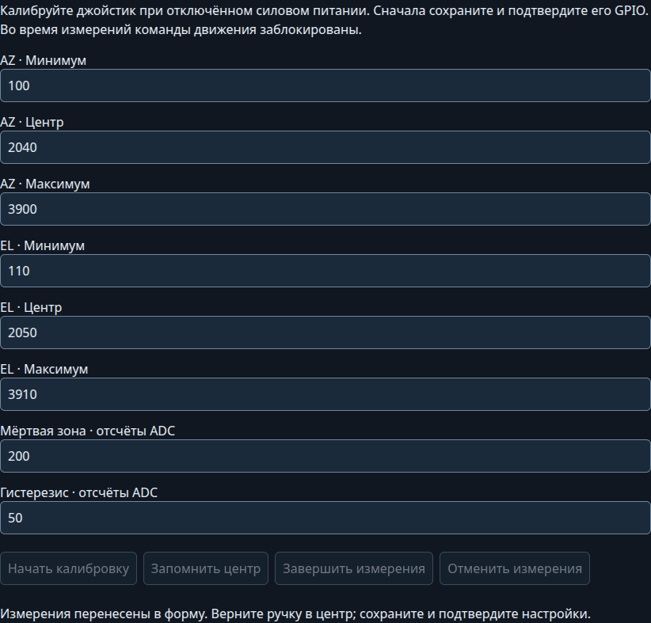

# Кнопки и резистивный джойстик

[Документация](index.md)

К основному контроллеру можно подключить кнопки направлений или пружинный джойстик с двумя потенциометрами. Вращение идёт при удержании; отпускание кнопки или возврат ручки в центральную зону останавливает соответствующую ось. Обе оси могут двигаться одновременно. У G-800DXA используется только AZ, входы EL игнорируются. В роли удалённого пульта HUD кнопки и джойстик управляют выбранной повороткой через Wi-Fi или UART. При потере связи или смене поворотки удержание прекращается; перед новым движением отпустите кнопки или верните ручку в центр.

Режим, GPIO, инверсия направлений и калибровка джойстика задаются **после прошивки** на странице `/hardware`: выберите «Кнопки направлений» или «Аналоговый джойстик», назначьте свободные GPIO в одноимённой группе, сохраните настройки и подтвердите пробный запуск. По умолчанию входы выключены. Для кнопок используемой оси назначайте оба направления; неиспользуемые сигналы оставляйте «Не подключён».

Параметры `LOCAL_*` в `G5500_Fork/build_config.hpp` и готовые профили сборки ниже задают начальные значения для платы без сохранённых настроек. Уже сохранённые назначения имеют приоритет.

На HUD используются входы самого пульта; силовые выходы и обратная связь положения остаются на контроллере поворотки. Доступность GPIO зависит от платы. У штатной CrowPanel ADC1 заняты встроенными устройствами: подключить аналоговый джойстик к свободным разъёмам без изменения аппаратуры нельзя. Для внешних кнопок нужны свободные GPIO с подтяжкой. GPIO43/44 можно использовать только при доступе непосредственно к соответствующему входу ESP32 и при отключённых UART/HC-05 на этих выводах. Штатный UART-разъём CrowPanel содержит согласующие цепи: перед подключением проверьте направление буфера и уровни по схеме своей ревизии. Назначение GPIO в вебе не меняет аппаратное направление буфера. Полноценный двухосевой джойстик удобнее подключать к отдельному ESP32/S3 в роли HUD с доступными ADC1.

## Четыре кнопки

Используйте нормально разомкнутые кнопки без фиксации. Каждая замыкает свой GPIO на GND контроллера; в прошивке включена внутренняя подтяжка к 3,3 В. На длинных проводах добавьте внешнюю подтяжку 4,7–10 кОм к 3,3 В и используйте витую пару GPIO/GND.

Готовая конфигурация для ESP32-S3 DevKitC-1 N16R8:

| Кнопка | GPIO | Параметр |
|---|---|---|
| AZ − / влево | 38 | `LOCAL_AZ_NEG_GPIO` |
| AZ + / вправо | 39 | `LOCAL_AZ_POS_GPIO` |
| EL − / вниз | 40 | `LOCAL_EL_NEG_GPIO` |
| EL + / вверх | 41 | `LOCAL_EL_POS_GPIO` |

```sh
pio run -e esp32s3_n16r8_buttons
```

В Arduino IDE задайте `LOCAL_INPUT_MODE LOCAL_INPUT_BUTTONS` и те же четыре GPIO в `build_config.hpp`. В `/hardware` можно выбрать обратное направление каждой оси. Кнопка подтверждения внешней цели настраивается отдельно в `/hardware`.

Нажатие принимается после 40 мс устойчивого контакта; отпускание останавливает движение при ближайшем опросе. Если во время локального вращения нажать также противоположную кнопку этой оси, она остановится и останется заблокированной до отпускания обеих кнопок. Другую ось можно продолжать удерживать.

## Аналоговый джойстик

Нужен джойстик с возвратом в центр и двумя потенциометрами, например около 10 кОм. Подключите крайние выводы потенциометров к **3,3 В и GND**, а движки — к входам ADC1. Для каждого входа рекомендуется резистор 1 кОм последовательно с движком и конденсатор 100 нФ от ADC к GND рядом с контроллером. Соедините земли. Встроенную кнопку нажатия ручки можно подключить отдельно как кнопку подтверждения.

**Не подавайте 5 В на ADC/GPIO ESP32.** У готового модуля проверьте напряжение обоих аналоговых выходов перед подключением. Включайте и отключайте джойстик при отключённых приводах: оборванный или плавающий аналоговый вход неотличим от отклонения ручки.

Готовая конфигурация ESP32-S3:

| Сигнал | GPIO | Параметр |
|---|---|---|
| Движок X / AZ | 1 | `LOCAL_AZ_ADC_GPIO` |
| Движок Y / EL | 6 | `LOCAL_EL_ADC_GPIO` |

```sh
pio run -e esp32s3_n16r8_joystick
```

GPIO6 в этом примере занят джойстиком; включить внешний HC-05 с его штатной распиновкой одновременно нельзя. Перенесите аналоговый вход джойстика на другой свободный ADC1 либо переназначьте UART модуля HC-05. На обычном ESP32 в конфигурации без дисплея и HC-05 можно использовать GPIO36 и GPIO39; на S2/S3 доступны ADC1 GPIO1…10 при отсутствии других назначений. Проверяются также дисплей, обратная связь положения, моторные выходы, UART и кнопка подтверждения. Страница оборудования и контроллер проверяют занятость GPIO и отклоняют конфликтующие назначения.

У джойстика отклонение от мёртвой зоны до крайнего положения задаёт 0…100% установленной рабочей скорости. Действуют разгон, ограничения и защиты выбранного привода. На выходе без регулировки скорости отклонение выбирает только направление. Инверсия AZ/EL на странице оборудования меняет направление без перестановки проводов.

### Центр и диапазон

Калибровка джойстика независима от калибровки положения поворотки. Для каждого аналогового входа задаются 12-битные отсчёты `analogRead()`:

| Параметры | По умолчанию | Назначение |
|---|---|---|
| `LOCAL_AZ_ADC_MIN`, `LOCAL_EL_ADC_MIN` | 0 | Нижний край |
| `LOCAL_AZ_ADC_CENTER`, `LOCAL_EL_ADC_CENTER` | 2048 | Отпущенная ручка |
| `LOCAL_AZ_ADC_MAX`, `LOCAL_EL_ADC_MAX` | 4095 | Верхний край |
| `LOCAL_ADC_DEADZONE` | 200 | Полуширина центральной зоны, отсчёты ADC |
| `LOCAL_ADC_HYSTERESIS` | 50 | Дополнительное отклонение для начала движения |



1. Отключите силовое питание приводов. В `/hardware` выберите джойстик, назначьте ADC1, сохраните и подтвердите настройки.
2. Нажмите «Начать калибровку». На странице появляются текущие 12-битные отсчёты AZ/EL; команды движения блокируются на время измерений.
3. Отпустите ручку и нажмите «Запомнить центр». Затем несколько раз проведите её до обоих краёв каждой подключённой оси.
4. Нажмите «Завершить измерения». Минимум, центр и максимум переносятся в форму. При недостаточном диапазоне продолжите измерения. «Отменить измерения» оставляет прежние значения.
5. Выберите мёртвую зону больше колебаний отпущенной ручки и задайте гистерезис. От центра до каждого края должно оставаться больше отсчётов, чем сумма мёртвой зоны и гистерезиса.
6. Верните ручку в центр, сохраните настройки, после перезапуска подтвердите их. Проверьте направления в имитации движения перед включением привода.

При закрытии страницы или потере соединения измерения автоматически прекращаются через 2 секунды без опроса. После завершения требуется нейтраль перед новым удержанием. Калибровка центра при включении автоматически не выполняется: отклонённая ручка не становится новой нейтралью. Калибровка джойстика сохраняется на той плате, к которой он подключён; калибровка положения поворотки выполняется отдельно на её контроллере.

## Проверка и управление

1. При отключённом силовом питании подключите входы, проверьте напряжения и запустите контроллер. Для проверки поведения можно выбрать имитацию движения: физические кнопки/джойстик работают и в ней; моторные выходы и ADC обратной связи выключены.
2. Отпустите все кнопки или верните ручку в центр минимум на 0,1 с. При загрузке с удерживаемым входом движение заблокировано до нейтрали.
3. Коротко проверьте оба направления каждой оси и остановку при отпускании. Затем при необходимости измените направление AZ/EL на странице оборудования и сохраните настройки.
4. Для реального привода проверьте калибровку поворотки, диапазоны и настройки регулятора по [инструкции управления](usage.md).

Локальное удержание выполняется сразу в ручном и автоматическом режимах; режим сохраняется. Оно отменяет наведение своей оси и активную последовательность, снимает активную предустановку. Нейтральный вход не останавливает наведение, начатое через веб или протокол.

STOP через веб/API и новая команда движения имеют приоритет над уже удерживаемым входом. Для повторного локального запуска верните все используемые входы в нейтраль. То же требуется после ошибки, изменения диапазона/модели и перерыва опроса от 250 мс. При ошибке сначала устраните её причину и выполните штатный сброс ошибки; удержание не сбрасывает защиту. Во время автотюна, применения оборудования, восстановления и OTA локальное управление заблокировано. Остановка использует штатный механизм контроллера; длительность фактической остановки двигателя зависит от привода и выбега.
