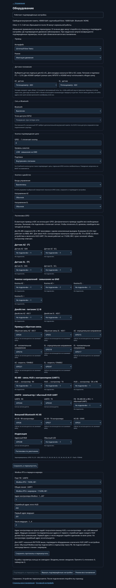

# Выбор конфигурации и оборудования

[Документация](../index.md)

## Выбор конфигурации

| Плата / сценарий | Окружение PlatformIO | Flash | Дисплей | Bluetooth | OTA |
|---|---|---|---|---|---|
| ESP32 WROOM/WROVER | `esp32_4mb` | 4 МиБ | Нет; варианты `_tft`, `_lcd` | SPP или HC-05 | Нет |
| WT32-ETH01, Ethernet | `wt32_eth01` | 4 МиБ | Нет | SPP или HC-05 | Нет; `wt32_eth01_noweb` — ArduinoOTA |
| ESP32 без веба | `esp32_4mb_noweb` | 4 МиБ | Нет | Нет | ArduinoOTA |
| ESP32 с увеличенной Flash | `esp32_8mb_ota` | 8 МиБ | Через `--display` | SPP или HC-05 | Да |
| S3 DevKitC-1 N16R8 | `esp32s3_n16r8` | 16 МиБ | Нет; `_tft`, `_lcd` | HC-05 | Да |
| LOLIN S2 Mini | `esp32s2_mini` | 4 МиБ | Нет; `_tft`, `_lcd` | HC-05 | Да, с учётом размера образа |
| Прежняя проводка S2 | `esp32s2_4mb_ota_compact` | 4 МиБ | Нет | HC-05 | Через браузер |
| CrowPanel 2.1 | `crowpanel_21` | 16 МиБ | Встроенный | HC-05 при свободных GPIO | Да |
| [ESP32 + Waveshare 1.85″](../boards/waveshare-1.85-qspi.md) | `esp32_4mb_st77916` | 4 МиБ | ST77916 360×360 / CST816S | Встроенный SPP | Нет |
| [ESP32-S3 + Waveshare 1.85″](../boards/waveshare-1.85-qspi.md) | `esp32s3_n16r8_st77916` | 16 МиБ | ST77916 360×360 / CST816S | HC-05 при свободных GPIO | Да |
| ESP32-2424S012C-Y(B) | `esp32_2424s012c` | 4 МиБ | GC9A01 240×240 / CST816 | HC-05 при свободных GPIO | Нет |
| [ESP32-3248S035C](../boards/esp32-3248s035c.md) | `esp32_3248s035c` | 4 МиБ | ST7796 480×320 / GT911 | Встроенный SPP | Нет |
| [ESP32-C3 без дисплея](../boards/esp32-c3.md) | `esp32c3_4mb` | 4 МиБ | Нет | HC-05 | Нет |
| Переделанная CrowPanel, AZ | `crowpanel_21_az` | 16 МиБ | Встроенный | Только при свободной распиновке | Да |

У всех вариантов доступны имитация и роль HUD. HTTP/WebSocket есть во всех перечисленных профилях, кроме вариантов `noweb`; командный API работает и без веба. Bluetooth по умолчанию выключен. Обычная CrowPanel управляет реальной повороткой через HUD; локальному приводу нужна [переделка](../boards/crowpanel-az.md).

| Когда выбирается | Параметры |
|---|---|
| При сборке | Плата, дисплей, Flash/PSRAM, USB, разделы; наличие веба/Bluetooth; начальные значения местных входов |
| Начальные значения сборки | Интерфейс привода, имитация, Bluetooth, политика AP, кнопка подтверждения и карта GPIO |
| Сохраняется на устройстве | Аппаратные настройки и GPIO, сеть, роль, модель, диапазоны, калибровки, регуляторы, предустановки |

Сохранённые параметры имеют приоритет над начальными флагами. Смена флага и повторная прошивка не заменяют настройку через `/hardware`. Flash должна соответствовать физическому модулю; [разметка и OTA](../maintenance/ota.md#платы-и-разметка).

## Параметры сборки

[Кнопки направлений и резистивный джойстик](../control/local-controls.md) включаются на странице `/hardware`. Там же назначаются GPIO, инверсия направлений и калибровка ADC. Параметры `LOCAL_*` при сборке задают начальные значения для платы без сохранённых настроек; по умолчанию дополнительные входы выключены.

Один комплект исходников в `G5500_Fork` используется Arduino IDE/CLI и PlatformIO. Основные параметры [build_config.hpp](../../G5500_Fork/build_config.hpp) — **плата и дисплей**:

```cpp
#define BOARD_PROFILE BOARD_AUTO
#define DISPLAY_KIND DISPLAY_NONE
```

Меняйте значения существующих определений под `#ifndef`, сохраняя эти защиты. Флаги `-D` имеют приоритет. `BOARD_AUTO` выбирает S2 Mini для LOLIN S2 Mini, прежнюю S2 для общего S2, классический ESP32 для ESP32, `BOARD_ESP32_C3` без дисплея для C3 и S3 для S3. Явные варианты: `BOARD_ESP32`, `BOARD_ESP32_C3`, `BOARD_S3`, `BOARD_S2_MINI`, `BOARD_S2_LEGACY`, `BOARD_CROWPANEL_21`, `BOARD_WT32_ETH01`, `BOARD_WAVESHARE_S3_ETH`, `BOARD_ESP32_2424S012C`, `BOARD_ESP32_3248S035C`. WT32-ETH01 использует отдельную [распиновку Ethernet](../boards/wt32-eth01.md). Плата в IDE должна соответствовать чипу.

Дисплей: `DISPLAY_NONE`, `DISPLAY_ILI9341` (TFT и XPT2046), `DISPLAY_LCD1602` (параллельный HD44780), `DISPLAY_CROWPANEL_21`, `DISPLAY_GC9A01`, `DISPLAY_ST7796` или `DISPLAY_ST77916`. CrowPanel требует одновременно `BOARD_CROWPANEL_21` и `DISPLAY_CROWPANEL_21`, GC9A01 — `BOARD_ESP32_2424S012C` и `DISPLAY_GC9A01`. ST7796 требует `BOARD_ESP32_3248S035C` и `DISPLAY_ST7796`. Внешний ST77916/QSPI выбирается с `BOARD_ESP32` либо `BOARD_S3`; его GPIO задаются в веб-настройках. Графические экраны используют общий [сенсорный интерфейс](../control/display.md). Прежние `TFT_DISPLAY_ENABLED=0/1` и `DISPLAY_ENABLED=0/1` сохранены как алиасы NONE/TFT; противоречивые флаги отклоняются.

Тип чипа, режимы Flash/PSRAM, native USB и таблица разделов выбираются в окружении PlatformIO или меню IDE согласно [инструкции сборки](../build.md).

## Отключение функций

Переключатели в `G5500_Fork/build_config.hpp` определяют состав прошивки: `0` удаляет поддержку, `1` включает её. Меняйте значения внутри существующих `#ifndef` либо задавайте `-D ИМЯ=0`; параметры сборщика имеют приоритет. Настройка выключенного сервиса в вебе сохраняет его код в образе, поэтому для экономии памяти используйте именно флаги сборки.

| Возможности | Флаги |
|---|---|
| Дисплей и локальные кнопки/джойстик | `DISPLAY_SUPPORT`, `LOCAL_INPUT_SUPPORT` |
| Сеть | `WIFI_SUPPORT`, `ETHERNET_SUPPORT` |
| Веб и поток состояния | `WEB_INTERFACE_ENABLED`, `WEB_LIVE_SUPPORT`, `WEB_PLAIN_HTML_SUPPORT` |
| Bluetooth и встроенный SPP | `BLUETOOTH_SUPPORT`, `BLUETOOTH_SPP_SUPPORT` |
| Программы управления | `GS232_SUPPORT`, `ROTCTLD_SUPPORT`, `N1MM_SUPPORT`, `PSTROTATOR_SUPPORT` |
| Командный API | `COMMAND_API_SUPPORT` |
| HUD и его каналы | `HUD_SUPPORT`, `HUD_UDP_SUPPORT`, `HUD_UART_SUPPORT` |
| Последовательные протоколы | `RS485_SUPPORT`, `MODBUS_RTU_SUPPORT` |
| Обновление | `OTA_SUPPORT`, `ARDUINO_OTA_SUPPORT` |
| Камера | `CAMERA_ENABLED` |
| Диагностика | `LOG_HISTORY_SUPPORT`, `RSSI_HISTORY_SUPPORT`, `RESET_HISTORY_SUPPORT`, `NTP_SUPPORT` |
| MQTT и Home Assistant | `MQTT_SUPPORT`, `HOME_ASSISTANT_DISCOVERY_SUPPORT` |

По умолчанию дочерние функции следуют доступности родителя. Например, `MQTT_SUPPORT=0` также выключает discovery, а `HUD_SUPPORT=0` — HUD UDP/UART. Если дочерний флаг задан отдельно через `-D`, выключите его явно вместе с родителем. MQTT, веб и HUD UDP требуют Wi-Fi или Ethernet; discovery требует MQTT, Modbus — RS‑485, WebSocket — веб. Сборщик проверяет зависимости и наличие канала настройки: сохраните командный API или веб с сетью.

`DISPLAY_SUPPORT=0` работает также на платах со встроенным дисплеем; сохраняйте выбранный `DISPLAY_KIND` и профиль платы. Для HTTP-управления с периодическим опросом состояния оставьте `WEB_INTERFACE_ENABLED=1`, установив `WEB_LIVE_SUPPORT=0`. `BLUETOOTH_SPP_SUPPORT=0` сохраняет возможность подключения HC-05 при `BLUETOOTH_SUPPORT=1`.

`WEB_PLAIN_HTML_SUPPORT=0` удаляет несжатые копии страниц: браузер должен поддерживать gzip. JSON API остаётся доступным. Этот флаг уже выключен в профилях ESP32-3248S035C, ESP32 с ILI9341 и компактном профиле ESP32 с OTA.

Калибровки, алгоритмы движения, автотюн, имитация и защиты сохраняются. Настройки исключённых функций остаются в NVS. Если сохранена роль HUD, а поддержка HUD исключена, роль сохраняется и местный привод не активируется. Верните прошивку с HUD или явно настройте роль и оборудование. Отключение функций не превращает сохранённый HUD в работающий местный привод.

Фактические возможности доступны через `build.features` в `/api/status` и `/api/config`. Веб скрывает исключённые сервисы; соответствующие API-операции возвращают `feature_disabled`. Изменение состава требует пересборки и записи прошивки. Числа экономии возле флагов относятся к указанным профилям: общий код библиотек означает, что экономия нескольких флагов не всегда складывается. Runtime heap зависит от активных подключений и выбранного оборудования.

## Оборудование в веб-интерфейсе

Откройте **Настройки → Оборудование → Настроить оборудование** или адрес `/hardware` на контроллере.

| Настройка | Варианты и назначение |
|---|---|
| Режим привода | Один список: Штатный блок Yaesu; DIR + SPEED_PWM; LEFT / RIGHT + SPEED_PWM; LEFT_PWM / RIGHT_PWM (BTS7960 / IBT-2); Имитация движения. Во всех PWM-схемах доступен необязательный ENABLE |
| Выходы BTS7960 | Прямой PWM или инвертирующие оптроны RPWM/LPWM; назначенный ENABLE активен HIGH |
| Датчики положения AZ / EL | Потенциометр (ADC), MT6701 или AS5600 по I²C; тип, GPIO, адрес и программный ноль выбираются отдельно для осей |
| Bluetooth | Выключен или включён |
| Транспорт Bluetooth | Автоматически: SPP на ESP32, HC-05 на S2/S3; либо явный HC-05 / SPP. Встроенный SPP доступен только на обычной ESP32 |
| Точка доступа | Резервная при потере домашней сети или постоянная AP вместе со STA. Выбор доступен на ESP32, S2 и S3; незавершённый мастер не включает постоянную AP |
| GPIO кнопки | Свободный доступный GPIO; −1 отключает кнопку. На CrowPanel кнопка ручки также работает через PCF8574; отдельная GPIO-кнопка необязательна |
| Уровень нажатия и подтяжка | LOW с замыканием на GND или HIGH; внутренняя подтяжка к питанию либо внешняя |

Карта GPIO показывает выбранные устройства: для потенциометра — ADC, для энкодера — I²C; группы выключенных кнопок, джойстика и HC-05 скрываются. Сначала включите нужные местные входы, затем назначьте их GPIO.

Выбирайте интерфейс и инверсию по подключённой схеме. Изменяйте проводку при выключенном питании. Для двух PWM-приводов на прежней S2 назначьте выход `elSpeedEnable`. У обычной CrowPanel встроенные соединения занимают все доступные ADC1, поэтому для физического привода требуется аппаратная переделка. Для переделанной CrowPanel профиль [`crowpanel_21_az`](../boards/crowpanel-az.md) поддерживает Yaesu G-800DXA и один BTS7960: GPIO6 — положение AZ, RX/TX — направления либо PWM, BOOT через инвертор — скорость либо ENABLE. В исходной распиновке RX/TX заняты приводом; HC-05 или HUD UART требуют отдельной свободной пары GPIO. Активный HIGH на входах ENABLE моста получается после обязательного инвертора BOOT.

Модель, диапазоны, калибровки и предустановки остаются в своих разделах настроек. В «Регуляторы и остановка» выберите простой вариант или каскадный ПИД; отдельное разрешение оси не требуется. Скорость, время разгона и торможения, начало замедления, ручной выбег и коэффициент торможения задаются в «Регуляторы и остановка» отдельно для AZ и EL при выборе простого варианта. Начальный угол выбега физического привода — 5°; сохранённый угол имеет приоритет. См. [настройку остановки](../control/index.md#наведение-при-шумной-обратной-связи).



## Магнитные энкодеры MT6701 и AS5600

Подключение, выбор GPIO и программного нуля описаны в [инструкции датчиков положения](position-sensors.md). Смена датчика выполняется на странице оборудования без пересборки прошивки. После сохранения подтвердите пробную конфигурацию и откалибруйте изменённую ось.

## Применение и восстановление доступа

1. На новом устройстве с веб-интерфейсом открывается [мастер настройки](first-start.md). Для последующих изменений откройте **Настройки → Оборудование → Настроить оборудование** или `/hardware`. В сборках без веба сохраняются аппаратные начальные значения выбранной сборки.
2. Выберите подключённое оборудование и нажмите **Сохранить и перезапустить**.
3. Если аппаратные параметры отличаются от последних подтверждённых, после подключения на главной странице и в настройках появится уведомление с таймером отката. В течение пяти минут проверьте работу устройства. Управление доступно сразу.
4. Дождитесь проверки устройства и нажмите **Подтверждаю, что всё ок** рядом с уведомлением. Конфигурация сохранится без остановки и повторного перезапуска. Эта же кнопка доступна на странице оборудования. Сохранение новых параметров само по себе не отменяет таймер отката.

Если подтверждение не пришло вовремя, запуск прервался, произошёл аварийный перезапуск или обнаружена нехватка памяти, привод отключается. После первого и второго сбоя устройство перезапускается с последними подтверждёнными аппаратными параметрами. Неудачная пробная конфигурация повторно не включается. После третьего сбоя включается режим восстановления. Счётчик сохраняется между перезапусками и очищается после 30 минут непрерывной нормальной работы; короткий успешный запуск его не очищает. На странице `/hardware` показано число сбоев из трёх. Ручной вход в восстановление, повреждённая конфигурация, недостоверное хранилище и отсутствие подтверждённых параметров для отката обрабатываются сразу.

В режиме восстановления Bluetooth, привод и локальный дисплей отключаются; остаётся точка доступа `G5500-Rotator-XXXXXX`, прежний пароль AP и страница настройки. Откройте `http://192.168.4.1/`, устраните причину — например, уменьшите расход памяти — и повторите применение. Подтверждённые ранее параметры можно выбрать кнопкой **Вернуть подтверждённые настройки**. Возврат к ним или повторное сохранение без изменений требует одного перезапуска, без пробного запуска и повторного подтверждения. Новые аппаратные параметры и восстановление при отсутствии подтверждённой конфигурации требуют пробного запуска. Явное повторное применение из восстановления начинает новую серию подсчёта. Перезапуск после сбоя не возобновляет прежнее движение.

Адрес `/recovery` доступен и при обычной работе. На нём можно изменить оборудование или включить режим восстановления. Сохранение оборудования не стирает Wi-Fi, калибровки и предустановки. Перезапуск не возобновляет прежнее движение. Подтверждение сохраняет текущую работу устройства.

Выключение Bluetooth освобождает его доступные ресурсы, но код SPP остаётся в ESP32-образе. Поэтому размер приложения и пригодность разделов OTA проверяйте независимо от значения переключателя Bluetooth.

## Имитация движения

Имитация выбирается на странице оборудования и применяется после перезапуска. Веб, дисплей, GS-232, UDP и HUD показывают одинаковые моделируемые положения. Скорость — до 13,4°/с при 100%, с настройками разгона и торможения; STOP удерживает достигнутое положение. Моторные GPIO/PWM не инициализируются и не переключаются, ADC обратной связи положения не читается. Калибровка поворотки не требуется. Тип физического интерфейса, датчики положения и моторные GPIO в имитации не выбираются. При выборе имитации назначения GPIO привода и датчиков положения сбрасываются в «Не подключён» (−1) на любой плате. После сохранения это состояние сохраняется при перезагрузке. Для возврата к физическому приводу назначьте его GPIO заново. Настроенные кнопки или аналоговый джойстик продолжают работать как локальные входы управления. В роли HUD отображается положение выбранной удалённой поворотки независимо от локальной имитации.

[RS‑485](../integrations/rs485.md) настраивается назначением DE/RE для UART0 и отдельной тройки RX/TX/DE для связи HUD через UART1.

## UART и RS‑485

В разделе **UART и RS‑485** страницы оборудования выберите протокол и параметры каждого порта:

| Порт | Назначение | По умолчанию |
|---|---|---|
| UART0 | ПК: GS‑232 или Modbus RTU; обычный HUD при включении его в настройках роли | GS‑232, 9600, 8N1 |
| UART1 | Связь HUD: собственный протокол или Modbus RTU с маркером | HUD, 115200, 8N1 |

Для каждого порта доступны скорости 1200, 2400, 4800, 9600, 19200, 38400, 57600 и 115200 бод, чётность «Нет», «Чётная» или «Нечётная», один или два стоп-бита. Битов данных всегда восемь. Смена протокола и роли не меняет выбранные параметры линии. При обновлении прошивки прежние параметры сохраняются.

На обоих концах одной линии задайте одинаковые скорость, чётность и стоп-биты, затем нажмите **Сохранить UART и перезапустить**. Параметры UART0 и UART1 могут различаться. При отдельном UART1 связь HUD использует его настройки; без него — настройки UART0. Внешний Bluetooth HC‑05 настраивается отдельно в разделе Bluetooth и занимает UART1.

## Распиновка GPIO

На странице `/hardware` задайте номера GPIO в группах привода, связи, индикации и выбранного внешнего дисплея. Списки показывают подходящие выводы и занятость. Для обмена назначениями двух сигналов сначала временно выберите «Не подключён», затем укажите оба GPIO и сохраните итоговую карту. Кнопка **Распиновка по умолчанию** восстанавливает значения выбранного профиля в форме; примените их обычным сохранением.

Значение `−1` отключает ENABLE оси в любом PWM-режиме, GPIO-кнопку, LED/RGB или необязательный RESET/IRQ внешнего TFT/тача. UART отключается только парой RX/TX. Для включённого HC-05 нужны RX, TX и STATE. Вход обратной связи должен поддерживать ADC1, выходы привода и дисплея — вывод сигнала, кнопка с внутренней подтяжкой — соответствующую подтяжку. Один GPIO нельзя одновременно использовать для разных активных сигналов. TFT и тачскрин используют общие MOSI/SCK/MISO одной шины SPI.

Имитация доступна на всех платах. В ней моторные GPIO и ADC не используются и не занимают выводы; распиновку привода можно оставить неполной. При переходе к физическому приводу задайте обратную связь и управляющие сигналы выбранного режима: DIR и SPEED_PWM, LEFT/RIGHT и SPEED_PWM либо LEFT_PWM/RIGHT_PWM. ENABLE каждой оси необязателен; выберите GPIO, если он подключён, или −1. Для DIR_PWM и SEPARATE_PWM это `azEnable` / `elEnable`, для BTS7960 сохранены `azSpeedEnable` / `elSpeedEnable`. Для отключения EL целиком установите `−1` у `elAdc`, `elNegative`, `elPositive` и `elSpeedEnable`: физический контроллер будет работать как G-800DXA с одной осью. В интерфейсе Yaesu отдельный сигнал скорости EL не используется.

Встроенные экран, тачскрин, энкодер и подсветка CrowPanel сохраняют аппаратные соединения и занимают свои GPIO. Внешние сигналы, включая отдельную кнопку, настраиваются так же, как на остальных платах. Профиль `crowpanel_21_az` учитывает аппаратное освобождение GPIO6; одно изменение номера GPIO не заменяет переделку платы и согласование электрических уровней.

Перед изменением проводки отключите питание контроллера и привода. После переназначения сверьте подключение и напряжения, затем сохраните и подтвердите настройки. Калибровка сохраняется; проверьте показания положения и при необходимости повторите калибровку. Перенос UART0 меняет выводы рабочего порта, но не соединение встроенного USB–UART-моста и не выводы ROM-загрузчика.

API чтения, изменения GPIO и подтверждения конфигурации: [оборудование](../api/index.md#http-api-оборудования).

## Совместимость начальных значений

Прежние `-DBLUETOOTH_ENABLED`, `-DBLUETOOTH_MODE`, `-DDRIVE_INTERFACE`, `-DDRIVE_SIMULATION`, `-DBTS7960_PWM_INVERTED` и `-DUSER_BUTTON_*` сохранены как начальные значения для нового устройства. Они не исключают драйверы из бинарного образа и не заменяют сохранённые веб-настройки. `CROWPANEL_SIMULATION` остаётся алиасом начального режима имитации. Параметры с прежними именами на схемах выбираются в соответствующих полях страницы оборудования.

`CROWPANEL_LOCAL_DRIVE=1` выбирается при сборке и меняет физические назначения GPIO CrowPanel. Окружение `crowpanel_21_az` включает этот флаг и задаёт начальный режим физического привода. Устанавливайте его только на плату, переделанную по [инструкции локального AZ](../boards/crowpanel-az.md); переключатель имитации в вебе не заменяет выбор правильного профиля.

Распиновки находятся в [board_s3.hpp](../../G5500_Fork/board_s3.hpp), [board_s2_mini.hpp](../../G5500_Fork/board_s2_mini.hpp) и [board_s2_legacy.hpp](../../G5500_Fork/board_s2_legacy.hpp); классический ESP32 — [board_esp32.hpp](../../G5500_Fork/board_esp32.hpp), CrowPanel — [board_crowpanel_21.hpp](../../G5500_Fork/board_crowpanel_21.hpp). Это начальные назначения. Для иной разводки используйте страницу оборудования или API; редактировать заголовок и пересобирать прошивку не требуется. [board.hpp](../../G5500_Fork/board.hpp) выбирает профиль и проверяет доступность GPIO, выходов, ADC1, конфликты активных устройств и достаточность каналов LEDC. Несовместимые параметры платы и дисплея отклоняются при компиляции; конфликт подключаемых устройств или GPIO кнопки — при сохранении оборудования.

| Назначение | S3 DevKitC-1 N16R8 | LOLIN/WEMOS S2 Mini |
|---|---:|---:|
| ADC AZ / EL | 4 / 5 | 4 / 5 |
| AZ отрицательное / положительное | 15 / 16 | 34 / 16 |
| EL отрицательное / положительное | 18 / 17 | 18 / 17 |
| AZ скорость либо ENABLE | 21 | 21 |
| EL скорость либо ENABLE | 47 | 33 |
| UART0 RX / TX | 44 / 43 | 37 / 39 |
| HC-05 RX / TX / STATE | 6 / 7 / 3 | 6 / 7 / 3 |
| Индикация | RGB48 | LED15 |
| Flash / PSRAM | 16 МБ / 8 МБ OPI | 4 МБ / 2 МБ |

TFT: MOSI10, SCK11, MISO2, CS12, DC13, RST14; XPT2046: CS8, IRQ9. LCD1602: RS8, E9, D4…D7=10…13, RW=GND. Это параллельный HD44780, не I²C-адаптер. Для LCD с логикой 5 В нужен отдельный согласующий TTL-буфер. В [прямой схеме IBT-2](../hardware/bts7960/index.md) внешнего буфера приводов нет: VCC модулей с HC/AHC питается от 3,3 В. PWM независимых приводов работает на **1 кГц, 10 бит**; канал скорости Yaesu — на **20 кГц, 10 бит**. [Изолированная схема на PC817C](../hardware/bts7960/index.md#вариант-в-шесть-pc817c) рассчитана на 1 кГц; инверсия применяется только к четырём PWM-каналам, а ENABLE остаются неинвертированными. Инверсия PWM выбирается по общей полярности нового каскада.

Прежний профиль S2 сохраняет LEFT15, UART0 44/43 и отсутствие EL PWM. Этот профиль выбирают `esp32s2_4mb` / `esp32s2_4mb_headless` и Arduino-аргумент `s2`. Для двух независимых приводов задайте свободный выход `elSpeedEnable` через настройки оборудования. GPIO15 S2 Mini занят светодиодом, поэтому LEFT перенесён на GPIO34.

У S3 N16R8 исключены GPIO Flash/OPI PSRAM 26…37, отсутствующие 22…25 и native USB 19/20. У S2 Mini проверяются выведенные на разъёмы GPIO; native USB 19/20 исключены. GPIO46 у S2 допускает только вход без внутренней подтяжки; у S3 он поддерживает также выход и подтяжку. Возможности выводов: [ESP32-S3](https://docs.espressif.com/projects/esp-idf/en/v5.5/esp32s3/api-reference/peripherals/gpio.html), [ESP32-S2](https://docs.espressif.com/projects/esp-idf/en/v5.5/esp32s2/api-reference/peripherals/gpio.html). С2 Mini использует native USB CDC для диагностики и отдельные RX37/TX39 для GS-232 UART0; при отсутствии встроенного UART-моста нужен внешний USB-UART.

Действие пользовательской кнопки — подтверждение ожидающей цели. Оно не связано с именем BOOT: GPIO0 является только значением по умолчанию для плат с отдельной GPIO-кнопкой. У CrowPanel подтверждение выполняет кнопка энкодера через PCF8574; BOOT не является кнопкой управления. В профиле локального AZ он занят приводом: [правила подключения и загрузки](../boards/crowpanel-az.md#полярность-boot-и-загрузка). Дребезг GPIO-кнопки 40 мс, одно событие на нажатие; удержанную при запуске кнопку сначала нужно отпустить. Для активного HIGH без внутренней подтяжки обеспечьте внешнюю подтяжку к GND. Аппаратный загрузчик ESP32 на GPIO0 сохраняет своё поведение.

## Классический ESP32

Общая распиновка WROOM/WROVER и настройки встроенного Bluetooth приведены в [classic-esp32.md](../boards/classic-esp32.md). GPIO6…11 и GPIO16/17 исключены из профиля; GPIO34…39 разрешены только как входы без внутренней подтяжки. Обратная связь использует ADC1 GPIO34/35, совместимый с работающим Wi-Fi. Светодиодная индикация по умолчанию отсутствует.

## Диапазоны AZ / EL и калибровка

Профили P36, P45 и произвольный диапазон AZ, стандартный и произвольный диапазон EL задаются в вебе: **Настройки → Диапазоны и калибровка**. Начало допускает отрицательное и положительное смещение; ход — 1…3600°. Для обеих осей действует одна процедура: выбор диапазона и способа калибровки, затем запись положений от начала к концу. Порядок настройки, правила сброса и HTTP API приведены в [инструкции диапазонов и калибровки](az-range.md).

Далее: [подключение](../hardware/index.md) и [сборка с USB-прошивкой](../build.md). На работающем устройстве — [калибровка](az-range.md).
