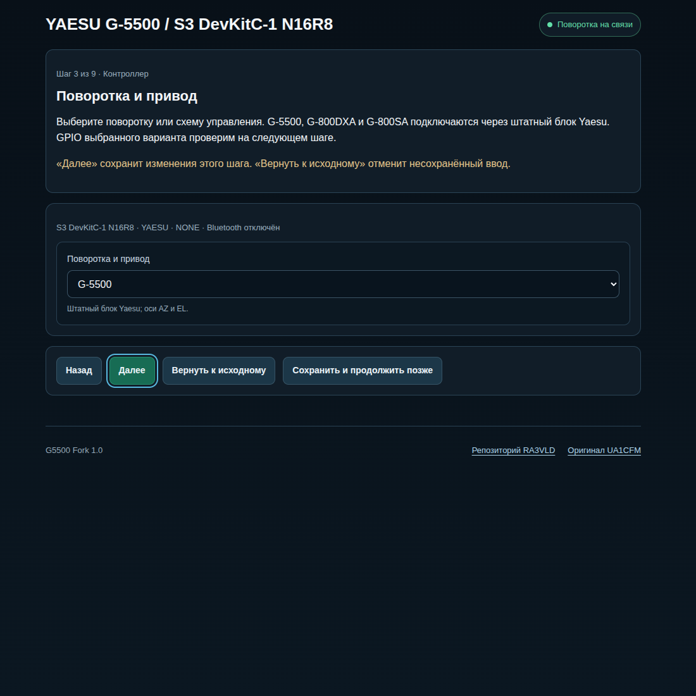

# Мастер первоначальной настройки

[Документация](../index.md)

На новом устройстве с веб-интерфейсом мастер открывается автоматически. На уже настроенном устройстве откройте **Настройки → Мастер настройки** (первый пункт) или адрес `/setup`: текущие настройки и подходящие калибровки сохраняются.

Кнопка **Далее** сохраняет все введённые параметры текущего шага и проверяет его готовность. **Вернуть к исходному** отменяет несохранённый ввод этого шага, загружая сохранённые значения. Перезагрузка нужна при смене сети, роли, проводной связи или оборудования; имя, диапазоны и параметры регуляторов сохраняются без неё. Шаг записывается на устройстве. После перезапуска, смены IP или закрытия браузера откройте устройство снова. Кнопка **Сохранить и продолжить позже** также сохраняет введённые параметры и оставляет доступ к настройкам и диагностике; до завершения мастера обычные команды движения заблокированы. Проверочные движения запускаются отдельно в мастере. При потере проверочной сессии движение останавливается, восстановление связи его не возобновляет.

## Сеть и роль

1. Подключитесь к AP `G5500-Rotator-XXXXXX` и откройте `http://192.168.4.1`, либо используйте адрес ETH на устройстве с Ethernet. На новом устройстве AP открытая; задайте её пароль.
2. Выберите основное подключение: Wi-Fi через роутер, собственная AP, общая AP, клиент общей AP или Ethernet. Ethernet предлагается только на подходящей плате.
3. Для Wi-Fi задайте SSID и пароль. Для Wi-Fi STA и Ethernet отдельно выберите DHCP или статический IPv4. При статическом адресе укажите IP и маску; шлюз и DNS задайте при необходимости. Шлюз должен находиться в той же подсети. Адрес и маску AP устройство выбирает самостоятельно.
4. Нажмите **Далее** для сохранения параметров. После необходимого перезапуска переподключитесь и откройте мастер. Дождитесь подключения STA или ETH; для собственной AP достаточно её запуска. Доступ в интернет не нужен. Сервисная AP сохраняется до завершения настройки; при ошибке исправьте параметры через неё. При одновременном подключении Ethernet имеет приоритет.
5. Выберите роль **Контроллер поворотки** или **HUD — удалённый пульт**, имя и способ связи. Нажмите **Далее**. При смене роли или связи дождитесь перезапуска; изменение только имени его не требует. Назначение GPIO и проводных интерфейсов проверяется в оборудовании.

## Контроллер поворотки

1. На шаге **Поворотка и привод** используйте один список: **G-5500**, **G-800DXA**, **G-800SA**, **DIR + SPEED_PWM**, **LEFT / RIGHT + SPEED_PWM**, **LEFT_PWM / RIGHT_PWM (+ ENABLE)** или **Имитация**. Во всех трёх PWM-схемах ENABLE каждой оси необязателен: на следующем шаге назначьте его GPIO или оставьте «Не подключён». Три модели автоматически выбирают штатный блок Yaesu: G-5500 для AZ/EL, G-800DXA и G-800SA для AZ. Нажмите **Далее**: выбор сохранится и будет использован при настройке GPIO.
2. В оборудовании проверьте выбранный интерфейс привода, назначьте GPIO, датчики положения и их параметры. Для каждой оси выберите прямое либо обратное направление сигнала потенциометра или энкодера. При управлении G-800DXA или G-800SA через штатный блок включите подключённый модуль 0–5 В на шаге **Регуляторы и остановка**. У G-800SA положение считывается через [дифференциальный согласующий каскад](../hardware/g800sa/index.md), его подключение отличается от G-800DXA. Инверсию PWM задайте по своей схеме.
3. Настройте необходимые Bluetooth и местные входы. Тип дисплея определяется образом прошивки; GPIO внешнего экрана можно изменить. Свободные выводы и конфликты показаны в карте GPIO.
4. При отключённом питании проверьте проводку и напряжения. Нажмите **Далее** для применения оборудования. После пробного запуска дождитесь проверки памяти и снова нажмите **Далее** для подтверждения; затем дождитесь повторного перезапуска.
5. Проверьте кнопки, отклик энкодера и сенсорный экран. Для джойстика при отключённом силовом питании измерьте центр и края, задайте мёртвую зону и гистерезис, нажмите **Далее** для сохранения и применения изменений.
6. Задайте диапазоны и ориентацию антенны. Коротким удержанием проверочных кнопок сверьте направления. Выполните [калибровку углов](az-range.md), затем проверьте промежуточное положение. До калибровки ориентируйтесь на физическое положение антенны.
7. Для регулируемой оси выберите [простой регулятор или каскадный ПИД](regulator-tuning.md). Настройте параметры вручную либо запустите автотюн и просмотрите результат перед применением.
8. Для фиксированной скорости откалибруйте ось и выберите свободный участок вдали от границ. Измерьте выбег отдельно в направлениях − и +. Мастер отключает выход после пробного хода и измеряет угол и время до остановки. **Применить результат** применяет больший из двух углов как упреждение отключения оси. Прерванный или недостоверный замер настройки не заменяет. Измерение нужно повторить после изменения нагрузки или аппаратного переключателя скорости.
9. Настройте внешние программы. **Рекомендуемые режимы** задают общий ручной режим: PstRotator ждёт подтверждения цели, N1MM/GS-232/rotctld выполняют цели автоматически. Поведение каждого протокола, порты, имя N1MM и трактовку AZ можно изменить.
10. Проверьте STOP, ручное управление и небольшое наведение. При необходимости сохраните предустановки. Нажмите **Завершить настройку**: введённые предустановки сохранятся перед завершением.

В имитации физические проверки и калибровка датчиков пропускаются. Изменение модели, оборудования или диапазона возвращает связанные шаги на проверку.

## Удалённый пульт HUD

1. Выберите сетевую, UART- или RS-485-связь с контроллерами. Для общей адресуемой линии задайте существующий Modbus-режим и адреса участников. Для схемы ПК → HUD → контроллер проверьте независимость двух проводных линий и доступность UART; [подключение RS-485](../integrations/rs485.md).
2. Настройте Bluetooth, кнопки, энкодер и джойстик, проверьте GPIO. Кнопкой **Далее** примените оборудование, после перезапуска этой же кнопкой подтвердите пробный запуск. Дисплей выбирается при сборке. Привод и датчики положения на самом HUD не настраиваются.
3. Проверьте местные органы управления. Калибровка джойстика сохраняется на HUD.
4. Найдите поворотки по сети или UART; при необходимости укажите адрес вручную. Сохраните записи с понятными именами и явно выберите устройство для управления. Выбор записи не меняет Wi-Fi.
5. Проверьте доступность, калибровку и ошибки выбранного контроллера. Углы и регуляторы настраиваются в веб-интерфейсе самого контроллера; для сетевой записи мастер даёт переход к нему.
6. Настройте программы, подключённые к HUD. Они управляют выбранной записью; имя HUD в N1MM не меняется при переключении повороток. Режимы протоколов задаются так же, как на контроллере.
7. Проверьте адресата команды, STOP и прекращение удерживаемого движения при потере связи. Предустановки необязательны. Для завершения выберите доступный откалиброванный контроллер без ошибки привода.

Подробнее о выборе устройств и поведении при обрыве связи: [HUD](../control/hud.md).
