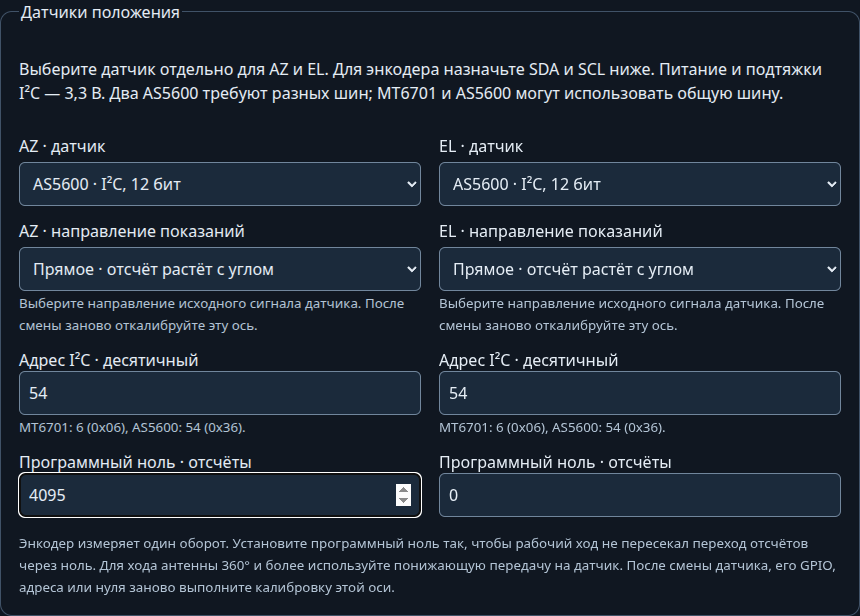

# Датчики положения MT6701 и AS5600

[Документация](../index.md) · [Оборудование](configuration.md#оборудование-в-веб-интерфейсе)

MT6701 и AS5600 подключаются по I²C вместо потенциометра обратной связи. Тип выбирается отдельно для AZ и EL в **Настройки → Оборудование → Настроить оборудование**, раздел **Датчики положения**. Можно использовать энкодер на одной оси и потенциометр на другой. Пересобирать прошивку для смены датчика не требуется.

| Параметр | MT6701 | AS5600 |
|---|---|---|
| Отсчёты за оборот | 16384 (14 бит) | 4096 (12 бит) |
| Адрес по умолчанию | 6, то есть `0x06` | 54, то есть `0x36`, неизменяемый |
| Программный ноль | 0…16383 | 0…4095 |
| Проверка магнитного поля | По I²C статус поля недоступен | Наличие магнита, слишком слабое и слишком сильное поле |

## Подключение

1. Отключите питание контроллера и привода.
2. Подключите питание датчика по схеме его модуля для 3,3 В, общий GND, SDA и SCL. Подтяжки SDA/SCL должны идти к 3,3 В; обычно используются резисторы 4,7 кОм. Убедитесь, что модуль не подтягивает линии к 5 В.
3. Для MT6701 выберите на модуле режим I²C согласно его распиновке. Выводы A и B в этом режиме служат SDA и SCL. Выходы OUT и ABZ для этого подключения не используются.
4. На странице оборудования выберите датчик и его адрес. В разделе распиновки назначьте свободные GPIO **Датчик AZ / EL · SDA** и **SCL**. Оба GPIO должны поддерживать выход. Прежний вход ADC этой оси можно оставить назначенным или выбрать «Не подключён».
5. Нажмите **Сохранить и перезапустить**, затем откройте страницу заново и подтвердите пробный запуск. До подтверждения движение заблокировано.

Шина работает на 400 кГц. Используйте короткие провода, удалённые от силовой проводки двигателя. Проверьте питание и качество сигналов на месте установки.

Датчики с разными адресами можно подключить к общей паре SDA/SCL: укажите одинаковые GPIO у обеих осей. Два AS5600 требуют двух отдельных пар SDA/SCL. У CrowPanel встроенная шина занята дисплеем и органами управления: для датчиков доступна одна отдельная шина на свободных GPIO. Два датчика на ней должны иметь разные адреса. Не назначайте GPIO, уже подключённые к дисплею, Ethernet, камере или другим сигналам.

## Рабочий ход и программный ноль

Оба датчика измеряют положение в пределах одного оборота. Число полных оборотов после выключения питания они не сохраняют. Для хода антенны 360° и более установите понижающую передачу, чтобы датчик за весь ход проходил меньше одного оборота с запасом у обоих концов. Например, передача 2:1 даёт 225° поворота датчика при ходе антенны 450°. Масштаб определяется калибровкой по известным углам антенны.

**Программный ноль** сдвигает место перехода отсчётов через ноль. В прямом режиме значение для калибровки вычисляется как `(RAW − ноль + отсчётов_за_оборот) % отсчётов_за_оборот`. В обратном режиме отсчёт отражается относительно нуля с сохранением циклической шкалы. Выберите ноль так, чтобы весь рабочий ход находился на непрерывном участке шкалы и не пересекал этот переход. Например, при RAW AS5600 от 3800 через 4095/0 до 1500 ноль 3500 даёт непрерывный участок 300…2096.

Посмотреть RAW и значение с учётом нуля можно на странице **ADC TEST** (`/adc`). Для энкодера там отображаются отсчёты, а не напряжение. При быстром скачке через границу шкалы чтение отклоняется; исправьте положение нуля и выполните калибровку заново.

## Калибровка и диагностика

После изменения типа датчика, его GPIO, адреса или программного нуля заново [откалибруйте соответствующую ось](az-range.md). Калибровка другой оси сохраняется. Доступны два опорных положения и многоточечная калибровка. Для каждой оси поле **Направление показаний** задаёт прямой или обратный сигнал: выберите обратный, если при увеличении реального угла исходный отсчёт потенциометра или энкодера уменьшается. Настройка доступна для всех типов датчиков. После смены направления заново откалибруйте эту ось; калибровка другой сохраняется. Программный ноль энкодера задаётся отдельно. RAW в диагностике остаётся исходным, значение положения учитывает ноль и направление.

Для двухточечной калибровки разница показаний должна превышать 100 отсчётов. Точки многоточечной калибровки должны последовательно расти или убывать. При ошибке чтения положение не записывается в калибровку.

При потере I²C, неполном ответе или недопустимом поле AS5600 движение оси останавливается с ошибкой обратной связи. Проверьте питание, адрес, проводку, положение и зазор магнита; затем сбросьте ошибку регулятора. Для MT6701 успешное чтение I²C подтверждает связь, но не подтверждает правильную установку магнита: проверьте изменение показаний при повороте вручную.

Описание полей: [HTTP API оборудования](../api/index.md#http-api-оборудования). Электрические характеристики и распиновка: [MT6701, документация MagnTek](https://www.magntek.com.cn/upload/pdf/202407/MT6701_Rev.1.8.pdf), [AS5600, страница производителя](https://www.infineon.com/part/AS5600).
