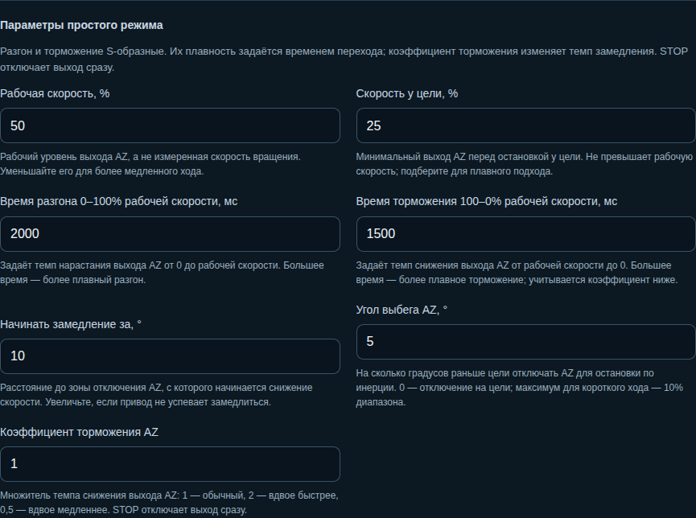
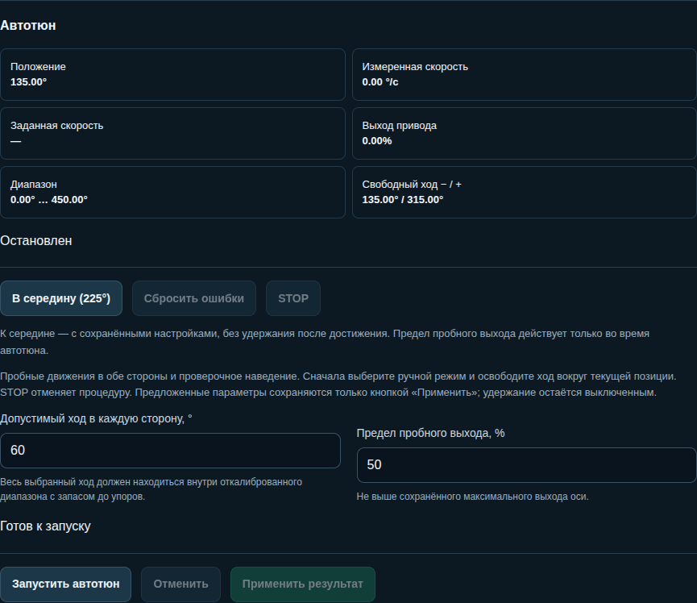
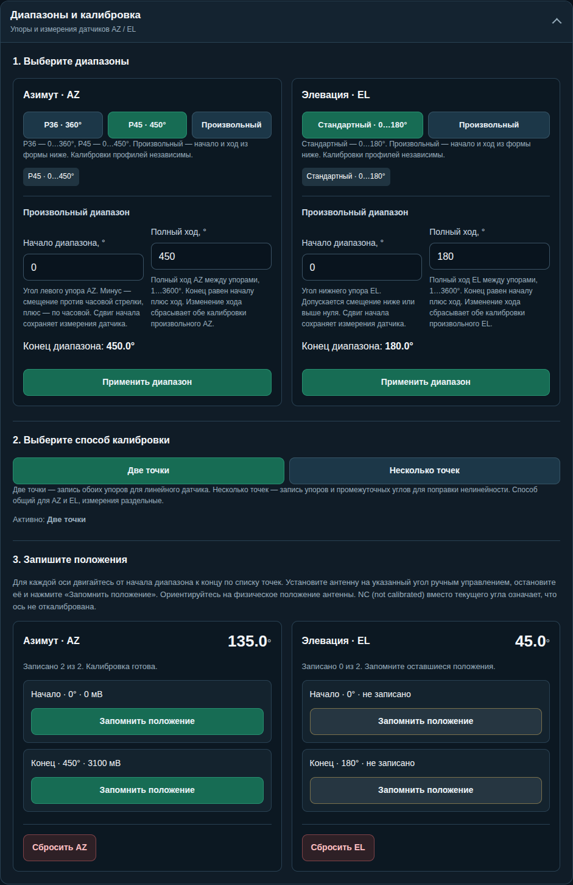

# Использование

## Вкладки веб-интерфейса

Значок вкладки браузера — зелёная стрелка вращения, когда поворотка на связи. При потере связи он становится красным и перечёркнутым; после восстановления связи снова зелёным. В режиме HUD значок показывает доступность выбранной поворотки. Пока связь не подтверждена или поворотка не выбрана, значок остаётся красным. Значок основан на Lucide rotate-cw ([лицензия ISC](licenses/lucide-favicon.md)).

В заголовке обеих вкладок показан статус связи с повороткой. В режиме HUD он относится к выбранной поворотке: если пульт доступен, а контроллер не отвечает, появится «Нет связи с повороткой». «Нет связи с устройством» означает, что браузер перестал получать состояние самого контроллера или пульта. При восстановлении связи индикатор обновляется автоматически. Версия прошивки, автор исходного проекта и ссылки на оба репозитория находятся в подвале страницы.

На вкладке «Управление» находятся текущее положение и цель, кнопки движения, предустановки и режим управления. В самом низу главной компактный статус показывает Wi-Fi, Bluetooth, уровень сигнала в dBm, свободную внутреннюю память и uptime устройства. Для HUD также показана выбранная поворотка и её доступность; память и uptime относятся к самому пульту.

Вкладка «Настройки» (`/#settings`) содержит сворачиваемые разделы настройки поворотки, привода, калибровки, предустановок, пульта, сети и обновления прошивки. Раздел «Сеть и подключение» открыт по умолчанию. Нажмите заголовок раздела, чтобы открыть или закрыть его. Несколько разделов можно держать открытыми одновременно. Ссылки ADC TEST, RESET DIAG и DIAG CONSOLE находятся в верхней навигации рядом с вкладками «Управление» и «Настройки». Вкладки переключаются без перезагрузки страницы; сообщения о результате команд видны в обеих. Uptime берётся из `uptimeSeconds` в `/api/status` и показывает время работы устройства с момента запуска.

После нажатия кнопки сохранения, выбора профиля или захвата калибровки внизу экрана появляется уведомление: «Выполняется…», затем «Готово» или «Не выполнено» с пояснением. Оно видно при любой прокрутке и занимает отдельную область под страницей, не перекрывая поля и кнопки. Пока устройство отвечает, нажатая кнопка недоступна; подтверждение успеха появляется только после ответа устройства. Успешное уведомление скрывается через 6 секунд, ошибку можно закрыть крестиком. Если подтверждение не получено, проверьте состояние устройства перед повторным действием.

## Подключение Wi-Fi

Подключитесь к точке доступа `G5500-Rotator-XXXXXX`, откройте `http://192.168.4.1`, перейдите в «Настройки» → «Сеть и подключение», укажите SSID и пароль домашней сети и нажмите «Сохранить и подключиться». Настройки сохраняются и применяются без перезагрузки. Дождитесь сообщения «Подключено»: под формой появятся полученный IP клиента (STA), адрес точки доступа (AP) и ссылка для открытия устройства в домашней сети. Эти адреса также видны в заголовке страницы, текущем статусе и на экранах TFT и CrowPanel. На HUD адреса относятся к самому пульту.

Во время настройки точка доступа остаётся включённой до следующей перезагрузки на всех платах. При смене канала Wi-Fi телефон может кратковременно потерять связь; при необходимости снова подключитесь к сервисной сети и обновите страницу. Если подключиться к роутеру не удалось, страница покажет сообщение; проверьте SSID и пароль. Пустой пароль предназначен для открытой сети. При ошибке записи настройки подключения не меняются. В режиме «Общая точка доступа» для подключения к роутеру сначала выберите обычный режим Wi-Fi в разделе «Пульт и связь».

Сохранённый SSID отображается в форме, в том числе после перезагрузки. Если ответ о сохранении не получен за 12 секунд, подключитесь к доступной сети устройства, обновите страницу и проверьте SSID перед повторным сохранением. Автоматически форма сохранение не повторяет.

Если подключение не удалось, откройте `/diaglog` и найдите сообщения Wi-Fi. На классическом ESP32 отправьте `H4` через USB-UART на 9600 бод с окончанием CR/LF: ответ покажет сохранённый SSID, состояние связи и адреса `ap`/`sta`. Используйте адрес `sta` из домашней сети и `ap` из точки доступа устройства. Описание диагностических полей — в [инструкции ESP32](classic-esp32.md#диагностика).

В обычном режиме сети на **ESP32-S2/S3** точка доступа `G5500-Rotator-XXXXXX` запускается сразу и остаётся доступной после подключения к роутеру: работает STA+AP. На **обычной ESP32** по умолчанию сначала запускается только STA; AP включается как резерв при отсутствии настроек, неудаче подключения или потере связи и отключается после восстановления STA. Для принудительного STA+AP на обычной ESP32 задайте `ESP32_FORCE_AP_STA=1` в `build_config.hpp` или через `-D`. Это повышает расход RAM и может приводить к нестабильности, особенно при одновременной работе веба и встроенного SPP; значение по умолчанию — `0`.

В обычном режиме подключения к роутеру стартовая попытка длится до 8 секунд. После неудачи работает AP-only; через 30 секунд начинается новая попытка STA до 8 секунд при сохранённой AP. После сохранения Wi-Fi через веб AP остаётся включённой до следующей перезагрузки. При обычном запуске после успеха AP остаётся включённой на S2/S3 и на ESP32 с `ESP32_FORCE_AP_STA=1`; обычная ESP32 с флагом `0` отключает AP. Сохранение настроек ещё не подтверждает подключение к роутеру. `H4` показывает `runtimeMode=STA/AP/AP+STA/OFF` и `apPolicy=always/fallback`; при выключенной AP её IP указан как `0.0.0.0`, в вебе — `-`. В роли HUD имя сервисной сети — `G5500-HUD-XXXXXX`. При совпадении подсети роутера с `192.168.4.0/24` сервисная AP при запуске выбирает другую подсеть; во время сохранения Wi-Fi её адрес сохраняется до следующей перезагрузки, чтобы страница настройки оставалась доступной; адрес виден на дисплее и в диагностике. В режиме общей точки доступа HUD AP остаётся включённой независимо от `ESP32_FORCE_AP_STA`.

## Режимы

Первый запуск — ручной. По умолчанию числовые внешние цели AZ, EL, AZ+EL и GS-232 последовательности сохраняются для подтверждения. Новая цель заменяет ожидающую, сохраняя текущий поворот. LEFT/RIGHT (L/R), UP/DOWN (U/D) на G-5500, STOP и запросы положения выполняются сразу через UART0, Bluetooth, TCP и UDP; при активном пресете внешние команды движения отклоняются.

В **Настройки → Поворотка и привод → Протоколы в ручном режиме** отдельно выберите поведение N1MM UDP, PstRotator UDP, GS-232 и rotctld:

- **С подтверждением** — новая числовая цель ожидает запуска кнопкой.
- **Автоследование** — новая числовая цель выполняется сразу, сохраняя ручной режим.

Например, включите автоследование N1MM и GS-232, а для PstRotator оставьте подтверждение. GS-232 использует общий выбор для UART, Bluetooth и TCP, включая последовательности M/W + T; команды Hamlib P/set_pos используют выбор rotctld. Настройки сохраняются после перезагрузки. Сохранение настройки само по себе не запускает уже ожидающую цель. Автоматические режимы выполняют цели всех протоколов сразу независимо от этих настроек. Приоритет предустановки, допустимый диапазон, калибровка и порог повторных внешних целей действуют и при автоследовании.

В роли HUD выбор относится к протоколам, подключённым к этому пульту; команда передаётся выбранной поворотке с тем же поведением. Для автоследования через HUD обновите прошивку обоих устройств: прежняя прошивка контроллера отклонит команду с новым признаком.

Пользовательская кнопка (`USER_BUTTON_GPIO`, по умолчанию GPIO0) или веб «Повернуть» запускает ожидающую цель. Дребезг 40 мс; удержание даёт одно событие, удержание при загрузке не запускает движение. GPIO0, удержанный до включения питания, аппаратно переводит ESP32 в загрузчик.

Кнопка **Повернуть** рядом с полями **Задать угол** выполняет введённую цель сразу. Заполните AZ, EL или оба поля; пустое поле не меняет цель другой оси. Если указаны обе оси, обе должны быть откалиброваны: при отсутствии калибровки одной из них вся команда отклоняется. Сообщение указывает, для какой оси нужна калибровка. Значения должны попадать в настроенные диапазоны.

В веб-интерфейсе подтверждение находится в центре кнопок направления. В ручном режиме, пока поворотка стоит, кнопка показывает ожидающую цель, например `170°`; без новой команды — последнюю выполненную цель. Во время движения она показывает `stop` и останавливает обе оси. После остановки или достижения цели снова появляется прежний угол: `170° → stop → 170°`. Повторное нажатие запускает эту цель заново; само появление угла движения не запускает. Для AZ+EL показаны оба угла, для команды одной оси повторяется только она. Последняя цель доступна после обновления страницы, но сбрасывается при перезапуске контроллера или смене модели. Без известной цели кнопка «Повернуть» неактивна. В автоматических режимах центральная кнопка остаётся `stop`.

«Автоматический» сразу выполняет ожидающую и последующие цели. «Авто 1 ч» начинает новый час при каждом выборе; после 3600 секунд включается ручной, текущая точка завершается, последовательность дальше не идёт. Переход в ручной также позволяет закончить текущую точку. Направление отменяет наведение только соответствующей оси, сохраняя ожидающую цель. STOP очищает движение, ожидание и последовательность, сохраняя режим.

Постоянные ручной/автоматический сохраняются в NVS. «Авто 1 ч» после перезагрузки становится ручным. Цели не сохраняются и не воспроизводятся. Если ось не откалибрована, подтверждение не запускает её, а автоматический режим сохраняется с сообщением `target_not_calibrated`.

## Предустановки и профили

Четыре предустановки запускаются сразу в любом режиме. Имена и AZ/EL редактируются в вебе; начальные значения AZ 0/90/180/270, EL 0. Пресет очищает ожидание; до достижения цели внешние команды движения отбрасываются, включая направления. STOP и положение доступны. Второй пресет заменяет первый. Режим и часовой таймер сохраняются.

G-800DXA использует только AZ. Комбинированная команда с EL=0 допускается; ненулевой EL и U/D отклоняются. Веб и экран скрывают ось EL. Смена модели останавливает движение, очищает ожидание и включает ручной режим. Калибровки и пресеты хранятся отдельно для каждой модели. При смене модели выберите её диапазон и калибровку.

## N1MM+

Имя ротатора по умолчанию `G5500`, UDP 12040; настраиваются в вебе. В N1MM Configurer → Broadcast Data → Rotor указать `IP_контроллера:12040`, а в Antennas использовать точно такое же Rotor Description. Включить Display Rotors Responding From Network. Промежуточный N1MMRotor.exe для прямого UDP не требуется.

Для прямого UDP вводите угол в поле позывного Logger+ и нажимайте Alt+J; Ctrl+Alt+J отправляет STOP. Выбирайте нужную антенну через Alt+F9: её Offset и Bidirectional влияют на итоговую цель. Кнопка Turn отдельной программы N1MM Rotor работает через настроенный COM-порт; один адрес UDP в Logger+ не создаёт такое соединение. В ручном режиме полученная цель появится как ожидающая, если для N1MM UDP выбрано «С подтверждением»; при автоследовании выполняется сразу. Для выполнения числовой цели нужна калибровка соответствующей оси.

Принимаются `N1MMRotor/rotor`, `goazi`, `offset`, `bidirectional`, `freqband`, `app`, а также вложенный `stop/rotor`. Имена в `rotor` могут перечисляться через запятую; `*` означает все ротаторы (реальный N1MM использует его при вводе числового азимута). Чужие имена и неверные пакеты не меняют состояние. `offset` добавляется к цели. При выборе **Кратчайший путь** `bidirectional` выбирает ближайшее из направлений, разнесённых на 180°, с учётом перекрытия. В одиночных GS-232 M/W и rotctld P/set_pos азимут 0…360° также выбирает кратчайший доступный путь; отрицательные и многоборотные координаты остаются точными. Например, 350° → 10° при диапазоне 0…450° означает цель 370° и поворот на +20°.

Если программа сама рассчитывает механическую цель, откройте **Настройки → Поворотка и привод → Угол AZ от программ** и выберите **Механический угол**. Тогда 10° остаётся 10°, 370° — 370°, включая N1MM и PstRotator; цель за пределами хода отклоняется. N1MM `offset` продолжает прибавляться, `bidirectional` не меняет координату; PstRotator `LP` прибавляет 180° без выбора другого оборота. Выбор общий для входящих протоколов, сохраняется после перезагрузки и действует во всех режимах. На HUD он относится к подключённым к этому пульту программам. Подробности — в [описании углов и направлений](az-range.md#непрерывные-углы-и-направления).

Фактическое положение `имя@азимут` отправляется раз в 500 мс на UDP 13010 IP-адресам, от которых пришли адресованные команды (до 8 компьютеров), и дополнительному Report IP из веба. Report IP помогает показывать положение до первой команды и после перезагрузки. Угол в UDP-отчёте передаётся в десятых долях градуса: `G5500@1370` означает 137°. Используйте десятые доли градуса: `@137` обозначает 13,7°, а не 137°. Направление отчёта нормализуется к 0…359,9°, веб показывает непрерывное механическое положение выбранного диапазона.

[Официальный формат и настройка N1MM](https://n1mmwp.hamdocs.com/setup/interfacing/#rotator-udp-packet-information).

## PstRotator UDP — UR5EQF и 5MContest

Поле «PstRotator UDP» в веб-настройках задаёт порт общего протокола для UR5EQF и 5MContest. Логгеры подключаются напрямую к контроллеру; отдельно запускать программу PstRotator не требуется.

Для [TR4W](https://github.com/TR4W/TR4W/blob/master/RELEASE_NOTES.md) (с версии 4.148.6), [DXLog.net](https://dxlog.net/docs/index.php/Menu_Options#Rotator_configuration) и [Log4OM 2](https://www.log4om.com/l4ong/usermanual/Log4OMNG_ENU.pdf) выберите PstRotator UDP, IP контроллера и порт **PstRotator UDP** из его веб-настроек. Включите передачу числового азимута (в Log4OM 2 — **Send Azimuth** и исходящее соединение PSTRotator в **Connections → UDP Outbound**). Передача только позывного не задаёт направление: контроллер сам не рассчитывает азимут по позывному. Поддерживаются перечисленные ниже команды; остальные возможности программы PstRotator контроллер не заменяет.

Интеграцию с PstRotator также предлагают [Swisslog](https://www.swisslogforwindows.com/english/Help/Features/Rotor%20Interface.htm) и [LogHX](https://pstrotator.com/ANT/PstRotatorAz%20User%20Manual.pdf). Для них нужно отдельно сверить транспорт и формат команд: наличие интеграции с программой PstRotator само по себе не гарантирует совместимость с UDP-интерфейсом контроллера.

UDP 1234 по умолчанию, порт меняется в вебе. В UR5EQF выбрать UDP/PstRotator, указать IP контроллера и этот порт. Принимаются XML `<PST>…</PST>`: AZIMUTH, LEFT/RIGHT, STOPR/STOP, LP, информационные CALL/FREQUENCY/RADIO, TRACK (проверяется как 0/1, не меняет выбранный режим), ELEVATION для G-5500. LP добавляет 180° к направлению; выбор механического положения зависит от настройки «Угол AZ от программ». `PARK=1` из UR5EQF выбирает сохранённую цель пресета 1 как внешнюю числовую команду: в ручном она следует настройке PstRotator UDP, при активном пресете отбрасывается. `PARK=0` не запускает движение. Другие управляющие расширения PstRotator не реализованы.

`<PST>AZ?</PST>` возвращает `AZ:123.4\r`; TGA? возвращает ожидающий/исполняемый азимут. Ответ идёт IP отправителя на **настроенный порт приёма + 1**, независимо от исходящего порта клиента. STOP здесь сохраняет режим согласно правилам форка. [Протокол PstRotatorAz, стр. 11–12](https://pstrotator.com/ANT/PstRotatorAz%20User%20Manual.pdf).

## SkyRoof и Gpredict

[SkyRoof](https://ve3nea.github.io/SkyRoof/users_guide/setting_up_rotator_control.html) и [Gpredict](https://github.com/csete/gpredict) используют протокол rotctld по TCP. В настройках управления повороткой укажите IP контроллера как **Host** и порт **4533**. Контроллер сам принимает команды rotctld; отдельный процесс `rotctld.exe` на компьютере для такого подключения не нужен.

В SkyRoof включите управление повороткой (**Enabled**); в Gpredict создайте сетевой интерфейс поворотки с этим адресом и портом. Укажите диапазоны AZ/EL по калибровке контроллера. Для G-800DXA задайте EL = 0: у этой модели нет оси элевации. Для непрерывного слежения включите автоследование rotctld в ручном режиме либо выберите автоматический режим контроллера.

## 5MContest / PstRotator UDP

5MContest подключается напрямую через PST UDP-интерфейс контроллера. Отдельная программа PstRotator для этого не требуется.

В настройках 5MContest на вкладке PstRotator:

1. Включить использование ротатора и выключить автозапуск внешней программы PstRotator.
2. В `Addr` указать IP контроллера.
3. Задать `TxPort=1234`, `RxPort=1235` для стандартного PST-порта прошивки. Если нужно сохранить порты логгера `12000/12001`, в веб-настройках контроллера изменить **PstRotator UDP** на `12000`. Приёмный порт логгера всегда равен PST UDP + 1.
4. Для немедленного наведения включить автоследование PstRotator UDP в ручном режиме или выбрать на контроллере автоматический режим. При выборе «С подтверждением» в ручном режиме цель ожидает пользовательской кнопки или веб-кнопки «Повернуть». Для числовой цели нужна калибровка AZ.

Команда «Вращать антенну» — `Alt+J`, «Остановить вращение антенны» — `Ctrl+Alt+J` при стандартных сочетаниях клавиш. Если они переопределены, используйте соответствующие пункты меню логгера. Можно отправлять цель с азимутальной карты. Управление автоповоротом в логгере задаёт отправку целей; режим выполнения этих целей выбирается на контроллере.

Логгер отправляет `<PST><AZIMUTH>288</AZIMUTH></PST>` и `<PST><STOP>1</STOP></PST>`. STOP выполняется сразу, включая остановку активной предустановки, и сохраняет режим. Цель от логгера во время выполнения предустановки отбрасывается. G-5500 и G-800DXA принимают эти азимутальные команды; элевацию они не задают.

Запрос `<PST><AZ>?</AZ></PST>` возвращает фактическое направление `AZ:288.0\r` на IP отправителя и PST UDP + 1. Периодическая отправка положения без запроса по PST не реализована. Для чтения положения программа должна отправлять запрос; также используйте экран контроллера или веб.

## USB, Bluetooth, TCP

USB–UART-мост платы и внешний UART0 используют GS-232 на 9600 бод. Native USB S2/S3 используется для диагностики и программирования; на CrowPanel он также принимает GS-232 и команды положения Hamlib. Для HC-05 на S2/S3 используйте UART1, 9600 бод и GS-232. Классический ESP32 при `BLUETOOTH_MODE=BT_AUTO` использует встроенный SPP `G5500-Rotator`, обычное сопряжение без PIN на устройстве; `BLUETOOTH_MODE=BT_HC05` выбирает внешний HC-05 на UART1; его USB-UART0 совмещает программирование и GS-232, диагностика доступна в вебе. См. [подключение ESP32](classic-esp32.md). TCP 4533 принимает rotctld: `P az el`, `p`, `S`, `set_pos`, `get_pos`, `stop`, а также GS-232 L/R/U/D, M/W, X1…X4; строки CR, LF, CRLF. USB/Bluetooth/TCP принимают до 512 байт на строку; переполненная или содержащая недопустимые байты строка целиком отбрасывается до разделителя. На UART0 также доступны команды калибровки и диагностики.

Настройка начала и полного хода, захват упоров и промежуточных точек описаны в [инструкции диапазона AZ и калибровки](az-range.md).

## Наведение при шумной обратной связи

Для управления используется отфильтрованное положение; страница ADC показывает исходные raw/mV. Дробные цели принимаются независимо от допуска остановки: 20,1°, 20,2° и далее до 40° обновляют одну актуальную цель. Во время движения обновления не запускают разгон и страгивание заново. Приём команд по 0,1° не гарантирует механическую точность 0,1°: она зависит от датчика, люфта и нагрузки.

В ручном режиме внешние цели требуют подтверждения, кроме протоколов с включённым автоследованием. В автоматическом режиме следующая команда позиции после STOP снова разрешает движение, даже при совпадении угла. Повторная доставка уже обработанного пакета HUD новой командой не считается.

## Независимые приводы AZ и EL

Пошаговый порядок ручной настройки, работа автотюна и разбор его ограничений — в [инструкции по настройке регуляторов](regulator-tuning.md).

Для SEPARATE_PWM/BTS7960 и G-800DXA с внешним управлением 0–5 В в **Настройки → Регуляторы движения** доступны простой регулятор и каскадный ПИД. Настройки AZ/EL независимы от Ручного / Авто / Авто 1 ч. Нерегулируемые релейные выходы сохраняют управление направлениями с фиксированной скоростью.

При первом включении без сохранённых параметров используется простой регулятор с рабочим выходом 50% и порогом обнаружения движения 5°. Отдельное разрешение оси не требуется. Диапазоны, калибровки, пресеты и сохранённые параметры сохраняют приоритет. Страгивание пусковым импульсом по умолчанию выключено; его можно включить отдельно для каждой оси. Для ручного захвата точек калибровки используйте простой режим; каскад требует действующей калибровки.

Изменение параметров останавливает ось. Сохранение само движение не запускает. Настройки хранятся отдельно для модели, силового интерфейса и имитации. Цели и разрешение удержания текущей цели после перезапуска не восстанавливаются.

На вкладке **Управление** стрелки клавиатуры ←/→ управляют AZ, ↑/↓ — EL: удерживайте клавишу для вращения и отпустите для остановки соответствующей оси. При потере фокуса окна или уходе с вкладки движение от клавиатуры останавливается. Во время редактирования полей стрелки работают с полем, без запуска привода. В блоке **Задать угол** клавиша Enter отправляет введённые углы так же, как кнопка «Повернуть».

На главной странице в **Наведение → Ручное вращение** рядом с кнопками находятся независимые ползунки скорости AZ и EL. Они появляются только для подключённого регулируемого выхода с назначенными GPIO; для G-800DXA нужно включить внешний модуль 0–5 В. В простом режиме ползунок задаёт процент выхода, в каскаде — °/с до сохранённого предела скорости. Нижняя граница ползунка составляет 5% от максимума оси в выбранном режиме. Скорость меняется во время перетаскивания и действует на текущее и следующее движение, сохраняя состояние регулятора. Ползунок не запускает остановленный привод. Его уставка сохраняется во flash через 40 секунд после последнего изменения или перед штатной перезагрузкой и восстанавливается после включения. При внезапном отключении питания до сохранения остаётся предыдущая сохранённая уставка. Настройки регулятора сохраняются отдельно; их изменение сбрасывает уставку ползунка соответствующей оси. Во время автотюна ползунки недоступны. Эти ползунки доступны в веб-интерфейсе контроллера поворотки, через веб HUD управление скоростью не передаётся.

При доступном live-соединении ползунки отправляют команды по нему; в HTTP-режиме следующая команда не ждёт полного обновления статуса. В каскаде изменение ползунка перепланирует текущее движение с сохранением цели, скорости и ускорения команды. Старая расчётная траектория не задерживает новую уставку. Скорость меняется плавно в пределах настроенных ускорения, торможения и рывка; малые значения этих ограничений по-прежнему растягивают переход на секунды. При подходе к цели ползунок задаёт верхний предел: регулятор продолжает тормозить для остановки у цели.

### Простой регулятор

В **Настройки → Регуляторы движения → AZ / EL → Простой** задаются рабочий выход, выход у цели, времена разгона/торможения, угол замедления, ручной выбег и коэффициент торможения. S-рампа плавно меняет темп нарастания и спада выхода. Проценты означают управляющий выход, а не измеренную скорость. Больший коэффициент торможения сокращает время снижения выхода; выход у цели ограничивается рабочим.

В форме простого регулятора каждой оси задайте угол выбега: 0…90° с шагом 0,1°, не больше одной десятой полного хода. При цели 90° и выбеге 2° привод отключается на 88° при положительном направлении или на 92° при отрицательном. После отключения регулятор не исправляет отклонение самостоятельно. Выбег не отбрасывает новые дробные цели.

Начальные значения независимого PWM: рабочий выход 50%, подход 18%, разгон 1800 мс, торможение 1200 мс, замедление AZ 3° / EL 2°. Проценты — 1…100; времена — 100…10000 мс. Начальный выбег физического привода 5°, имитации — 0°. Сохранённые значения имеют приоритет.

### Страгивание

Включите **Пусковой импульс для страгивания** и задайте уровень, максимальную длительность, угол подтверждения движения и время плавного снятия импульса. Например, пусковой выход 50% может использоваться с рабочим 5%. Общий максимальный выход ограничивает оба значения. Подтверждение страгивания использует смещение в заданном направлении; выбирайте порог выше шума датчика. Без действующей калибровки пусковой импульс при ручном вращении не применяется.

Если движения нет до окончания пускового времени, выход отключается с ошибкой. Последующие цели не повторяют импульс. Устраните причину, нажмите **Сбросить ошибку**, затем задайте цель. Отдельно контролируются свежесть измерений и отсутствие движения под ненулевым выходом. Ошибка отсутствия движения `stalled` снимается следующей принятой командой движения соответствующей оси, включая повтор того же угла. Повторная доставка пакета и продолжение прежнего ручного жеста не запускают привод заново. Остальные ошибки требуют явного сброса.

### Состояние и сброс ошибок движения

На главной странице веб-интерфейса в разделе **Наведение** строка **Состояние привода** показывает ошибку красным текстом с причиной отдельно для AZ и EL. Рядом появляется кнопка **Сбросить ошибку** для обеих осей. Сообщения об исполнении команд не скрывают активные ошибки. После успешного сброса возвращается обычный статус.

На экране CrowPanel ошибка и её причина заменяют обычный статус вращения или остановки. В сообщении указана ось; длинный текст прокручивается. При потере связи HUD показывает отсутствие связи вместо устаревшей ошибки поворотки.

Для подробного состояния откройте веб-интерфейс контроллера поворотки → **Настройки → Регуляторы движения**. Внизу формы AZ и EL перед кнопками показаны состояние соответствующей оси, измеренная скорость и причина отключения.

| Ошибка API | Сообщение в вебе | Что проверить |
|---|---|---|
| `kick_start_timeout` | Привод не тронулся | Питание, силовой выход, пусковой уровень и длительность, изменение угла датчика |
| `feedback_stale` | Нет свежих показаний датчика | Поступление новых измерений |
| `feedback_invalid` | Неверные показания датчика | Подключение и калибровку датчика, скачки показаний |
| `stalled` | Движение прекратилось | Механическое препятствие, питание, достаточный рабочий выход |
| `planner_error` | Ошибка профиля движения | Допустимость сохранённых параметров регулятора |

После устранения причины нажмите **Сбросить ошибку** в разделе **Наведение** или в форме нужной оси. На CrowPanel для сброса нажмите энкодер или коснитесь отображаемой цели. При активной ошибке это действие только сбрасывает её; для движения нужно следующее действие. Сброс отключает её выход и удержание, но не запускает наведение: задайте движение заново. Если причина сохранилась, защита может сработать повторно. Для `stalled` достаточно новой принятой команды движения. Ошибки оборудования, сохранения настроек и калибровки требуют исправления соответствующей настройки или неисправности; эта кнопка их не устраняет.

### Каскадный ПИД и удержание

Задайте скорость в °/с, ускорение и торможение в °/с², рывок в °/с³, коэффициенты ПИД положения и скорости. Упреждение выхода задаётся в процентах на °/с. Ручной выбег и параметры простой рампы в каскаде не используются.

Внешний контур исправляет ошибку положения, внутренний — измеренной скорости. D использует производную измерения с фильтрацией; интегральные составляющие ограничены при насыщении. Начальные коэффициенты и фильтры нужно настроить по фактическому отклику привода.

Без удержания выход отключается, когда положение и скорость остаются в допуске заданное время. При **Активно удерживать заданную позицию** цель сохраняется: внутри допуска выход может быть нулевым, а при отклонении за порог возобновления включается коррекция. Этот порог должен быть не меньше допуска положения. Узкие допуски при шумном датчике вызывают лишние коррекции.

STOP немедленно снимает выход и удержание. Отпускание ручного направления, изменение параметров, потеря калибровки и защитное отключение также снимают удержание. Новая команда позиции снова разрешает его, если оно включено в настройках. Потеря связи с пультом не отменяет принятую числовую цель.

Реверс сначала снижает выход, затем отключает направления минимум на 300 мс. При наличии измеренной скорости он также ожидает остановки механизма. STOP, предел диапазона и защиты действуют сразу.

Проценты на LCD/TFT показывают управляющий выход. GS-232 `N` возвращает индекс последовательности `N=k/n`; STOP очищает последовательность и ожидание, сохраняя выбранный режим.

### Автотюн простого режима и каскада

В веб-интерфейсе контроллера откройте **Настройки → Регуляторы движения → AZ / EL → Автотюн**. Процедура доступна для откалиброванной оси с регулируемым выходом; на HUD и нерегулируемых реле она недоступна.

1. Выберите и сохраните простой или каскадный регулятор. Переключитесь в ручной режим, остановите обе оси, снимите удержание и ожидающие цели. Устраните активные ошибки.
2. Разместите ось ближе к середине рабочего диапазона. Укажите допустимый ход **в каждую сторону** от текущей позиции — 10…90°, не меньше шести порогов подтверждения движения. Весь этот участок должен находиться внутри откалиброванного диапазона с запасом до упоров не меньше сохранённого выбега и 2°. Убедитесь, что кабели и механизм допускают такие движения.
3. Укажите предел пробного выхода 10…100%, не выше сохранённого максимума оси, затем нажмите **Запустить автотюн**. Привод начнёт двигаться. Выполняется одна процедура на контроллер; команды наведения и ручного вращения во время неё отклоняются. **STOP** или **Отменить** немедленно отключают выход и возвращают прежние параметры.
4. Дождитесь результата. Процедура оценивает шум, ищет страгивание, проверяет два рабочих выхода в обоих направлениях, измеряет отклик и выбег, затем выполняет проверочное наведение. Фаза, направление и пробный выход показаны в форме. При недостаточном ходе, шуме, отсутствии движения, недостоверном отклике или срабатывании защиты процедура останавливается с объяснением; старые настройки восстанавливаются.
5. Просмотрите предложенные параметры и ошибку проверочного наведения. В каскадном режиме также проверьте предложенный допуск позиции: он учитывает измеренный выбег и может быть больше прежнего допуска. **Применить результат** сохраняет параметры выбранной оси, оставляя привод остановленным и удержание выключенным. Само завершение автотюна параметры не сохраняет. После перезапуска результат процедуры не восстанавливается.

Простой автотюн предлагает рабочий выход, такой же проверенный выход подхода, параметры S-разгона/торможения, угол замедления, выбег и страгивание. Каскад дополнительно получает консервативную настройку PI скорости и P положения по измеренному отклику, упреждение выхода и ограничения профиля. Неиспользуемые составляющие I/D обнуляются. Скорость каскада выбирается по измеренному устойчивому движению и может увеличиться относительно прежней настройки. Ускорение, торможение и рывок не повышаются относительно сохранённых ограничений.

Защиты датчика, заклинивания, диапазона и пауза реверса работают во время автотюна. Ошибки защиты автоматически не сбрасываются. Временные параметры измерительных проб не сохраняются даже при сопутствующей записи настроек. Результат зависит от нагрузки, питания, механического люфта и датчика; автотюн не гарантирует механическую точность 0,1°. После применения проверьте короткие и длинные перемещения под рабочей нагрузкой.

Во время автотюна контроллер может остановить пробу и переставить ось внутри выбранного участка, чтобы продолжить измерение в том же направлении. Пауза перед реверсом сохраняется. Если участок слишком короток для страгивания, измерения и безопасной остановки, процедура завершается без предложения параметров: увеличьте допустимый ход, сохраняя запас до упоров. Параметры до запуска восстанавливаются.

## Плавная скорость G-800DXA

При подключённом каскаде включите **Управлять скоростью через внешний модуль 0–5 В**, затем настройте AZ в **Регуляторы движения**. Начальные параметры простого варианта: рабочий выход 50%, подход 25%, разгон 2000 мс, торможение 1500 мс, замедление 10°. Рабочий выход и подход допускают 1…100%; малые значения могут требовать пускового импульса.

Для G-5500 в интерфейсе YAESU и при отключённом модуле G-800DXA остаётся фиксированная скорость. Аппаратный переключатель скорости должен соответствовать программной настройке. X1…X4 меняют рабочий выход AZ простого регулятора; в каскаде скорость задаётся в °/с.

## Командный API UART/USB, UDP и TCP

[Командный API](command-api.md) доступен также в обычных сборках с веб-интерфейсом. Он использует существующие операции и поля настроек, поддерживает восстановление и ArduinoOTA без браузера.

## Веб API

Операции POST принимают `application/x-www-form-urlencoded`:

| Метод / путь | Поля |
|---|---|
| GET `/api/status` | model, controlMode, remainingMs, pendingValid/pending, presetActive/presetSlot, presets, speedEnabled/speedPercent, startSpeedPercent, approachSpeedPercent, accelerationMs, decelerationMs, slowdownDegrees, coastDegrees, decelerationFactor, speedOutputPercent (текущий выход, %), fault, сетевые настройки |
| POST `/api/mode` | mode=manual/auto/auto_1h |
| POST `/api/execute` | без полей |
| POST `/api/preset` | slot=1…4, label, az, el (G-5500) |
| POST `/api/preset/run` | slot=1…4 |
| POST `/api/settings` | model=G5500/G800DXA, rotorName, n1mmReport, n1mmPort, pstPort, reportPort, reportHost, n1mmManualFollow/pstManualFollow/gs232ManualFollow/rotctldManualFollow=true/false, externalAzMode=shortest/mechanical, speedEnabled=true/false, speedPercent/startSpeedPercent/approachSpeedPercent=1…100, accelerationMs/decelerationMs=100…10000, slowdownDegrees=1…90, coastDegrees=0…90, decelerationFactor=0.1…10 |
| POST `/api/target` | az и/или el; хотя бы одна ось, для G-800DXA — az; явная локальная команда выполняется сразу |

`GET /api/status` также возвращает `n1mmManualFollow`, `pstManualFollow`, `gs232ManualFollow`, `rotctldManualFollow`: `true` — автоследование в ручном режиме, `false` — подтверждение. Эти параметры доступны на контроллере и на HUD для принимаемых ими команд. `externalAzMode` в статусе и настройках задаёт обработку внешнего AZ: `shortest` — кратчайший доступный путь (по умолчанию), `mechanical` — механическая координата программы.

JSON: `ok`, `result`; 200 успешно/ожидание, 400 неверно/нет калибровки, 409 команда отложена приоритетом пресета. `GET /api/move?d=L/R/U/D/S/A/E` доступен для локального управления.

### Параметры двух осей и аппаратная конфигурация

`/api/status` содержит объект `build` (плата, дисплей, Bluetooth, силовой интерфейс, кнопка и основные GPIO), массив `axes` (положение, цель, калибровка, tracking/completed, направление, допуск, активность и выход скорости) и поля `azSpeedPercent`/`elSpeedPercent`, `azStartSpeedPercent`/`elStartSpeedPercent`, `azApproachSpeedPercent`/`elApproachSpeedPercent`, `azAccelerationMs`/`elAccelerationMs`, `azDecelerationMs`/`elDecelerationMs`, `azSlowdownDegrees`/`elSlowdownDegrees`, `azSpeedOutputPercent`/`elSpeedOutputPercent`.

`azCoastDegrees`/`elCoastDegrees` — настроенный угол выбега; `azDecelerationFactor`/`elDecelerationFactor` — коэффициент торможения. Они доступны в `GET /api/status` и `POST /api/settings`. `coastDegrees` и `decelerationFactor` без префикса относятся к AZ. Фактический допуск находится в `axes[].stopToleranceDegrees`. Настройки выбега меняются на самом контроллере поворотки.

`POST /api/settings` принимает настройки с префиксами `az`/`el` (кроме измеренных выходов). Поля без префикса также относятся к AZ. Если `speedPercent=50` и `azSpeedPercent=75` переданы вместе, весь запрос отклоняется без частичного изменения. `azSpeedEnabled` — алиас опционального `speedEnabled` Yaesu; у независимых приводов управление PWM является частью выбранного аппаратного интерфейса и не отключается настройкой. EL в модели G-800DXA выключена. Аппаратные поля доступны только для чтения; попытка изменить их через settings отклоняется.

`POST /api/speed` принимает `axis=az` / `el` и `value`: в простом режиме — процент выхода, в каскаде — °/с. Допустимый диапазон — от 5% до 100% верхнего предела оси (`speedLimit`). Уставка меняется без остановки текущего движения и сохраняется через 40 секунд после последнего изменения или перед штатной перезагрузкой. В `/api/status` и live-состоянии `axes[].speedSetpoint` и `speedLimit` содержат текущую уставку и её верхний предел, `speedAdjustable` — доступность регулировки. Команда доступна также через USB API контроллера. Для HUD и нерегулируемых выходов она отклоняется.

### API регуляторов движения

`GET /api/motion` возвращает массив `axes` с настройками AZ и EL: `regulatorMode` (`simple` / `cascade`), `ready`, `kickEnabled`, `holdEnabled` и числовые поля ниже. Числовые имена этого ответа начинаются с прописной буквы.

Для записи используйте `POST /api/settings`: `azRegulatorMode` / `elRegulatorMode`; остальные имена имеют вид `azMotion…` / `elMotion…`, например `azMotionVelocity=3`. Сохраняйте оси отдельными запросами, чтобы укладываться в лимит формы. Готовность определяется автоматически. Прежнее поле `MotionReady` принимается для совместимости и не требует подтверждения. Некорректный запрос отклоняется целиком.

Смену модели и изменение параметров регулятора выполняйте отдельными запросами. При смене модели загружаются её сохранённые параметры; без такой записи используются параметры по умолчанию.

| Суффиксы после `Motion` | Значение |
|---|---|
| `KickEnabled`, `HoldEnabled` | Логические `true` / `false` |
| `OutputLimitPercent`, `KickPercent`, `MovementDegrees` | Общий предел, пусковой выход, угол подтверждения движения |
| `SustainingPercent` | Минимальный выход движения каскада, целый процент 0…100; 0 отключает ограничение снизу. Не выше `OutputLimitPercent`. Не действует при торможении, достижении позиции, STOP и защите. |
| `Velocity`, `Acceleration`, `Deceleration`, `Jerk` | Ограничения профиля: °/с, °/с², °/с², °/с³ |
| `PositionKp`, `PositionKi`, `PositionKd` | ПИД положения: 1/с, 1/с², безразмерный D |
| `VelocityKp`, `VelocityKi`, `VelocityKd`, `Feedforward` | ПИД скорости и упреждение выхода |
| `PositionTolerance`, `HoldResumeDegrees`, `StoppedVelocity` | Допуск позиции, порог коррекции и порог остановки |
| `KickMs`, `KickReleaseMs` | Время нарастания пуска и время его снятия. В обычном движении ошибка страгивания возникает через `max(KickMs, StallMs)`; автотюн использует отдельные ограниченные пробы |
| `VelocityWindowMs`, `DerivativeFilterMs`, `FeedbackTimeoutMs` | Окно скорости, фильтр D, срок свежести |
| `SettleMs`, `StallMs` | Подтверждение позиции и контроль заклинивания |

`axes[]` в `/api/status` и live-состоянии содержит `regulatorMode`, `motionReady`, `motionPhase`, `motionFault`, `measuredVelocity`, `requestedVelocity`, `profileAcceleration`, `holdEnabled`, `holdArmed`. Фазы: `idle`, `kick`, `run`, `braking`, `holding`, `fault`. Ошибки: `kick_start_timeout`, `feedback_stale`, `feedback_invalid`, `stalled`, `planner_error`.

Для проверки задержек `GET /api/status` возвращает `localFeedback` в порядке AZ, EL: `ageMs` — возраст последнего отсчёта АЦП, `maxIntervalMs` — наибольший интервал между отсчётами с запуска. Для отсутствующей локальной обратной связи передаётся `null`. Эти значения позволяют отделить задержку получения показаний от задержки передачи статуса по сети. При реверсе каскад ожидает остановки по измеренной скорости и выдерживает паузу направлений 300 мс; неподвижный привод не ждёт дополнительного торможения расчётного профиля.

`POST /api/motion/reset` с `axis=az`, `el` или `all` снимает ошибку и останавливает выбранные оси; наведение не возобновляет. Настройки выполняются на контроллере поворотки. HUD передаёт сброс выбранной поворотке; для этого обе прошивки должны поддерживать сброс через HUD. Старый контроллер отклоняет неизвестную команду без запуска движения.

`GET /api/motion/autotune` возвращает фазу, `active`, `id`, ось (`0` AZ / `1` EL), режим, направление, пробный выход, причину остановки и ошибку проверки. Полный ответ содержит границы пробного участка и `measurements` для обоих направлений, в том числе при остановке с ошибкой. После успешного завершения добавляется `result` с предложенными параметрами. Краткое состояние `autotune` также включено в `/api/status` и live.

`POST /api/motion/autotune` с `action=center&axis=az|el` запускает однократное наведение выбранной оси к середине её откалиброванного диапазона, без удержания после достижения. Используются сохранённые настройки движения; `outputLimit` пробного автотюна к этому наведению не относится. Нужны ручной режим, свежие откалиброванные измерения, отсутствие движения, ошибок, удержания и ожидающих команд. Можно передать `rangeRevision`; устаревшая ревизия отклоняется. STOP останавливает наведение.

`POST /api/motion/autotune` принимает `action=start` с `axis=az|el`, `mode=simple|cascade`, `travel` (ход в каждую сторону), `outputLimit` и `id` из последнего статуса. Успешный запуск увеличивает `id`; повтор старого запроса не запускает новую процедуру. `action=cancel` останавливает активную процедуру; `action=apply&id=…` применяет только готовый результат указанного запуска. Изменённые параметры, калибровка или диапазон требуют нового автотюна. Для сохранения через HTTP используйте контроллер поворотки; HUD не пересылает эти запросы. Во время автотюна `/api/settings` возвращает `busy`.

Прежние поля процентов и ручного выбега относятся к простому варианту. `startSpeedPercent` / `elStartSpeedPercent` сохранены для совместимости хранения; новый пуск задаётся через `MotionKickPercent` и `MotionKickEnabled`. На нерегулируемых выходах пусковой импульс, S-профиль и каскад недоступны.

### Ограничения HTTP-клиента

Передавайте POST-формы с `application/x-www-form-urlencoded`. Полный запрос вместе с заголовками и телом — до 4096 байт, суммарно до 32 параметров query/body; после URL-декодирования ключ — до 32 байт, значение — до 128 байт. Загрузка файлов и chunked-запросы не поддерживаются.

При обрыве или тайм-ауте запроса управления сначала прочитайте состояние: команда могла выполниться до потери ответа. Для HUD дополнительно дождитесь результата по `requestId`, как описано в [API HUD](hud.md#http-api).

## Диапазоны и калибровка в вебе

На вкладке **Управление** сверху показаны положение и цель, ниже — режим, ввод углов, ручное вращение и предустановки. На вкладке **Настройки** сначала выберите модель и привод, затем откройте **Диапазоны и калибровка**. Обе оси имеют отдельный произвольный диапазон и редактор 2–16 точек; [порядок настройки](az-range.md). Способ калибровки переключается без перезагрузки страницы. Под каждым полем настроек есть пояснение его действия. **NC** вместо текущего положения AZ или EL означает отсутствие калибровки этой оси; настройте её на контроллере. При потере связи HUD показывает отсутствие данных, а прочерк в задании означает, что цель не задана.

Страницы **ADC TEST**, **RESET DIAG** и **DIAG CONSOLE** содержат прямые переходы **Управление** и **Настройки**.
